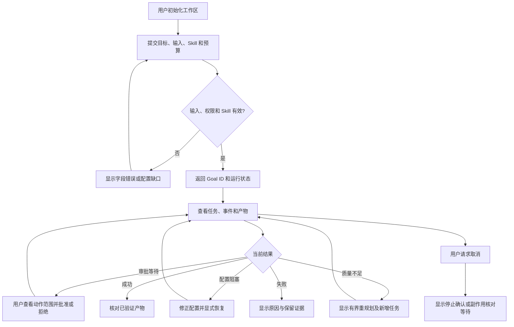
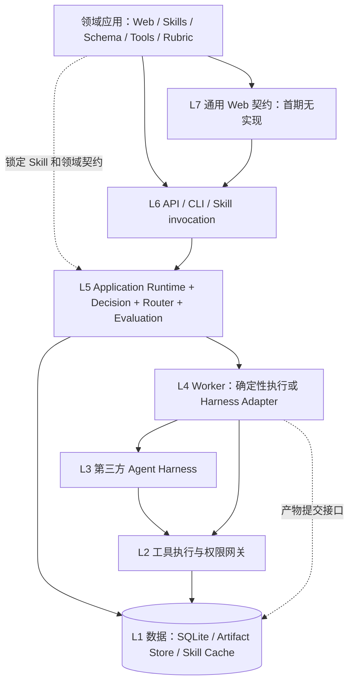
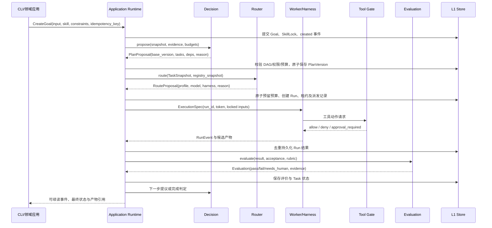
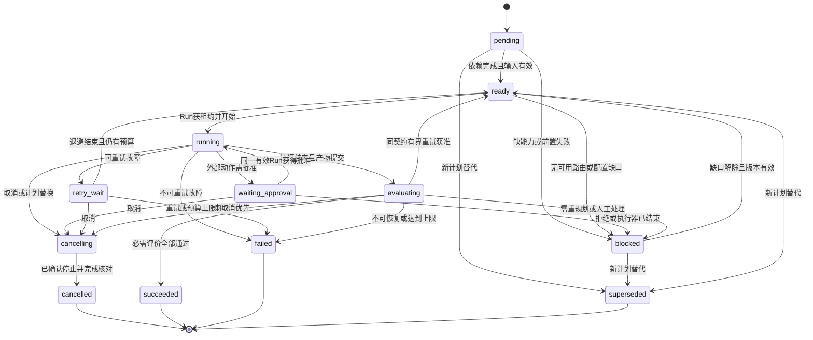

# RFC-0001：TaskLoop 总体架构

| 项目 | 内容 |
|---|---|
| 状态 | Draft，完整设计提案；未经过人工架构批准，未实现 |
| 版本 | 0.1.0，2026-11-01 |
| 需求与验收 | [Issue #1](https://github.com/xforce-io/taskloop/issues/1)，S1–S4 |
| 术语 | [名词表](glossary.md) |
| 事实源 | 本文件是唯一详细设计事实源；Issue 只保存验收与概要 |
| 范围依据 | 用户在研究系统讨论及本次续办中确认的 Skill-first、Task-first、七层、领域解耦、第三方 Harness 与详细设计范围；本稿新增技术选择均为提案 |

本次按用户指定路径发布 RFC，取代 Issue 原定的 `docs/design/1-taskloop-architecture.md`，不生成第二份详细正文。保留用户指定的 13 节结构。§4 定义产品路径与验收细项，§5–10 定义技术契约，§11 定义验证，§12 记录未决项，§13 收录 ADR 与关联。L1 概要在 Issue 评论，完整产品行为在 §4；L2 为本 RFC 的技术部分。L1: write、L2: write；理由是全新系统且用户明确要求总体详细设计。`keel-how: skip: 无现成机制可讲`，基线提交 `6f9ffa4` 只有 README 和名词表，没有运行时代码。这里完成的是设计发布，不是实现验收或批准。

## 1 背景

研究、编码等领域都需要把目标拆成任务，按能力和预算选择执行方式，根据证据评价结果，并在必要时调整计划。领域方法、业务对象、交互界面差别很大；任务状态、持久化、路由、恢复与审计可以复用。

TaskLoop 是 Skill 驱动、目标导向的任务编排与执行运行时。Skill 是可版本化的能力资产，Task 是基本编排单元。Agent 只是一种执行配置；确定性程序、CLI 和工具也可以执行 Task。框架保留 Plan → Route → Execute → Evaluate → Replan 闭环，但不重新实现第三方 Agent Harness 的模型推理及局部工具循环。

本 RFC 对应 Issue S1 的边界、S2 的闭环、S3 的 Skill/Harness 契约、S4 的最小实现与评审条件。七层是逻辑责任，不要求七个服务，也不是所有数据必须逐层穿过。

## 2 名词解释

规范定义统一见[名词表](glossary.md)，本节只澄清容易混淆的关系。

- **Task / Run / Goal**：Goal 表达想达到的结果，Task 表达可评价的逻辑工作，Run 是某个叶子 Task 的一次执行尝试。一次 Goal 可有多个根 Task 和子 Task；一个 Task 可有多个 Run。框架不另设“整个工作流的 Run”。
- **Decision / Router / Application Runtime**：Decision 提议做什么，Router 提议由谁和怎样执行，Application Runtime 是唯一状态写入者并校验这些提议。Decision 不意味着一个不可审计的模型黑盒。
- **Skill / Agent Profile / Agent Harness**：Skill 提供方法与契约，Agent Profile 提供可组合的角色和能力配置，Agent Harness 提供实际执行循环。Profile 不能自行扩大 Skill 或用户权限。
- **Plan / 状态**：Plan、Route、Execute、Evaluate、Replan 是阶段和事件语义，不是同一对象的全部持久化状态。尤其重规划改变计划版本，重试增加 Run，二者不能混用。

## 3 目标与非目标

### 3.1 目标

1. 用同一组核心契约承载研究与编码等不同领域，而不在内核引入 Claim、Evidence、Issue、PR 等业务实体。
2. 所有执行都能追溯 Goal、Task、Run、Skill 锁定版本、输入、执行配置、评价与产物。
3. 成功由验收证据决定；执行器退出成功、模型自称完成都不足以标记 Task 成功。
4. 恢复不丢失已提交状态；重试、重规划、模型升级与人工审批均有预算、边界和终止条件。
5. 先验证最小闭环和第三方适配，再决定是否需要分布式调度、更多领域和 Web。

### 3.2 非目标

首期不建设通用可视化工作流编辑器、领域 Web、Skill 市场、多租户托管平台、训练系统或自动学习路由；不内置研究 SOP；不承诺外部副作用 exactly-once；不复制 Harness 内部推理循环。设计中的未来 REST/Web 契约不表示首期会提供这些入口。

## 4 能力

### 4.1 UI/UX：CLI 产品契约与未来 Web 边界

首期没有图形页面。L7 只规定未来可复用的 Goal/Task/Run 状态展示边界；领域证据图、研究报告阅读、代码差异评审由领域应用实现。本次不设计这些页面，也不交付通用 Web 壳。

首期 CLI 以工作区为上下文，支持 `init`、`goal create/get/cancel`、`task list/get`、`run get`、`events`、`approval list/decide`、`goal resume`。命令完整参数见 §8。每次写操作返回对象 ID 与当前状态；异步执行不把“已接收”显示成“已完成”。`get` 始终显示目标、状态、当前等待原因、剩余预算、最近事件和可执行的下一步。`events` 可按游标继续读取，终态提供产物引用和评价摘要。

空工作区执行 `task list` 返回空数组及“尚无任务”，引导创建 Goal；没有凭据或可用执行配置时，Goal 保持 `blocked` 并显示缺失能力，不偷偷换用其他模型。输入错误在执行前报告字段与约束；对象不存在、权限不足与版本冲突使用稳定错误码。成功必须有产物、通过的必需评价和终态事件。取消请求先显示 `cancelling`，完成停止确认后显示 `cancelled`。



### 4.2 Stories 与主路径

沿用 Issue S1–S4，不把“设计已有”写成“产品已实现”。上图覆盖 S2 的运行路径；S1/S3/S4 是开发者评审活动，其入口为本 RFC 与 Issue，无额外产品页面。

| Story | 入口、观察中间态与终点 | 异常和边界 |
|---|---|---|
| S1 | 开发者从 Issue 打开 RFC → 对照七层与责任矩阵 → 在 Issue 留下具体决定或待决项 | 边界冲突必须修改契约并保留版本；只发布文档不算人工批准 |
| S2 | coding-agent 从 CLI 提交测试 Goal → 观察任务规划、路由和 Run 事件 → 核对成功、失败或重规划终点 | 缺凭据 blocked；权限失败不降级绕过；用户可取消；审批在动作执行前等待 |
| S3 | 开发者加载锁定 Skill → 核对 Schema/权限 → 执行适配样例并观察规范化结果 | 不兼容或不可信包拒绝；Harness 不支持所需隔离时不可路由 |
| S4 | 开发者从 RFC 的 ADR 和实现范围进入评审 → 决定接受或修订 → 按依赖建立后续实现事项 | 本次只给拆分提案，不虚构后续 Issue、评审通过或运行结果 |

### 4.3 产品规则与细化验收

R1：创建 Goal 不自动授权所有外部动作。R2：必需门禁不可因预算耗尽而降级为通过。R3：暂停或审批等待必须显示原因及恢复入口。R4：重试不改 Task 验收，实质修改目标/权限/验收需用户确认并新建 Goal 修订。R5：所有终态可检索历史证据，终态对象不可原地重新执行。

下表为**待实现验证标准**，不是本次测试报告。全部为必需项；自动故障注入证明契约，真实 Harness 测试证明适配；领域质量仍需领域评审。没有应用代码，因此当前不存在 verify 功能文件；未来实现主要验证文件约定为 `.agents/skills/verify-taskloop/features/architecture.md`（S1）、`lifecycle.md`（S2）、`skills-harness.md`（S3）、`mvp.md`（S4），这些是计划路径而非已存在文件。

| ID / 关联 | 前置与入口操作 | 可判定结果、异常与禁止行为 | 证据与执行 |
|---|---|---|---|
| S1.A1 / R4 | 开发者打开 Issue 链接的 RFC v0.1.0，检查 §6–9 | 7 层都有责任/依赖；领域 Schema 不进入通用实体；责任冲突列为评审项 | 文档链接、评审记录；人工评审 |
| S2.A1 / R2,R5 | fixture 工作区，CLI 创建 `extract-facts` Goal，查看 events/get | 产生 Plan、Route、Execute、Evaluate 证据；通过门禁后成功，产物摘要可核对；不得只凭 exit 0 成功 | CLI 输出、事件序列、DB/产物；agent、无真实模型 |
| S2.A2 / R2,R4 | 同入口，第一次结果缺必需证据，允许 1 次重规划 | 记录失败评价和计划 v2，新增补证据 Task，再通过评价；旧 Run 不覆盖，禁止放宽验收 | 事件、计划差异、评价；确定性注入 |
| S2.A3 / R2 | 同入口，连续输出不合格，配置重规划上限 2 | 第 3 次重规划申请被拒，Goal failed，记录 limit_exceeded；不得无限循环或伪成功 | 计数、预算账、最终事件；agent |
| S2.A4 / R1,R3 | 提交需外部写入的 Task，执行 approval list/decide | 批准前无副作用；拒绝后动作不执行；参数变化导致旧批准失效 | 动作账、审批记录；模拟外部端点 |
| S2.A5 / R3,R5 | 执行期间退出 Runtime，再重启；另一路在 running 时取消 | 已提交事件不丢失；过期执行无权提交；取消后不启动新 Run，未知副作用停待核对 | 重启、进程/数据库记录；故障注入 |
| S3.A1 / R1 | CLI 加载合法锁定 Skill，再加载摘要不符与越界依赖包 | 合法包可解析；后两者在执行前拒绝，错误有包 ID；不得执行安装脚本 | lock、校验日志；agent |
| S3.A2 / R1,R5 | 用只读代码目录运行 Codex CLI 适配的声明测试 | 规范化 started/progress/completed/error；记录真实 Harness 版本、模型、产物；取消和隔离验证未通过时不得宣称支持 | 原始脱敏事件和规范化事件；需真实服务，fixture 不替代 |
| S4.A1 | 开发者核查 §11、§12、ADR 和本表 | 实现范围均有依赖/可判定验收，未决风险有验证责任；测试只分 E2E/Integration/Unit | 设计覆盖检查及人工评审；不得将 not_run 标 pass |

## 5 思路与折衷

### 5.1 Skill-first 与 Task-first

Skill-first 指任务规划、能力需求、输入输出、领域评价首先来自版本化 Skill；不是把所有系统规则写成提示词。Task-first 指无论 Agent 还是程序都经过 Task/Run、预算、门禁与证据机制；不是所有 Task 必须使用 LLM。

框架强制状态不变量、授权、预算、Schema 与审计；领域提供任务类型、业务 Schema、方法、工具声明和质量规则。领域规则可增加约束，不能降低框架安全下限。Skill 可影响 L6 入口、L5 规划/路由/评价、L4 执行上下文、L3 提示与工具配置；跨层共享同一锁定引用，不能直接写任务数据库或接管队列。

### 5.2 关键取舍

| 选择 | 收益 | 代价及放弃项 |
|---|---|---|
| 单进程控制面、独立 Worker 子进程、SQLite | 简化事务与恢复，足够验证最小闭环 | 不支持多主写入；放弃首期 Redis/Kafka/分布式队列 |
| 确定性约束包围可插拔 Decision | 可审计、可用 fixture 复现 | 模型提议受限；放弃模型直接写状态或动态发任意工具调用 |
| 不可变 Skill lock + Run 快照 | 升级不改变历史执行依据 | 存储增加；放弃运行中追随 Git branch/latest |
| 内核只保留通用实体，领域数据走 Artifact/Schema | 领域可独立演进 | 领域查询需自己建索引；不提前建统一知识图谱 |
| 评价独立于执行 | 避免自我宣称成功 | 增加耗时与费用；首期先用确定性规则，按需加独立模型审阅 |
| Task DAG 可版本化增量修订 | 允许补证据等动态工作 | 需要失效传播；不建设任意循环的可视化流程语言 |

## 6 架构

### 6.1 七层与依赖



| 层 | 所有责任 | 允许依赖与禁止事项 |
|---|---|---|
| L7 Web | 未来通用状态与审批展示契约 | 只经 L6；领域信息架构归领域应用，不读写数据库 |
| L6 API / CLI / Skill invocation | 输入校验、调用者身份、幂等、命令/查询转换 | 依赖 L5 应用服务；Skill invocation 调用同一服务，不绕过策略 |
| L5 Application Runtime + Decision + Router | 生命周期、计划、预算、调度、评价、恢复、路由 | 经 L4 执行，经 L1 存储；不包含领域 SOP 和 Harness 内部推理 |
| L4 Worker | 按不可变 ExecutionSpec 组装环境、调用执行器、规范化事件 | 可用 L3 或直接 L2；不能自选更高权限模型、修改验收或提交 Task 成功 |
| L3 第三方 Agent Harness | 模型推理、会话、局部规划、工具调用循环 | 工具调用须受 L2/环境策略约束；不拥有 TaskLoop 生命周期 |
| L2 外部工具执行 | 文件、网络、CLI、MCP 等实际动作，权限网关和动作账 | 领域可注册工具；不能凭提示文本获得新权限，不能修改 L5 状态表 |
| L1 数据 | 状态事实、事件、Skill 缓存、产物及可重建索引 | Repository 接口限 L5 写状态；Worker 只能经受控接口提交产物 |

领域应用拥有 Web、Skill、Schema、领域工具实现、Rubric 和领域索引。TaskLoop 内核只知道 `schema_ref`、类型化输入、能力与产物引用，不理解“论点成立”或“PR 应合入”。领域评价器按统一接口返回评价证据，不能直接推进状态。

### 6.2 主路径与执行数据流



输入先存不可变引用；Worker 只收到必要上下文。原始 Harness 输出是未信任数据，解析后成为候选产物。评价使用锁定验收版本，Runtime 最后判定状态。终态成功要求当前计划全部必需 Task 成功、当前 Goal 评价通过、无未决审批/副作用、无未完成必需门禁。

### 6.3 失败路径

输入或 Skill 无效在创建前拒绝；已创建但能力不足进入 blocked。瞬时执行故障可有界重试；质量失败进入 Decision 重规划；权限拒绝不能自动换通道。Runtime 崩溃后从数据库恢复派发，Worker 丢失后依据租约和动作账决定重试还是人工核对。所有路径都写稳定错误码和证据，不以日志文本代替状态。

## 7 模块

### 7.1 核心职责及接口

以下为语言无关契约，不是实现函数清单。建议首期使用 Python、标准库 SQLite 和类型化 JSON Schema 校验；语言选择不改变协议。

| 模块 | 输入 → 输出 | 权限与失败语义 |
|---|---|---|
| Application Runtime | Command + expected_version → persisted result；tick → ready Run | 唯一生命周期写入者；版本冲突拒绝，事务失败不派发 |
| Decision | GoalSnapshot + PlanVersion + EvaluationRefs + budget → DecisionProposal | 只读、无工具副作用；可提议 plan/replan/retry/block/complete/fail；结构不合法拒绝 |
| Router | TaskSnapshot + SkillRequirements + RegistrySnapshot + Budget → RouteProposal 或 NoRoute | 只读选择；必须记录拒绝候选和理由，不能提议放宽硬约束 |
| Worker | ExecutionSpec → RunEvent stream + ExecutionResult | 执行不可变配置；支持 cancel；不掌握 Task DB 凭据 |
| Harness Adapter | describe/start/events/cancel → 规范化事件与结果 | describe 声明支持能力与版本；不支持的 resume/approval 不能模拟成支持 |
| Evaluation | ArtifactRefs + AcceptanceSnapshot + RubricRef → Evaluation | 只读输入；领域判断与通用校验分别留证，评价错误不算 pass |
| Skill Registry | SkillRef + trust policy → SkillLock + validated contract | 解析与缓存只读包；校验失败前不执行任何包代码 |
| Tool Gate | ActionRequest + Principal + Policy + Approval → ActionResult | 动作前授权、执行前重验；外部副作用写账并使用幂等键 |
| Store | 原子状态命令、事件 append、产物 finalize → revision/ref | 状态写入与事件同事务；索引不作为事实源 |

`DecisionProposal` 包含 `proposal_id, goal_id, base_plan_version, action, task_changes, evidence_refs, reason_code, policy_version`。提议不可信：Runtime 校验引用、DAG、锁定版本、预算、权限、变更范围。模型返回散文或不完整 JSON 使用 `invalid_proposal`，最多修复 1 次且消耗预算，仍失败则 blocked 等待配置处理。

`ExecutionSpec` 包含 `protocol_version, run_id, task_revision, input_refs, output_schema, skill_lock_digest, agent_profile_digest, model_ref, harness_ref, tool_grants, resource_limits, deadline, lease_token, trace_id`。不放明文密钥，仅放凭据句柄。Worker 不得覆盖上述配置，临时故障也只能请求 Runtime 重路由。

`RunEvent` 包含 `schema_version, event_id, goal_id, task_id, run_id, attempt, sequence, type, timestamp, payload_ref, trace_id, fencing_token`。Worker 内 sequence 单调，Runtime 分配 Goal 范围递增事件游标。重复事件按 `(run_id, sequence)` 去重；不以时钟先后判断并发。

`ExecutionResult` 包含 `status=completed|failed|cancelled|unknown, artifact_refs, usage, provider_request_ids, error{code,retryable,detail_ref}, side_effect_refs`。completed 仅代表执行结束。`Evaluation` 包含 `subject_revision, rubric_digest, required_checks[], verdict=pass|fail|needs_human|error, evidence_refs, evaluator_ref`；缺任一必需检查即不能 pass。

首期 Decision 使用规则策略：领域包提供声明式任务模板、依赖和质量失败时允许的补充模板，内核只负责实例化提议与校验，不内置“研究应如何补证据”的业务逻辑。后续模型 Decision 也必须返回相同提议契约。评价器暂时故障可在剩余预算内重试最多 2 次，仍为 error 时阻塞人工处理，不得把评价服务故障当领域质量通过或启动无界重规划。

### 7.2 Task / Run / Goal 数据模型

ID 为不含业务含义的 UUID；时间统一 UTC RFC3339；用量用整数 token、金额用整数微单位与币种，不用浮点余额。

| 实体 | 必需字段与关系 | 不变量 |
|---|---|---|
| Goal | id, workspace_id, revision, version, objective, input_refs, acceptance, constraints, skill_lock_id, status, budget, created_at | 一次修订冻结目标与验收；实质变更新修订并使旧计划/审批失效；version 为每次状态写入的 CAS 版本 |
| Task | id, goal_id, goal_revision, parent_task_id?, kind=leaf|composite, revision, skill_entry, input_refs, output_schema_ref, acceptance, status, version | 每个 Task 只属一个 Goal；parent 是分解关系，dependencies 是前置关系，二者不混用 |
| PlanVersion | id, goal_id, goal_revision, version, base_version, task_memberships, dependencies, reason, decision_id | DAG 无环；同 Goal 仅一个当前版本；不可跨 Goal 建依赖 |
| Run | id, task_id, task_revision, attempt, status, route_id, execution_spec_ref, lease_owner, fencing_token, lease_expires_at, deadline, usage | 一次执行对应一个 Run；Task 同时最多一个有效活动 Run；重试新 ID、新 attempt |
| RouteDecision | id, registry_digest, candidates, selected, rejection_reasons, score_components, fallback_of? | 路由输入与选择不可变；实际模型与请求模型都记录 |
| Evaluation | id, subject_type/id/revision, run_id?, rubric_digest, verdict, checks, evidence_refs | 仅针对确切产物摘要和版本有效；独立审阅不能拿生成者身份冒充 |
| Artifact | id, workspace_id, content_digest, media_type, schema_ref, storage_uri, producer_run_id, provenance, retention_class | 内容不可变；访问授权独立于 URI；缺 blob 不得发布成功引用 |
| Approval | id, actor, action_digest, goal_revision, task_revision, policy_digest, status, expires_at, consumed_at? | 精确绑定动作参数/资源/范围；过期、版本变化或已消费不可复用 |
| Event / ActionRecord | 关联上述 ID、event sequence；动作有 idempotency_key、外部回执、status | 追加记录；外部执行结果未知不能按成功或无副作用处理 |

Task 的依赖默认 `all_success`，首期不提供任意布尔表达式。必需前置失败时其后继 Task 进入 blocked，Decision 可提出替代计划；不能直接运行。composite Task 不启动 Worker，以子 Task 的必需结果和聚合评价决定成功。父子关系无环，子 Task 所属 Goal 不变。

### 7.3 生命周期与状态机



`blocked.reason` 区分 `no_route, dependency_failed, quality_replan, budget_exhausted, manual_reconcile, configuration`，不能把 blocked 当作无限自动轮询。非活动状态收到取消可直接 cancelled；图只展开活动执行的停止流程。composite 在子项活动时为 running，无 Run，子项完成后 evaluating。权限永久拒绝或明确不可修复输入进入 failed；预算耗尽默认 failed，可由创建时明确的策略改为 blocked 等用户追加预算，但绝不自动加钱。

Run 状态为 `created → leased → running → completed|failed|cancelled|lost|unknown`；已取得租约未收到 started 就失联同样按 lost 处理。审批期间 Run 仍 running，Task waiting_approval，租约仍需心跳。首期 Codex CLI 只允许不需要中途审批的只读任务；需要审批的外部写动作拆成后续确定性 Task，在执行前走 Tool Gate，避免假定 CLI 支持交互审批。若不支持挂起的执行器遇到审批，结束本 Run 并等待批准后创建新 Run，不恢复旧进程。

Goal 为 `created → active ↔ blocked → succeeded|failed`，`active/blocked → cancelling → cancelled`。只有确定无可继续的必需路径或达到上限才 failed；可修复配置缺口 blocked。Goal 成功由 §6.2 的聚合条件决定，禁止“根 Task 完了所以 Goal 自动成功”。

取消、暂停、替换均是持久化命令。首期暂停仅指 blocked 后不再调度，不能保证冻结第三方会话；必须先停活动 Run。`goal resume` 仅解除已解决原因的 blocked，不复活终态，也不增加预算。拒绝/过期审批须停止对应动作；执行器失联或已结束后，旧批准不能恢复旧进程，只能校验动作和版本后新建 Run。计划替换的活动 Task 先取消，记 `supersede_requested`，确认停止后进入 superseded；未知副作用先 manual_reconcile。终态 Task 不原地重开：新建替代 Task，并在 PlanVersion 标记旧产物失效。后续任务只能读取当前计划认可的成功产物；已消费失效产物的下游也必须替代或重新评价，不能继续沿用旧成功。

### 7.4 Skill 包与版本规范

Skill 放在独立领域 Git 仓库；TaskLoop 仓库只维护通用 loader 与测试 fixture。一个包包含 `SKILL.md`、`skill.yaml`、`schemas/`、可选 `rubrics/`、`resources/` 与声明式工具描述。首期禁止安装钩子和自动执行包内脚本；可执行领域工具由操作者显式注册为独立工具提供者。

```yaml
# skill.yaml：契约示例，不对应已发布的包
manifest_version: "1.0"
id: example.research.extract-facts
version: "0.1.0"
runtime_api: ">=0.1.0 <0.2.0"
entry: SKILL.md
inputs: schemas/input.json
outputs: schemas/facts.json
capabilities: [text_extraction, structured_output]
tools:
  required: [artifact.read]
  optional: []
permissions:
  network: deny
  filesystem: input_readonly
quality:
  rubric: rubrics/facts.yaml
  required: [schema_valid, source_spans_present]
execution:
  preferred_profile: fact-reader
  allow_parallel: false
dependencies: []
```

`SkillRef = {git_url, path, version_constraint}` 只用于解析；运行必需 `SkillLock = {id, version, git_url, commit_sha, path, tree_digest, manifest_digest, dependency_locks, resolved_at}`。示例引用 `https://github.com/<领域所有者>/<领域技能仓库>.git#skills/extract-facts@0.1.0` 是占位格式，不是假定真实仓库；加载时必须解析出完整 commit SHA 和内容摘要，不能用此占位符直接运行。测试用本地独立临时 Git 仓库证明解析，不需要新建公开 Skill 仓库。

使用 SemVer：破坏输入输出、权限或评价语义升级 major；兼容新增能力升级 minor；不改变契约的修订升级 patch。`manifest_version` 与 Skill version 独立；未知 major 拒绝，未知可选字段忽略并告警，未知必需字段拒绝。0.x 的 minor 视作潜在破坏性变更，首期只能显式升级 lock。依赖必须形成无环闭包并统一锁定，不接受运行时再拉取依赖。Schema 同样锁摘要，不能在原 URL 静默变更。

缓存按摘要隔离，只读挂载。包路径必须位于仓库内，拒绝路径穿越、逃逸软链、过大包与外部依赖 URL；默认包总展开大小上限 20 MiB、依赖深度 8、总包数 32，可由操作者收紧。信任使用操作者维护的来源白名单与已审阅摘要；首期不把签名体系当作既有能力。升级产生新 lock，仅新 Goal/显式修订采用，历史 Run 保留旧包和规则。

### 7.5 模型、Agent 与 Harness 选择

Router 分两步：先按 Task/Skill 需求选择 Agent Profile，再选择该 Profile 允许的模型、Harness 和工具配置。Profile 是角色与策略配置，不必是常驻 Agent。确定性任务可选择 `worker=program`，不占模型预算。

硬约束依次过滤：用户授权和数据驻留 → 工具/Schema/上下文能力 → Harness 隔离与取消能力 → 当前健康和并发 → 预算与截止时间。成本、质量、时延在剩余候选中排序。质量得分来自同任务类别的版本化离线评测，不能只信模型自报；无评测候选只能显式 opt-in 试验，不自动处理高风险任务。无候选返回 NoRoute 和可操作缺口。

首期采用静态、有界优先表：`quality tier → configured priority → estimated cost → stable candidate id`，不伪装成自动优化。后续可按 `wq * quality - wc * cost - wl * latency` 排序，须记录权重、归一化版本、样本量和质量置信区间。已知费用取配置的版本化费率；未知费用按最坏上界预留，不能把 unknown 当 0。

```json
{
  "task_kind": "extract_facts",
  "profile": "fact-reader@1",
  "hard_requirements": ["structured_output", "input_readonly"],
  "candidates": ["local-program:v1", "codex-cli:configured-model"],
  "fallback_policy": {"max_changes": 1, "preserve_permissions": true},
  "selection_reason": "first_eligible_by_policy"
}
```

上例不指定具体商业模型名；部署配置必须提供确切模型标识、provider、版本/别名解析结果和评测记录。模型不可固定版本时记录实际返回标识与时间，并明确不可严格复现。回退只允许已评估、同授权范围的候选；更强模型仍需预算预留和策略批准，不能绕过审批。生成与审阅要求独立时排除同一 Run/身份，领域还可要求不同模型系列，无法满足则 blocked。

## 8 API/CLI

### 8.1 命令与调用语义

首期 CLI 是真实产品入口；同一应用服务供 Python 调用与 Skill invocation 使用，不要求启动 HTTP 服务。以下是待实现的稳定命令面，非现成可用命令。

```text
taskloop init --workspace PATH
taskloop goal create --workspace PATH --spec goal.json --idempotency-key KEY
taskloop goal get GOAL_ID --workspace PATH --json
taskloop task list --goal GOAL_ID --workspace PATH --json
taskloop task get TASK_ID --workspace PATH --json
taskloop run get RUN_ID --workspace PATH --json
taskloop events --goal GOAL_ID --after CURSOR --workspace PATH --json
taskloop approval list --goal GOAL_ID --workspace PATH --json
taskloop approval decide APPROVAL_ID --decision approve|reject --expected-version N
taskloop goal resume GOAL_ID --expected-version N --workspace PATH
taskloop goal cancel GOAL_ID --expected-version N --workspace PATH
taskloop runtime serve --workspace PATH
```

`goal.json` 必填 `objective, skill_ref, input_refs, acceptance, limits`。首期 Goal create 只接收，`runtime serve` 消费数据库待办；CLI 不必跟随进程存活。无运行中 Runtime 时 created 保持不变，并提示启动命令。审批命令从当前工作区读取身份配置；首期本地操作者身份由操作系统账户约束，不能声称支持团队身份联邦。

```json
{
  "objective": "从两份本地资料提取三个指定事实并附来源",
  "skill_ref": {"git_url": "file:///approved/demo-skills.git", "path": "extract-facts", "version_constraint": "=0.1.0"},
  "input_refs": ["artifact:document-a", "artifact:document-b"],
  "acceptance": {"required_checks": ["schema_valid", "fact_count_3", "source_spans_present"]},
  "limits": {"deadline_seconds": 1800, "max_tasks": 20, "max_replans": 2, "max_tokens": 100000}
}
```

该 JSON 为 fixture 格式示例，引用必须先注册且通过工作区访问校验；实际创建后会解析并保存 SkillLock，不能保留未解析引用开始执行。`acceptance` 检查 ID 必须在锁定 Rubric 中定义；`limits` 缺省采用 §9.2，付费执行额外要求 `max_cost_microunits` 与 `currency`。所有限制必须为有限非负整数，时间/Task 上限须大于零；首期不接受任意代码表达式作为验收。

所有查询返回 `schema_version, data, cursor?`。写命令包含调用者、工作区、幂等键或对象 expected_version。相同工作区/命令/键/请求摘要重放返回原结果；键相同而请求不同返回 conflict。幂等记录在工作区生命周期内保留，归档必须连同状态和事件。非法输入不创建部分对象。

错误结构为 `{code, message, field_errors?, retryable, correlation_id}`。稳定码：`invalid_input, skill_invalid, permission_denied, not_found, conflict, no_route, budget_exhausted, approval_required, deadline_exceeded, adapter_error, invalid_proposal, manual_reconcile`。CLI exit code：0 请求成功或查询成功，2 输入错误，3 权限，4 冲突，5 外部/运行时故障；查询到 failed Goal 仍返回 0，以 JSON 状态表达业务结果。禁止把接收成功与 Goal 成功混为一谈。

未来 HTTP `/v1/goals`、`/v1/tasks/{id}`、`/v1/runs/{id}`、`/v1/goals/{id}/events`、`/v1/approvals/{id}/decisions` 映射同一命令/查询，不新增状态源。分页游标为 Goal 内 event sequence，不依赖时间。首期不实现 HTTP/SSE 或远程认证。

### 8.2 Harness 最小适配例

首个第三方适配提案选择 **Codex CLI 的非交互执行**。官方文档提供 `codex exec --json` 的 JSONL 事件与 `--output-schema` 结构化输出接口；这只证明接口可作为适配入口，不证明本项目适配、隔离和恢复已通过测试。[依据：官方非交互模式文档，核对于 2026-11-01](https://learn.chatgpt.com/docs/non-interactive-mode)。以下为 TaskLoop 适配设计，不宣称是第三方原生协议。

| describe 声明项 | 首期值/处理 |
|---|---|
| adapter/protocol | `codex-cli-adapter/0.1`，TaskLoop execution protocol 1 |
| Harness 版本 | 由安装二进制读取并锁定；未列入兼容测试版本拒绝运行 |
| start | 通过参数数组启动 `codex exec --json`，显式模型、只读权限和输出 Schema；输入经文件/stdin 传递，不拼接 shell |
| events | `thread.started` 记录会话引用；`item.*` 变 progress；`turn.completed` 提交候选结果；`turn.failed/error` 变规范化错误 |
| completed 条件 | 进程退出、终结事件、输出 Schema 与产物摘要全部验证；仅有完成事件或 exit 0 不够 |
| cancel | Worker 管理进程组，先请求结束，宽限期后强制停止；本地停止不能证明远端副作用撤回 |
| resume | 首期 `supports_resume=false`，即使第三方有会话恢复也不映射为 TaskLoop 无损恢复 |
| approvals | 首期 `interactive_approval=false`；只读任务不允许外部写入，需要写入拆成 Tool Gate 管理的后续 Task |
| unknown events | 记录脱敏元数据；未知终结事件不能猜成成功，返回 adapter_error |

运行在独立工作目录与操作系统隔离环境，输入只读挂载、输出经受控目录收集、网络按允许清单开放。不能依赖只读文件权限来限制网络写动作。若当前 Harness 的内置网络/工具不能被限制或代理，此 Profile 不具备对应安全能力，Router 必须拒绝；不得仅在提示词里要求“不要访问”。模型凭据通过最小作用域代理或进程专用句柄供给，不能和不可信子命令共享通用账户令牌。

最小接入实验只读两个本地文档并输出事实 JSON；不安装包、不联网检索、不修改仓库。受控写动作由确定性 Worker 接入 Tool Gate 的模拟端点测试，不把危险权限切换当成接入成功。版本、事件兼容、超时、取消、无密钥日志、隔离逃逸测试必须完成后才把适配标为可用。

## 9 边界

### 9.1 质量门禁与动态重规划

门禁顺序：G0 输入/Skill/授权/预算 → G1 输出 Schema/产物完整性 → G2 领域 Rubric 和来源证据 → G3 可选独立审阅/人工审批 → G4 Goal 聚合完成。所有 `required=true` 的检查必须 pass；`needs_human/error` 都不是通过。Rubric 定义可量化阈值或明确的人工判定项，例如事实每项含来源段落，不能把 token 数当质量。

Decision 只能建议，Runtime 根据以下动作分流：

| 触发 | 允许动作 | 禁止行为 |
|---|---|---|
| 429、临时网络故障且确认未产生未知副作用 | 原 Task 新 Run、指数退避；可按策略换候选 | 隐藏重试费用、无限换模型 |
| Schema 错误 | 同契约最多一次修复或请求重规划 | 忽略必需字段、把非 JSON 当合格 |
| 缺来源、结论冲突 | 添加补证据/反证 Task，形成新 PlanVersion | 修改原验收以迁就输出 |
| 目标/输入/权限实质改变 | blocked，等待用户确认新 Goal revision | 自动扩大目标和网络范围 |
| 权限拒绝、数据越界 | 终止该动作或等待显式授权 | 换工具或 Harness 绕过策略 |
| 无进展、预算/截止时间到达 | failed 或按预定策略 blocked | 继续自主消耗资源 |

重规划提交必须包含旧计划版本、变化任务、保留/失效产物、理由和预期增加的价值。原子校验 DAG 与预算后激活新版本；旧计划保持历史。相同状态摘要和相同提议连续出现 2 次视为无进展，停止自动重规划。已运行任务需要替换时先停止并完成副作用核对；不能让旧 Worker 的迟到结果推进新版本。

### 9.2 首期默认限制与预算

以下是**可配置的保守提案值**，不是性能承诺；用户创建时可以收紧，追加预算需显式命令/修订并审计。

| 项 | 默认限制 |
|---|---|
| Goal 运行时限 | 30 分钟，等待审批也计入绝对截止时间 |
| Run 时限 / 停止宽限 | 5 分钟 / 10 秒；deadline 取 Goal 和 Run 最小值 |
| 活动 Run | 每工作区 1 个；以后扩展需验证并发预算 |
| Task 数 / 分解深度 | 每 Goal 最多 20 个 / 深度 4；替代 Task 也计数 |
| 重试 / 路由变更 / 重规划 | 每 Task 最多 2 次重试即 3 个 Run / 1 次 / 每 Goal 2 次 |
| 模型调用总 token | 每 Goal 100,000，含规划/执行/评价；未知用量保守预留 |
| 金额 | 使用付费 provider 时必须显式配置硬预算与币种，不设隐含无限额 |
| 退避 | 起始 2 秒、指数增加、上限 30 秒，带抖动，受剩余 deadline 限制 |
| 租约 / 心跳 | 30 秒 / 10 秒；过期后提升 fencing token 再处理 |
| 审批有效期 | 最多 15 分钟且不超过 Goal deadline；参数变化立即失效 |

预算包含 Decision 和 Evaluation 的模型开销，内部 Harness 重试也必须上报。派发前原子预留最坏允许额度，Run 完结按实际值结算；未知费用保留预留额待核对。不能精确监控 token 时用硬调用上限和 provider 侧费用限制，并在登记能力时注明局限，不承诺零超支。取消后费用仍可能迟到，保留账单核对，不因取消释放所有未知预留。

### 9.3 可靠性

派发采用至少一次，状态提交使用事务、幂等和 fencing token。Run 创建、预算预留、租约与派发 outbox 同事务提交；Worker 按 run_id 去重启动。重启扫描未完成 outbox 和租约，重复投递不产生第二个有效 Run。

Worker 心跳必须携当前租约 token。租约过期后旧结果只存为隔离证据，不能改变 Task 状态；同一个外部动作使用与业务动作相关的幂等键，不能因为新 Run 自动换键造成重复写入。Run lost 后先查动作账：纯读或确认未执行可重试；已确认执行则查询回执并接续评价；结果未知进入 manual_reconcile。没有幂等或查询能力的写工具，不能承诺自动恢复。

取消命令与成功提交用同一对象版本串行化：先提交成功则返回 already_terminal；先提交取消则后续结果只留证据，不能转 succeeded。收到取消立即停止派发和失效审批，再终止进程组；未知外部动作未核对前保持 cancelling 并显示原因。Worker 进程退出不等于远端任务停止，必须记录能力局限。

### 9.4 安全与审批

首期单操作者工作区以本地账户和目录权限隔离，不对公网提供服务。工具权限取用户授权、工作区策略、Skill 声明与 Profile 能力的交集。外部材料、Skill 文本、模型输出均是数据，不能覆盖系统权限；不把网页或仓库中的指令提升为用户授权。

Tool Gate 在每次动作执行前检查：资源与动作、参数摘要、所属 Goal/Task revision、策略版本、预算、审批有效性。外部写入、凭据读取和提权按策略要求审批；审批界面/CLI 必须展示目标、参数差异、风险和期限。拒绝、过期、重放、换参数均不执行。允许一次审批覆盖一组动作时必须显式列出资源范围与次数，首期默认单次。批准并不跳过执行时授权检查。

隔离使用最小网络清单、只读输入、独立输出目录、进程/内存/CPU/文件大小限制。路径必须规范化并防软链逃逸；产物下载与展示防脚本执行，默认作为数据读取。密钥不写 Skill、事件、产物、Issue 或日志；日志按字段白名单脱敏，原始响应仅本地受限保留且默认关闭。域应用与 Harness 均不能直接持有内核数据库写权限。

### 9.5 可观测与评价反馈

事件贯穿 `workspace_id/goal_id/task_id/run_id/decision_id/trace_id`。记录每阶段时延、排队时间、重试原因、路由候选/拒绝原因、token/费用估计与实际、门禁结果、取消时延、租约失效与未知副作用数。模型输出不默认进入通用日志，也不要求保存私有推理内容；决策仅保存结构化理由与证据引用。

Skill、Router、Profile、模型/Harness 版本分别作为评测维度。在线结果进入观察数据集前需脱敏与授权；不自动把用户资料加入训练集。路由策略更新须离线比较、版本化、显式发布；失败率或质量退化时切回旧策略，历史 Run 不改写。无真实样本时报告“无数据”，不生成虚假的成功率。

## 10 迁移/兼容/回滚

### 10.1 数据存储

首期 SQLite（WAL，单写者）保存 Goal、Task、PlanVersion、Run、RouteDecision、Evaluation、Approval、Event、ActionRecord、预算预留、幂等键和 outbox。表行版本用于 CAS，外键约束跨实体关系，唯一索引保证活动 Run、attempt、事件序列与动作幂等。JSON 承载扩展字段，但核心关系、状态与预算不藏在自由文本。

产物存本地内容寻址目录 `artifacts/sha256/<digest>`，包缓存 `skills/<digest>`。写入先临时文件 → 计算摘要与校验 → 原子重命名 → 数据库引用提交；崩溃遗留的无引用 blob 可在宽限期后清理，已引用缺 blob 触发存储错误并阻止成功。SQLite 与文件不能跨介质原子提交，靠这个顺序避免已提交引用指向尚未写完的文件。

Event 是审计与恢复依据，状态表是当前事务事实；不声称实现完整事件溯源。派发与恢复不重新调用模型“重放决定”，而是读取已保存的决定与 ExecutionSpec。搜索索引和领域索引可从产物与事件重建，首期不引入向量库。工作区默认保留事件/审批/状态至显式归档；大产物默认 30 天，可由操作者调整，删除后保留摘要和删除事件，并明确无法再全文复现。

### 10.2 兼容与回滚

全新项目没有旧运行时数据迁移，现有 README/术语保持可链接。数据库从 schema v1 开始，迁移有版本号、迁移前一致性备份与演练；未知较新 schema 拒绝启动。协议 major 不兼容拒绝；minor 只允许兼容新增可选字段，必需字段新增升级 major。

运行前锁定 Skill/Policy/Adapter 版本，回滚软件不自动把正在运行的 Run 转给旧适配器。先停止新派发、清空或隔离活动 Run，再校验旧程序可读当前 schema；不兼容时从备份恢复至新工作区，并核对备份后发生的外部副作用，不能直接丢弃。恢复备份不回滚外部系统。首期备份采用停派发并等待事务完成的一致性数据库快照，连同被引用产物与锁定 Skill 备份，定期在空目录验证恢复。

未来需要多 Worker 或远程服务时另做 ADR：SQLite → PostgreSQL、对象存储、独立队列与身份认证都不属于此次隐含承诺；先保留 Store 和执行协议边界，不预建微服务。

## 11 测试计划

本次只核对文档覆盖与链接，以下实现测试当前均为 `not_run`。不能把文档完成写成运行验证通过。测试仅使用 E2E / Integration / Unit 三层，真实模型测试另作同层中的执行配置，不另造测试层级。

### 11.1 E2E

| 映射 | 从真实 CLI 开始的测试 | 可判定结果 |
|---|---|---|
| S2.A1 | fixture Skill 读取两份本地资料、提取事实、聚合报告 | 5 阶段事件齐全，所有事实有 span、产物摘要匹配、Goal succeeded |
| S2.A2 | 第一次故意省略来源，第二计划增加补证据 Task | v1 保留，v2 有差异和理由；补证据后才成功，重规划计数准确 |
| S2.A3 | 连续不合格，重规划上限 2 | 到达上限后 failed，无第 3 次重规划提交 |
| S2.A4 | 模拟外部写工具，批准/拒绝/过期/换参数四条路径 | 只有确切有效批准产生一次动作；其他路径零副作用 |
| S2.A5 | 派发前后、动作确认前后、产物 finalize 前后强制退出再重启；并发取消 | 已提交状态不丢，外部副作用未知时等待核对，取消优先规则可验证 |
| S3.A2 | 真实 Codex CLI 只读输入适配，含取消/错误场景 | 保存版本化事件与 Schema 结果；无越权写和凭据泄露；真实服务失败标 blocked/fail |
| S1.A1,S4.A1 | 从 Issue 链接完整走读边界、ADR、最小范围与验证映射 | 人工评审有问题/决定记录；不冒充自动测试结论 |

fixture 样例 Goal：从文档 A/B 提取 3 个指定事实，输出 `facts[{text,source,span}]`，最后生成汇总；评价检查数量、span 与原文匹配以及冲突项。成功路径直接通过；失败路径持续缺来源至上限；重规划路径在 v2 加入补证据 Task。此样例是领域包中的演示规则，不能硬编码进内核。

### 11.2 Integration

S2：SQLite 事务与 outbox 的崩溃点、双领租约与迟到提交、预算并发预留、事件去重、重启恢复、取消/完成竞态、失效产物向下游传播。判定为不存在双有效 Run、未超逻辑预留限额、未知副作用不自动重复。

S3：临时独立 Git Skill 仓库解析 tag 到 SHA、闭包锁定、摘要校验、SemVer 兼容拒绝、依赖环与路径逃逸拒绝；Harness 版本/事件规范化、未知事件/截断流、超时和进程组停止；Tool Gate 审批摘要与动作幂等。真实服务与 fixture 各记录版本和证据，不能互相替代。

S4：数据库迁移、备份/恢复含产物、旧策略回滚、日志脱敏、无网络与只读隔离的对抗输入。不能通过的能力从 Registry 撤销，不能只在文档加免责声明后继续自动路由。

### 11.3 Unit

S1/S2：状态转移表、终态不可重开、DAG 环检查、父子关系/依赖区分、Decision 提议验证、上限/退避计算、Goal 聚合和全部必需门禁。

S3：路由硬约束优先、稳定排序、无候选错误、预算未知值处理、Profile 权限交集、Skill manifest/Schema 校验、审批摘要失效。

S4：错误码与 CLI exit 映射、幂等请求摘要冲突、事件游标和协议兼容规则。避免只测试内部函数互相调用；重点是不变量和可观察结果。

### 11.4 评测与最小可行实现

先做 12 个版本化案例：4 个成功提取、4 个缺证据/冲突、4 个故障/权限/取消案例。fixture 控制测试要求 12/12 达到预期状态、零越权副作用、零无界循环；真实 Harness 每案重复 3 次，报告质量通过率、费用、p50/p95 时延与失败分布，首期接入门槛为全部 Schema/权限/终止不变量满足，领域内容质量由评审确定阈值后才能推广。小样本报告分母，不据此宣称生产可靠性。对照基线为固定配置、不重规划，比较重规划带来的质量收益和额外费用；失败样本必须保留。

以下是后续实现的范围与依赖提案，不是实现 TODO 或已创建 Issue。每项实施前从本 RFC 与待决项形成独立验收票。

| 范围 | 依赖 | 验收与交付边界 |
|---|---|---|
| M0 契约及适配可行性 | 架构评审 | 真实 Codex CLI 版本、事件、隔离/取消探针留证；有不满足能力时缩减 Registry，不绕过策略 |
| M1 状态与存储闭环 | M0 接口结论 | CLI 创建 Goal，确定性 Worker 完成 Task，重启不丢已提交状态；包含预算账、outbox、取消和动作账 |
| M2 Skill 与执行适配 | M1 | 独立 Git fixture 锁定与失败拒绝，Codex 只读适配完成 S3.A1/A2；真实模型配置由操作者提供 |
| M3 评价与动态重规划 | M1、M2 | 同一个 Goal 的成功/失败/补证据三条路径均留计划/评价证据；上限、失效传播可判定 |
| M4 审批与评测交付 | M1–M3 | 审批拒绝/过期/换参不执行；12 案 fixture 与真实适配报告，恢复与无密钥日志验证完成 |

单进程 Runtime、单活动 Run、SQLite/本地文件、CLI、静态 Router、规则 Decision、确定性 Evaluation 与一个只读 Harness 适配构成 MVP。没有 Web、模型驱动自主规划、在线学习、生产部署或多租户。MVP 的实现验收要覆盖本 RFC 所有适用必需项；本次 RFC 发布不表示 M0–M4 已完成。

## 12 开放问题

| 项 | 当前提案/默认边界 | 责任与关闭条件 |
|---|---|---|
| Q1 首个真实 Harness 兼容版本 | Codex CLI 只读非交互；禁用交互审批与会话恢复 | M0 适配负责人提交锁定版本、隔离与取消证据；未通过不启用真实执行 |
| Q2 首个领域产品 | 用提取事实 fixture 证明机制，不决定 Research Web 产品 | 产品负责人选择领域目标与质量阈值；实施领域产品前单独确认 |
| Q3 具体模型与费用上限 | 无内置默认商业模型；付费运行必须操作者明确配置 | 运维/使用者提供模型标识、费率版本、预算和评测样本；未配置 blocked |
| Q4 独立审阅的强度 | 规则评价为首期默认；高风险领域可要求独立模型或人工 | 领域负责人定义 Rubric 与独立性，完成对应评测后启用 |
| Q5 多租户、远程认证与数据驻留 | 首期本地单操作者，不开放远程 API | 出现真实需求后另立 ADR 和威胁模型，不能沿用本地信任假设 |
| Q6 保留期限与敏感数据 | 默认本地受限、原始响应关闭；产物可配 30 天 | 领域应用确定法律/组织要求后调整策略；删除后明确可复现边界 |

这些问题不阻止 RFC 作为 Draft 发布；Q1/Q3 阻止相应真实 Harness 运行，Q2/Q4 阻止推广到未定义验收的领域，不可由实现者默默决定。

## 13 关联

### 13.1 ADR（均为 Proposed，待评审）

| ID | 决定提案 | 原因、代价与替代项 | 关联 |
|---|---|---|---|
| ADR-001 | Task 为逻辑单元，Run 为一次尝试，Goal 聚合验收 | 可精确重试与恢复；放弃把 Run 同时指代工作流和执行尝试 | §2、§7.2；S2 |
| ADR-002 | 七层逻辑架构，领域 Web/Skill/Schema 独立 | 保持内核薄；放弃通用领域知识模型和首期通用 Web 产品 | §6；S1 |
| ADR-003 | Runtime 唯一写状态，Decision/Router 只提议 | 约束 LLM 与并发；放弃模型直接操作数据库 | §7.1、§9；S1/S2 |
| ADR-004 | 独立 Git Skill + 不可变锁定闭包 | 支持复用与审计；代价是显式升级与缓存保留 | §7.4；S3 |
| ADR-005 | SQLite、本地内容寻址产物、事务 outbox | 快速验证恢复；放弃首期分布式多主 | §9.3、§10；S2/S4 |
| ADR-006 | 静态可解释 Router，硬约束先于评分 | 无训练数据时可控；放弃在线自优化和模型自报能力评分 | §7.5；S2/S3 |
| ADR-007 | 外部副作用不承诺 exactly-once，未知结果人工核对 | 尊重外部工具能力；放弃所有失败都自动重试 | §9.3/9.4；S2 |
| ADR-008 | 首个 Harness 提案为 Codex CLI 只读非交互适配 | 复用现成执行循环；隔离/取消须实验验证，放弃首期恢复和中途审批桥接 | §8.2、Q1；S3 |
| ADR-009 | 动态计划版本化，门禁独立于生成 | 保留反证与重规划价值；代价为下游失效处理和评价开销 | §7.3、§9.1；S2 |

ADR 接受需在 Issue 留下真实评审决定与适用 RFC 版本。修改决定保留旧版本和替代理由，不能由设计作者自签 Approved。

### 13.2 验收覆盖与发布边界

| Issue 验收 | 设计覆盖 | 当前证据/尚待执行 |
|---|---|---|
| S1：7 层与领域边界 | §3、§5、§6、ADR-002/003 | 已提供设计文本；人工评审待完成 |
| S2：5 阶段及成功/失败/重规划 3 路径 | §4、§6.2、§7.3、§9、§11 | 已提供状态/接口/示例与判定标准；产品测试 not_run |
| S3：Skill 引用和第三方适配 | §7.4、§7.5、§8.2、ADR-004/008 | 已提供锁定规范和适配例；真实接入 not_run |
| S4：评审、拆分及映射测试 | §4.3、§11–13 | 已提供实现范围/依赖/验收；人工评审与实现事项待推进 |

关联：[仓库](https://github.com/xforce-io/taskloop) · [Issue #1](https://github.com/xforce-io/taskloop/issues/1) · [名词表](glossary.md) · [官方 Codex CLI 非交互文档](https://learn.chatgpt.com/docs/non-interactive-mode)。本 RFC 中未引自官方文档的 TaskLoop 接口、默认值、策略和数据结构都是本项目设计提案。
