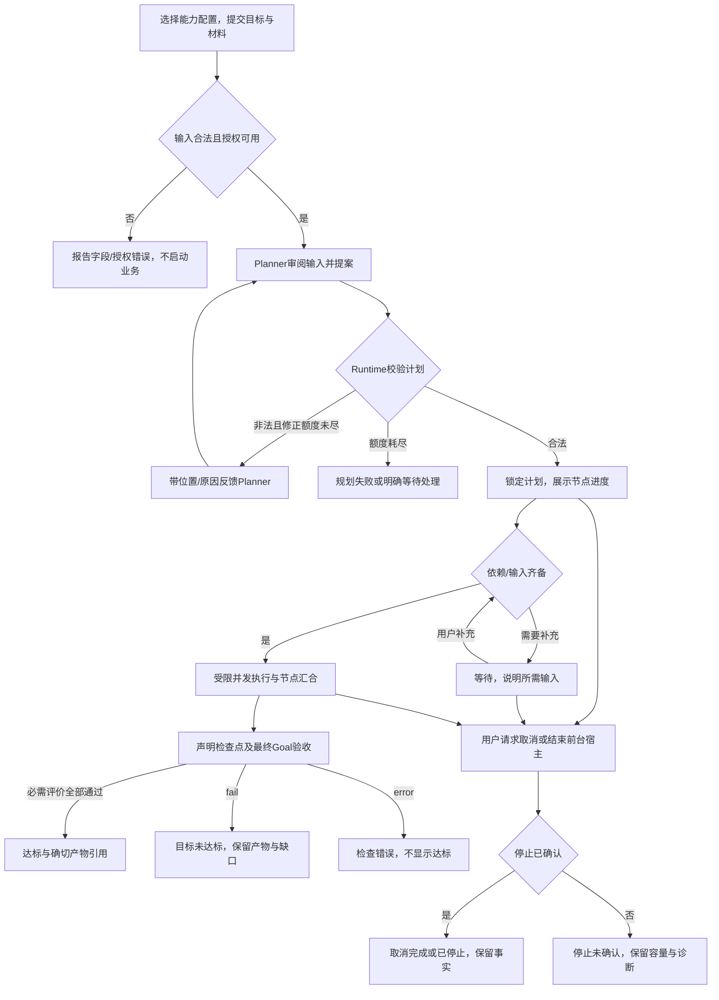

# TaskLoop #10：Goal Spec 与受检 DAG 编排

版本：产品草稿 v0.2；状态：Draft；[Issue #10](https://github.com/xforce-io/taskloop/issues/10)。

按用户格式，L1 概要放 Issue 评论，本文件保留十三节作为唯一详细规格工作稿。当前落实产品路径与细验收，技术契约在产品基线明确后补齐；不把技术占位当成已完成 L2。产品语义映射：背景/范围§1/3，交互/Stories§4.1，规则§4.2，细验收§11，取舍与待定§5/12。

确认来源：原 Epic 的明确边界及用户要求端到端推进；本轮“go”支持继续设计调查，不代填未明确默认值的批准。应用质量归属已经由用户“直接调整”确认，见 [Inquiry #7](https://github.com/xforce-io/inquiry/issues/7)。

## 1 背景

基线 main `066a88eb89640e263958c88cbd87338d7208a22d` 已含执行、Trace、预算及恢复修复。`src/definition.rs::State` 只有 Work/Wait/Terminal，`src/runtime.rs::worker_loop` 直接 await 单次 phase，当前并非 DAG 并行编排；`src/phase.rs` 已区分候选、执行结果和 DomainGate 接纳，但没有独立 Goal 充分性模型。

本票补通用目标规划、受检计划、节点协作和验收；研究方法、文章评价及最终内容效果由 Inquiry #7 提供与验收。

## 2 名词解释

沿用 [名词表](../glossary.md) 的 Goal Spec、Planner、DAG、节点、Worker、Evaluation、Artifact、Trace 与预算。节点不是 Ready/Waiting 等生命周期状态；模型返回的评价也不等于 Runtime 已接纳。

## 3 目标与非目标

目标：用户通过 CLI 提交目标，不手写 DAG 或操作内部 Worker，完成有界规划、受检执行和确切产物验收；Rust 宿主经同一核心接入。自主与 workflow 模板约束共享契约，顺序、并行分叉、全部汇合均可用。

非目标：Web/MCP、分布式、运行时改图、业务回边、自动循环返工、通用外部写审批、插件市场、额外必需远程服务。不能把进程退出、全部节点成功或模型自报完成当成 Goal 达标。

## 4 能力

### 4.1 CLI 与完整用户路径

产品入口提案：提交并运行、查询/读取产物、补充输入、取消、显式重新打开前台宿主；提供人工可读和结构化输出。具体命令拼写为技术设计事项，不能改变这些行为。所有资源与授权由明确配置及 Goal Spec 给出，空配置解释缺项，不自动扫描凭据或启动模型。

S1 覆盖 A–S：新用户缺能力/模型配置时看到具体缺项；正常输入不要求提交图。进度显示当前目标、计划是否锁定、节点结果及等待原因；查询失败与没有产物区分。成功、失败/未达标、等待、取消四类路径分别可判。结构化输出保留相同含义，不能只给退出码。读取结果与产物不需要内部表或拼接私有文件。

生命周期提案 P1：前台宿主在等待时仍运行，等待不占 Worker；第二个 CLI 命令仅递交补充输入或取消，不接管运行所有权。退出不能暗示后台继续；退出时有界停止，确认后说明已停止，未确认则说明未知事实。重新打开只推进已确认未启动且仍合法的工作，未知工作不盲重放。不自动重开另一个业务计划。

S2 覆盖 D–H：自主或模板模式由用户显式选择，模板限定允许流程而非授权扩张。六类非法计划反馈具体位置、原因及类别；修正提案仍受原验收/权限/预算约束。提案默认最多两次修正（初次加两次），同时受显式时间和调用约束，任一先到即停。非法计划不派发业务工作，规划工作本身计量并可取消。

S3 覆盖 I–K：已接受上游输出按声明连接组装节点输入；分叉可并行且受并发上限约束；全部汇合等所有必需上游。多 Worker 内部按注册汇合契约形成一个公共输出，不让下游直接依赖内部 Run。首版提案：必需 Worker 全成功才汇合，失败传播为后继明确不可执行，不能让其永久等待。无任意条件表达式或隐式 skipped；等待输入必须是公开可补充的状态，不能让失败节点假扮等待。

S4 覆盖 L–O：每次转移做确定性身份、版本、依赖、预算及取消检查。声明的评价可以使用规则或真实 Worker，结果 pass/fail/error 分开。最终成功必须引用确切产物和全部必需评价；进程退出、模型自评不直接提交状态。过期/伪造对象拒绝，评价不可用显示 error，所有工作成功但质量 fail 显示未达标。

S5 覆盖全路径及 P–S：同键重试保持同一命令效果，迟到结果不能推进已取消或新版本状态。宿主中断后公开已知事实与未知停止，不盲目重放。预算耗尽不自动调高上限；已有产物可读。通过公开查询、预算及 Trace 定位，无需操纵存储。至少两实例隔离，等待/终态不持续占 Worker，未知停止保留其容量。

S6 由应用调用公开核心走 A–O 等价 SDK 路径：真实 Inquiry 集成含规划、执行、产物/引用回溯、领域评价接纳及未达标；第二类最小业务复用同一核心。此 Story 没有独立页面；应用完整交互与文章质量验收见 Inquiry #7，不拿框架 CLI 测试替代应用 Web。

### 4.2 规则

R1：Goal Spec、接纳的计划、验收依据与能力版本固定；锁定后无回边、无重规划或验收自动放宽。

R2：Agent 提案，Runtime 校验、调度及提交。Worker 不绕开计划派发新业务工作。Schema 合法性与业务充分性独立。

R3：节点公共 Schema 与多 Worker 汇合契约可判定。非法输入不派发，前置失败有明确传播，工作并发受限；不存在无条件“继续直到成功”。

R4：状态转移拒绝过期/伪造/跨实例证据。Goal 成功要求确切输出及全部必需评价；check error 不是 fail，也不是 pass。

R5：规划、Review 和业务执行共享身份、授权及预算治理；未知停止不释放容量、不盲重放。观测记录不作为状态推进权威。

## 5 思路与折衷

复用 Rust Runtime 的执行器、工具桥、Milkie、Trace、预算和存储保障，不在应用或 Agent 内另写权威调度。新增 DAG 与节点协调不能假称现有平面 Flow 已支持并行。

选择 DAG 无回边及显式全部汇合，放弃任意条件脚本和锁定后改图。领域可预先规划有限修订，但不能以连续创建新计划变相自动返工。首版多 Worker 全部必需成功的代价是不能自动多数表决；若领域需要判断，应注册显式评价能力。

前台 CLI 边界清楚，代价是退出不会自动成为常驻服务；不为首版引入额外部署或后台守护。

## 6 架构

本阶段仅固定责任分层：CLI/宿主提交目标 → Planner 提案 → Runtime 校验并锁定 → 依赖调度与受控 Worker → 检查接纳 → 公开结果。失败路径见§4.1。具体并行状态、数据提交和恢复协议待产品基线确认后补齐；当前不是完成版 L2。

## 7 模块

N/A：本阶段仅定义产品契约，尚不以模块清单预定实现。

## 8 API/CLI

产品行为见§4.1；CLI 名称、JSON契约、SDK对象及错误码在产品基线明确后形成技术规格。现有 Runtime start/get/signal/cancel/read_artifact、budgets/trace 等公开机制是复用依据，不自动代表新编排接口已经存在。

## 9 边界

宿主明确注册能力、Schema、工具与权限。Planner 不能通过新增图节点扩权。输入输出字段引用必须有效，不能访问未授权产物或内部 Worker。未知/不支持能力必须拒绝，不能把不同 Harness 视为同等能力。恢复不暗改旧 Playbook 行为。

## 10 迁移/兼容/回滚

旧固定 Playbook 保持既有 API 行为；DAG 能力显式启用，不能自动改写旧实例或接受旧产物作新评价。具体持久化兼容与回滚协议待技术设计完成；迁移失败不能继续写入不认识的状态。

## 11 测试计划与细化验收

以下全为必需验收，当前均未执行；后续逐行记录候选、设计版本、环境、时间、原始证据与 pass/fail/blocked/not_run。E2E 从公开 CLI/SDK 验证；Integration 验证持久化与故障边界；Unit 检查图与契约。夹具证明确定性规则，不能证明真实Agent规划或应用文章质量。

| ID/Story | 前置及公开入口操作 | 可判定结果与禁止行为 | 证据、依赖与层级 |
|---|---|---|---|
| S1.A1/S1 | 配置能力后CLI提交目标，读取人/机输出 | 两种输出同义；不用手写图或操纵内部表 | CLI原始输出及公开视图；agent；E2E |
| S1.A2/S1 | 分别成功、失败/未达标、等待补充、取消 | 四类路径可判，输入错误保留原因，不伪成功 | CLI操作与产物；agent/受控能力；E2E |
| S1.A3/S1 | 等待时补充、前台退出及重新打开 | 生命周期明确，无后台承诺，未知工作不重放 | 进程事实/公开状态/Run列表；agent；E2E |
| S2.A1/S2 | 自主和模板模式各提案执行 | 同一核心校验，模板不扩权 | 计划/校验/Run记录；真实Agent另列；E2E |
| S2.A2/S2 | 提交格式、环/自环、引用、连接、能力权限、预算验收六类非法图 | 六类均有位置与原因，业务未启动 | CLI/SDK错误与零业务派发；夹具；Integration/Unit |
| S2.A3/S2 | 提案先非法再有限修正；另耗尽次数/时间/调用预算 | 正例锁定执行，反例停止且原约束不放宽 | 全部提案、反馈、预算；受控Planner；Integration |
| S3.A1/S3 | 顺序、并行分叉、全部汇合计划各执行 | 三图形通过，真实并行受上限约束 | 开始结束关联及产物；受控Worker；Integration/E2E |
| S3.A2/S3 | 单Worker与多Worker节点，合法/非法输入及汇合 | 两类节点公共输出可判，非法不派发，内部Run不泄露成依赖 | 输入/输出/汇合记录；Integration |
| S3.A3/S3 | 上游失败；另等待补充且运行其他节点 | 后继明确不可执行，等待不占工作槽、不永久挂起 | 公开状态及容量事实；Integration |
| S4.A1/S4 | 在声明检查点分别返回pass/fail/error | 三类独立；只有必需评价全部通过才成功 | 检查原文与产物摘要/状态；Integration |
| S4.A2/S4 | 过期/伪造评价、检查不可用、工作全成功但目标fail | 三类均不得成功，候选仍可回溯 | 公开拒绝/错误/未达标及原始证据；Integration/E2E |
| S4.A3/S4 | 修改候选摘要、版本或依赖后尝试推进 | 每次转移拒绝不合法事实，作者自报无提交权 | 版本与接纳证据；Integration/Unit |
| S5.A1/S5 | 同键重复命令与迟到结果 | 不重复创建/派发/推进 | 命令回执及Run计数；Integration |
| S5.A2/S5 | 规划/Review/业务中取消、未知停止和宿主中断 | 同受约束、容量真实、未知不重放、产物保留 | 进程停止与公开快照；Integration/E2E |
| S5.A3/S5 | 规划/Review/业务预算耗尽，另运行2实例 | 上限不抬高且隔离，不用内部表诊断 | 公开预算/Trace/实例记录；Integration/E2E |
| S6.A1/S6 | Inquiry通过公开核心真实规划执行并回溯产物/引用 | 1条真实集成闭环与1条回溯，领域评价正确接纳 | 原始Agent/工具/产物；真实服务；E2E |
| S6.A2/S6 | Inquiry领域评价返回未达标 | 1条目标未达标，保留文章和缺口、不自动返工 | 应用评价与Runtime公开状态；E2E |
| S6.A3/S6 | 替换能力和Schema运行第二类最小业务 | 2类业务使用同一核心，无研究硬编码 | 公开调用、配置及结果；Integration/E2E |

功能地图：S1–S3 主要映射 `.agents/skills/verify-taskloop/features/06-goal-dag.md`；S4–S5 主要映射 `07-goal-acceptance-reliability.md`；S6主要映射 `08-application-integration.md`，实施前补齐。现有01–05保留为执行、Trace、治理、预算与可选依赖回归；不存在的新增功能文件不算已验证。

## 12 开放问题

P1：确认§4.1 前台CLI/等待补充/停止恢复、显式资源约束、初次加最多两次修正、多Worker全部必需成功、首版无任意条件分支的组合产品提案。此提案不增改 Epic S1–S6 的最终要求。

技术项后续决定：具体状态/Run映射、图格式及算法库、字段引用、并发与存储事务协议、CLI命令拼写与兼容版本。只要不改变本产品契约，技术选择不再增加产品审批；影响产品承诺时回到本节说明变更。

Inquiry文章规则及运行资源由其应用设计/验证登记负责，不能复制成TaskLoop的语义质量标准。

## 13 关联

- [TaskLoop #10](https://github.com/xforce-io/taskloop/issues/10)
- [L1 概要及归属修订](https://github.com/xforce-io/taskloop/issues/10#issuecomment-6715457806)
- [Inquiry #7](https://github.com/xforce-io/inquiry/issues/7)
- 执行与治理：#5–#9；恢复：#15/#16。
