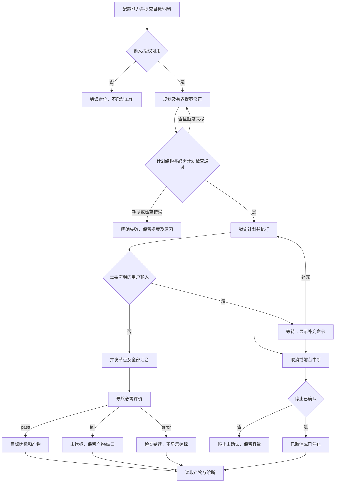
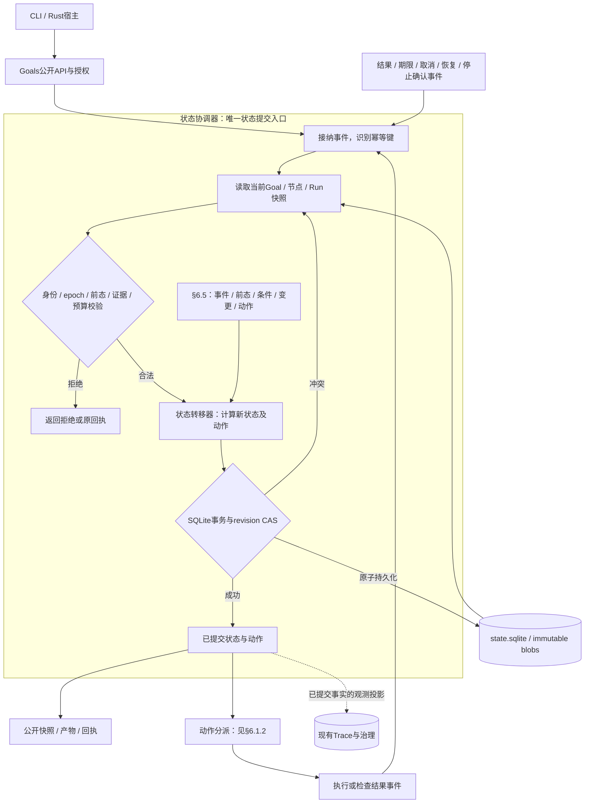
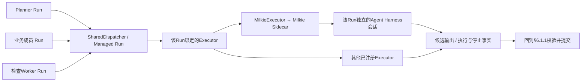

# TaskLoop #10：Goal Spec 与受检 DAG 编排

版本：L2 v0.10.17；交付状态：已随 [PR #19](https://github.com/xforce-io/taskloop/pull/19) 合入 main，验收及独立审查记录见该 PR；产品确认沿用下述基线，本文件不另行自批。[Issue #10](https://github.com/xforce-io/taskloop/issues/10)。

产品基线：[L1概要及归属修订](https://github.com/xforce-io/taskloop/issues/10#issuecomment-6715457806)，以及提交`16a68d48abb829dc14f13d0e0f4d3ed8c754558c`的v0.2用户路径与验收。复用§4行为和§11原18项Sx.Ax，不改变产品范围。本文件按用户指定十三节格式保存唯一L2事实源，L1留在Issue评论。

首版包含CLI、固定汇合与有界规划修正；后台服务、条件语言和自动返工不在范围内。[Inquiry #7](https://github.com/xforce-io/inquiry/issues/7)另行负责深度文章质量。

阅读顺序：§4看用户路径；§6.1看运行闭环；§6.3查节点输入输出与Gate；§6.5查状态转移；§6.7/6.9查事务与恢复。**Goal受理或显式resume后由Runtime持续推进，用户无需调用step。**

## 1 背景

实现基线 `066a88eb89640e263958c88cbd87338d7208a22d`：

| 源码 | 当前事实 | 本设计的复用/改变 |
|---|---|---|
| `src/definition.rs::Bundle/State` | 固定平面 Work/Wait/Terminal | 旧契约保留，新增显式 DAG 版本，不强行将并行压成 current_state |
| `src/runtime.rs::Record/worker_loop` | 单 active Run、逐个 await phase；重开时未知工作不重放 | DAG 用节点/Run集合与受限并发；旧流程维持原语义 |
| `src/execution.rs::HostBindings/Executor/Invocation` | 受控工具、执行器、候选、取消及观察接口 | 复用 Milkie/执行器与工具桥；增加内部工作归属上下文 |
| `src/phase.rs::Bridge/run` | Schema、授权、候选保存、Gate、epoch、预算与结果接纳 | 提取共享的受控 Run 管线，不复制另一套 Harness 驱动 |
| `src/store.rs::Store/commit` | 单宿主锁、SQLite IMMEDIATE事务、revision CAS、幂等命令、immutable blob | 新增目标持久化及在线命令幂等回执；状态仍由宿主提交 |
| `src/budget.rs` | RunBudgetPolicy 与公开生效/消耗事实 | 增加目标级原子预留与并发结算，不改变旧上限 |
| `src/trace.rs` | 独立 trace.sqlite、Run关联及有界查询/治理 | 扩展归属字段与编排事件，不充当调度日志或业务事实源 |

现有源码不能直接提供 DAG 并发或 Goal 充分性检查。设计中的 API、表和状态均为新增契约，不声明已存在。

## 2 名词解释

规范名见 [名词表](../glossary.md)。本次易混关系：

- Goal Spec 是不可变输入，不是可被 Planner 修订的目标；PlanProposal 是候选，不是已锁定 PlanVersion。
- 节点是DAG公共单元；Worker沿用名词表的L4执行组件。节点执行成员是该节点对某Worker的一次具名调用规格（member_id及EntryContract），一个成员最多产生一次Run；多个成员可调用同一或不同Executor绑定，但必须独立上下文/工作目录。产品所称单/多Worker节点对应单/多成员调用，不把成员等同于L4组件。
- Task 沿用一等任务含义：目标任务包含节点任务，不为每个 Worker 再暴露一个用户必须操作的 FlowInstance。Run 不等于独立业务实例。
- Evaluation 是评价内容；EvaluationReceipt 是受 Runtime 身份/版本检查接纳后的事实。评价 Worker 成功只表示产出有效评价，verdict=fail 可以与该 Worker 成功同时成立。
- `stop_unknown` 是停止事实，不是“执行失败”的同义词；它必须影响容量，即使 Goal 的业务结果已经失败。

## 3 目标与非目标

目标：CLI 与嵌入式 Rust 宿主共用一套 Goal、DAG、节点及验收核心；两种规划模式；三类图形；单/多 Worker；可取消、可诊断、可恢复且不重复业务执行；Goal 成功只能由确切产物与必需评价证明。

非目标：Web/MCP、分布式租约、动态改图、任意条件表达式、业务回边、隐式多数表决、自动循环返工、跨服务事务、通用写动作审批。TaskLoop 不实现资料分析方法或文章评分；不因一次集成成功声称 Inquiry 文章达标。

## 4 能力

### 4.1 UI/UX：CLI 主路径与状态

首版无图形页面；CLI 本身有完整用户路径，不标记为“无用户路径”。人工输出包括目标ID、当前阶段、节点进度、等待/失败原因和产物引用；JSON输出表达同一事实。



S1/S2走A–L，S3走L–N，S4走E–R，S5覆盖C–O与全程故障，S6经同义SDK路径接入应用。空配置/非法Spec就地报缺项，不启动模型；查询错误不伪装成“暂无报告”。计划锁定后不能由补充命令改目标、权限、预算或依赖。等待不占 Worker，宿主仍在前台；退出不是后台托管。实际命令和退出语义见§8。

§4.1是用户可见路径，§6.1是实现这些行为的内部机制，两者不是两套执行流程。一个用户步骤可以对应多次事件接纳与事务提交：

| 用户可见步骤 | 技术承接 |
|---|---|
| 提交、看到受理或错误 | §6.1.1授权、事件校验与原子提交 |
| 规划、锁定计划、执行节点 | §6.1.2分别派发Planner与节点成员；结果回到协调器后才推进 |
| 等待输入、补充后继续 | §6.6保存等待身份，补充事件经协调器接纳后重新计算就绪节点 |
| 取消/中断、看到停止结果 | §6.1.2向已有Run请求停止，按§6.9确认和结算，不启动新agent |
| 达标、未达标或检查错误 | §6.8接纳确切评价，协调器提交终态后由公开快照呈现 |

### 4.2 产品不变量

R1 固定目标、能力、规则与接纳计划。R2 Agent提案，Runtime调度与提交。R3 节点输入输出和汇合可判定。R4 结构合法、工作成功、质量达标分别记录。R5 规划/Review/业务同受预算、身份和停止治理。R6 无未知执行盲重放，不以Trace代替状态。

本版不提供条件分支或 skipped 节点；失败依赖用 `dependency_failed` 表示不可执行，区别于已执行失败。修订必须是预先声明的前向节点。提案修正上限默认2次（初次加2次），宿主/请求可降低，不能超过2次；其他执行资源必须显式提供。

## 5 思路与折衷

| 选择 | 理由与代价 | 放弃项 |
|---|---|---|
| 同一 Runtime 内增加 Goal 编排面，共享受控Run管线 | 单一状态提交权威，复用Milkie/工具/Gate/Trace；需要将旧单Run执行责任与协调责任分开 | 应用循环start旧Flow；另一套执行器与状态库 |
| 单宿主、单Goal revision串行提交，Run可并发 | 用既有SQLite CAS保证接纳顺序，图规模有界；提交吞吐不是首版优化目标 | 分布式调度、每节点租约与多层消息系统 |
| 声明式端口及字段选择，Schema摘要相等校验 | 可以判定连接，不尝试一般JSON Schema包含关系证明；复杂映射用显式能力节点 | 表达式语言、任意JSON Patch转换 |
| 多Worker全部必需成功，纯函数汇合 | 不隐藏失败、不依赖完成顺序；聚合算法由能力注册 | 任意多数投票、模型在汇合中偷偷追加工作 |
| 有限规划修正、业务Run不自动重试 | 重复副作用和质量刷分边界清晰；失败可能需要用户显式新建后续Goal | until-success、锁定后重规划 |
| 在线CLI经宿主本地Unix Socket提交命令 | Socket属于当前前台宿主，无后台服务；宿主离线直接报错，幂等回执仍由同一状态事务保存 | 离线命令收件箱、第二CLI改业务表、隐式后台守护 |

**首版结构约束：**在现有宿主Runtime内完成事件处理、状态计算和事务提交，共用一个受控Run执行通道。协调器、状态转移器和调度职责不要求拆成独立服务；TransitionRule/TransitionDecision用于描述契约，不要求规则引擎、规则注册表或第二份状态存储。外部命令及执行结果直接进入宿主处理，不新增消息总线。应用注册材料沿用现有资源机制，不新增能力包加载器。

采用JSON Schema 2020-12、JSON Pointer字符串语法（RFC6901），明确子集见§6；不宣称CWL兼容。图检查选择 petgraph 0.8.3 的拓扑排序检测环，自环同拒绝，运行时按稳定ID排序派发而非依赖库返回的任意拓扑序。其算法契约见[官方文档](https://docs.rs/petgraph/0.8.3/petgraph/algo/fn.toposort.html)。新增依赖只用于图算法，不承担持久化或执行状态。

## 6 架构

### 6.1 分层、状态转移处理与执行路径

本节分开表达三个问题：谁决定并提交状态（§6.1.1），提交后的动作交给谁（§6.1.2），一个节点如何衔接到具体Worker及其执行循环（§6.1.3）。合法状态边由§6.5的固定转移契约定义，本节不另造状态机。

| 层次 | 责任 | 与agent的关系 |
|---|---|---|
| 状态协调器 | 校验事件、计算转移、事务提交 | Rust确定性逻辑，本身不是agent；不调用模型或工具 |
| 规划与执行角色 | Planner提出计划；节点成员完成业务；检查Worker生成评价 | 角色不同，可以复用执行通道；Planner无权直接派发业务Worker |
| 调度与受控Run管线 | 预留资源、唯一启动、工具约束、结果/停止事实 | 连接角色调用与Executor，不替代agent内部执行循环 |
| Executor / Milkie / Agent Harness | Executor履行执行契约；MilkieExecutor经Milkie适配具体Harness | 每个Run绑定自己的执行器、入口、上下文和工作目录；不是一个全局编排agent |

#### 6.1.1 状态提交闭环

状态协调器是唯一状态提交入口，其内部包含事件接纳、转移校验、状态转移器、事务提交。依赖调度只提出可派发动作；Planner、Worker及检查均返回候选事实，不能直接修改Goal、节点或Run状态。



**实际状态转移在TX成功提交时生效。** D只计算待提交变更，不写库、不调用模型。TX使用SQLite IMMEDIATE事务及`WHERE revision=当前值`的条件更新，必须恰好更新一个Goal；冲突则回滚、重读并重算。状态、回执、接纳引用、预算及共享run_leases一起提交；blob可预写，事务只接纳引用。文件所有权锁限制写宿主，revision CAS防止该宿主内并发事件覆盖。

提交后才分派动作；启动前仍复核意图、期限及预留并以CAS记录started。存储失败不派发。完整接纳顺序只在§6.5.2定义，事务有效性见§6.7，崩溃处理见§6.9。图中反馈边表示接纳下一事件；模型Review只在声明检查点发生。

#### 6.1.2 动作分派与执行通道

协调器提交后只有三类动作；仅启动受控Run进入执行通道：

| 动作 | 执行者与边界 |
|---|---|
| 启动受控Run | SharedDispatcher完成资源准入和唯一启动；Managed Run约束输入、工具、预算及身份，再调用绑定的Executor |
| 内建检查或汇合 | Runtime执行有界的计划结构、Schema、一致性检查及object-by-worker固定投影；不创建Run、不调用Harness。纯校验可在事件接纳中完成，无需另存一份检查命令 |
| 停止已有Run | 按原run_id及Executor绑定调用取消Token/stop_or_confirm；不建新Run、不申请新槽位。停止未知保留原槽位；未启动预留按§6.5.1处理 |



Planner入口由Profile指定；业务成员入口由NodeContract中的EntryContract指定；检查Worker入口由checker登记。三者分别创建独立Run，复用通道不复用agent会话。Planner只能提案，不能直接派发业务Worker。“声明检查”是Profile/计划中的要求，执行时选择内建检查或检查Worker；结构合法不代表质量达标。其他Executor沿用现有扩展契约，首版不额外实现Harness适配器。

执行观测按Run关联到现有Trace，Milkie提供Harness观测；Trace失败只降级观测。执行返回、停止已确认、业务结果已接纳分别记录，均不能互相替代。

#### 6.1.3 节点如何执行及衔接后继

NodeContract定义一种节点能力的公共端口、成员入口及汇合规则；DAG中的节点引用该契约。Runtime每次只推进依赖和状态条件均满足的节点，不是同时执行整张图。work节点按以下顺序处理，input节点按§6.6等待补充，不创建Worker：

1. **准备并执行成员**：按冻结绑定准备每个具名成员的输入，各自创建独立Run，经§6.1.2准入执行。每个成员最多执行一次，分别取得可用槽位，无需同时取得全部槽位。
2. **接纳节点公共输出**：按run_id归属校验成员候选。全部必需成员成功后，按固定投影汇合并检查节点Schema/Gate；事务同时接纳公共Artifact并将节点标为succeeded。成员失败或汇合非法不形成公共成功输出，按§6.5–6.7收束。单成员节点采用相同规则。
3. **检查后继是否可运行**：公共输出提交后，检查依赖它的后继；全部必需输入齐备才标ready，取得容量后再派发。尚未齐备的节点继续等待，其他无依赖分支可并行。候选和仅已接纳的成员结果都不能提前作为下游输入。

例如A→B，另有独立节点C：A与C可并行；B必须等A的公共输出提交。若A有两个成员，需两者均成功并完成节点汇合，B才具备这个依赖；最终能否启动还取决于B的其他输入、意图、期限与容量。

**Worker内部的执行循环由该Run绑定的Agent Harness负责**，经Executor/Milkie适配；方法来自EntryContract.instruction及锁定Skill，工具调用由TaskLoop ToolBridge约束。TaskLoop负责节点之间的依赖、派发、汇合和恢复，不另设Routine对象或Worker内部持久化状态机。Worker是执行组件，成员是调用规格，Run是本次执行事实。内部阶段如需独立产物验收、等待或恢复边界，须在计划锁定前建模为显式DAG节点；Skill不能修改锁定图或扩大权限。

主路径：固化Spec/Profile→Planner提案→计划检查与锁定→节点执行与公共接纳→必需最终评价→提交终态。所有失败仍回到同一协调器：非法提案有界修正；输入/成员/Gate失败按依赖收束；质量fail为not_met，检查error为failed/check_unavailable；取消或资源耗尽先停止再收束，停止未知保留容量。

### 6.2 固定对象与归属

所有公开JSON含 `protocol_version:1`，未知字段、重复键、非法整数或重复ID拒绝。节点/端口/检查项等逻辑ID为1–64位ASCII，首字符字母或数字，后续允许`._-`；运行时保留`_tl.`前缀，不允许用户定义。Profile/Grant/能力引用、request_key及不透明Goal/Artifact/Run引用上限160字符，不适用64位逻辑ID规则；引用必须由目录或存储按完整值解析，不能截断。内部state_id映射上限160。无跨Goal裸路径引用。

| 对象 | 必需字段与关系 | 不变量 |
|---|---|---|
| Goal Spec | `goal`文本、`inputs`对象、`profile_ref`、`planning.mode`、`limits`；workflow模式还需template_ref | 原始字节与规范化摘要均保存，不能由Planner覆盖 |
| GoalRequest | protocol_version、request_key、grant_ref、spec（Goal Spec） | 幂等及授权信封不混入Spec摘要；调用身份由宿主提供 |
| Profile锁定记录 | 逻辑id/version、goal_input_schema、能力目录摘要、Planner入口、规划补充Schema、计划/节点检查点/最终检查要求、必需输出别名及Schema、可用模板、Skill/Schema/执行器配置摘要 | 宿主注册并授权；模型不能注册新Capability或Gate |
| Capability/NodeContract | id/version/digest、kind、input/output端口、节点执行成员、汇合器、确定性Gate、权限及预算策略 | work至少1个必需执行成员；input类型无Worker；成员ID和公共端口固定 |
| PlanProposal | `goal_spec_digest`、`profile_digest`、`planning_mode`、`nodes`映射、`outputs`映射、`checks`映射、`template_digest`（仅模板模式） | 不是已锁定计划，非法仍保存原文及错误 |
| PlanVersion | proposal摘要、规范化计划字节、目标/目录/模板摘要、接纳检查引用、locked_at | 目标内仅1份接纳计划；锁定后不可变；plan_digest即规范化提案摘要，锁定时间与接纳回执不参与该摘要，避免循环引用 |
| 节点任务 | GoalId、plan_digest、node_id、capability_digest、依赖、公共输入摘要、节点状态、输出引用、Worker状态集合 | 一个公共输出版本；内部Worker不成为跨节点连接对象 |
| RunRequest | request_id、role、输入/入口摘要、epoch、尝试序号、pending/materialized及run_id | 同GoalRecord持久化；请求不占槽，每个请求最多物化一个Run，见§6.5.2 |
| Run | 不透明run_id、GoalId、node_id或系统角色、member_id、attempt=1、epoch、输入/能力摘要、预算、started/stop事实 | Planner修正是不同受控Run；业务成员不自动复跑 |
| Artifact | 现有ArtifactRef加公开归属元数据：goal_id、node_id、member_id可选、plan_digest、schema_digest | 内容SHA-256按实际字节计算；候选和公共接纳输出分离 |
| EvaluationReceipt | evaluation_id、checker_id、rules_digest、subject、producer_run_id可选、verdict、evidence_refs、violations、accepted_revision | subject必须与当前检查请求完全一致，不接纳模型自编对象身份 |
| GoalSnapshot | GoalId、revision、spec/plan摘要、status、stage、outcome、terminal_intent、blockers、admitted_at_utc_ms、wall_deadline_utc_ms、nodes、waiting、artifacts、evaluations、stop、budget摘要、error | 生命周期、业务结果与停止事实独立，不靠一个completed字符串掩盖缺口 |

Profile包含固定验收要求，Planner只能选择已注册实现和连接输出，不能删除/修改要求。`admitted_at_utc_ms`为首次受理时间，`wall_deadline_utc_ms=admitted_at_utc_ms+effective.max_wall_ms`采用溢出检查并一次写入；受理时所有期限加法或单调时钟映射不可表示均input_invalid/category=budget_acceptance，拒绝整个submit且不写Goal/不启动Run，不截断或饱和期限。规划期限先取生效规划时长与wall时长最小值再checked_add，重开/补充/恢复不重置。宿主内以单调时钟映射剩余期限，避免本进程内系统钟调整延长预算；last_observed_utc_ms是Store.meta里的时钟高水位，不属于Goal业务revision；刷新时钟观测不能使resume/signal的业务版本持续失效。重开从固定UTC期限恢复，若系统钟早于该持久高水位，blocked/clock_untrusted且不派发，不能将未可信的时差当作新增额度。新目标可带 `parent_goal_id` 与显式 `imports` 列表；导入在submit事务前逐项校验：Artifact必须已接纳、对当前Caller可见，首版严格仅同一owner，不支持跨owner例外，即使其他Grant允许读也拒绝跨owner导入；引用的sha256及schema_digest必须与保存元数据和实际字节一致，当前GoalGrant须允许读取。失败则整个submit拒绝、零Run。parent_goal_id若提供也须是可见的同owner目标；它仅作来源关联，不授予整目标读取权。imports可来自明确选择的多个同owner目标，不强制必须等于parent；没有parent仍须逐项授权。冻结后工具只获得列入imports的确切版本，不获得父目标其他产物。此操作必须是显式新提交，不由失败自动触发。

DAG公共产物的兼容字段固定为state_id=`_tl.node.<node_id>`、slot=公共端口名、visit=1；每节点仅一次公共接纳，不能靠visit表示修订，修订用另一个前向节点。成员产物用`_tl.node.<node_id>.member.<member_id>`、slot=成员输出槽、visit=1，并标producer_kind=member_candidate或member_accepted，不得当作Plan公共输出。Planner系统产物state_id=_tl.planner、visit=提案尝试序号；独立检查用_tl.check.<check_id>、visit=1。完整node_id/member_id/plan_digest仍在公开元数据中，应用不必解析命名。ToolContext.artifacts/latest只在当前授权作用域内按这些精确字段工作，无跨节点“最新”猜测。

摘要：Artifact用原始字节摘要；Spec/目录/计划使用TaskLoop `normalized-json-v1`：重复键拒绝、对象键递归排序、依赖集合排序、保留有语义的数组顺序、以固定serde_json序列化后SHA-256。数字表示不同可得到不同摘要，不宣称RFC8785规范化兼容；编码版本随协议锁定，规范化字节保存而非重开时重新计算猜测。

Goal所用Executor须明确声明enforces_json_candidate_limit；默认false，仅对新Goal注册生效，旧Flow不增加该前置。外部适配器在构造候选JSON Value前读取ToolBridge.json_candidate_limit（宿主单值上限、Run剩余候选额度和4MiB硬上限的最小值），先检查借用的原始JSON片段长度；普通RPC/观测仍受各自帧限制。超限调用只走原Run/context/call身份核验、去重和拒绝计量，不把候选替换成null或送入正常写入。受信进程内Executor可明确声明没有外部解码边界；该声明纳入注册绑定摘要。

### 6.3 端口、连接与Schema

端口是命名的JSON值，各自关联冻结Schema摘要，节点输入是端口名到值的对象。每个必需输入端口恰有1条绑定；可选端口可不绑定，缺省仅来自已锁定能力定义，不能由Planner任意发明。每个端口必须在NodeContract注册source_policy：`goal(pointer)`要求恰好绑定该冻结目标路径；`artifact`只允许node公共产物或显式导入产物连接；`constant`允许经Schema验证的literal。只有constant端口可带缺省值。自主/模板模式同样执行该规则，question端口标goal(/goal)、证据端口标artifact时，literal或其他来源一律input_connection拒绝。

绑定是下列tagged union：

- `{"kind":"goal","pointer":"/goal"}`：指向冻结的`{goal,inputs}`输入视图，不能读取权限/配置/凭据。Profile的goal_input_schema验证inputs，selector注册覆盖该固定视图。
- `{"kind":"node","node_id":"research","port":"analysis","pointer":""}`：指向已接受公共输出；禁止引用Worker/Run候选。
- `{"kind":"import","artifact_id":"<opaque-id>","pointer":""}`：仅引用本Goal冻结imports白名单中的确切产物，selector与Schema规则同node，不创建DAG依赖边。
- `{"kind":"literal","value":...}`：仅可用于source_policy=constant的端口，须校验Schema和Profile允许值；goal/artifact来源的端口不能用literal替换。

pointer采用[RFC6901](https://www.rfc-editor.org/rfc/rfc6901)字符串形式：`""`选整值，转义按`~0/~1`；不支持URI fragment、通配、表达式或数组追加。非空pointer仅允许Profile显式声明的固定字段selector；每个selector给出Schema摘要及必然存在声明。首版selector仅跨required对象属性，不穿过可选属性、数组下标或动态条件Schema；需要这些转换时使用注册转换节点。宿主注册时核查selector能在该固定Schema中解析，拒绝无法证明的路径。

结构检查要求源端口或selector的Schema摘要与目标端口相等。不是一般Schema兼容推理；不同Schema需要显式转换节点。派发前仍用实际值校验整个节点输入，防止上游输出或selector声明与事实不符。能力Worker输入映射和汇合输出同样做实际Schema验证。

支持JSON Schema 2020-12的本地冻结资源，由现有jsonschema库验证。`$ref`只解析包内已锁定资源，禁止网络解析；`$dynamicRef`、自定义必须词汇及依赖运行时外部资源的Schema首版拒绝。format不作为隐式业务真实性检查。明确这是产品支持子集，不声称完整工作流标准兼容；[标准依据](https://json-schema.org/draft/2020-12/json-schema-core)。

### 6.3.1 类型注册与资源锁定

首版由可信应用代码构造NodeContract、EntryContract、Profile、checker与预算，注入同一OrchestrationRegistry；复用已有Definition的Schema/Skill资源读取及验证。**不实现独立CapabilityPackage文件加载器，不提供运行时JSON注册、插件加载或安装入口。** CLI的HOST.json只选择已打包的能力工厂/Profile ID，应用同样可通过Rust SDK注入，用户无需step。

| 对象 | 定义及形状依据 | 首版注册位置 |
|---|---|---|
| 节点公共端口、成员及映射 | [NodeContract](10-goal-dag-orchestration/contract/node-contract.schema.json) | 应用Rust能力定义 |
| Worker执行入口 | [DAG EntryContract](10-goal-dag-orchestration/contract/dag-entry.schema.json) | 应用Rust入口定义 |
| 目录、规划入口及检查要求 | [Profile](10-goal-dag-orchestration/contract/orchestration-profile.schema.json) | 应用Rust Profile定义 |
| Schema、Skill、规则及预算 | 已有资源读取机制、[RuleSet](10-goal-dag-orchestration/contract/rule-set.schema.json)、显式RunBudgetPolicy | 可信宿主提供的资源及入口预算 |
| checker执行输入 | [CheckInput](10-goal-dag-orchestration/contract/check-input.schema.json) | Runtime构造，不能由应用端口填受信身份 |

Schema用于定义和离线校验契约形状，不要求为内部对象实现一套JSON反序列化注册API。[CapabilityPackage Schema](10-goal-dag-orchestration/contract/capability-package.schema.json)及package.json保留为**离线示例清单**，对应应用代码中的同一组定义；它们不是首版外部协议或必须交付的加载器。独立包分发/加载待存在部署需求再设计，不保留悬空SDK方法。

注册按目录类型解析，capabilities.review@1与entries.review@1不混用；能力/Profile引用为id@version，Core保留`_tl.`/`taskloop:`身份。内建Schema引用为`_tl.planner-result@1`、`_tl.check-input@1`、`_tl.evaluation-candidate@1`，分别对应现有三份执行输入输出契约。应用资源仅解析已锁定本地引用，模板/工具/Executor由宿主编译注册，不加载外部代码。缺引用、重复或同ID异内容、覆盖Core资源均拒绝。

目录在Runtime开放Goal前统一validate_and_freeze：检查所有引用、Schema/Skill合法性、预算恰好覆盖入口、成员/端口映射、checker要求、Profile最终检查及绑定的宿主能力；任何一项失败整个目录不可用。冻结实际资源字节与引用闭包摘要，执行时使用该不可变快照，不重读可变路径。重用资源读取的有界/路径约束：每份JSON资源最多1MiB，全部资源最多16MiB，禁止逃逸、符号链接和联网解析；JSON摘要按实际字节，Skill摘要沿用现有SkillPackage字节映射算法。NodeContract/Profile目录摘要绑定资源闭包，不包含自身digest字段；无需另设包锁或注册存储。

### 6.3.2 公共端口如何映射到Worker

NodeContract每个input端口含schema_ref、required、source_policy；可选default仅允许constant来源且必须通过对应Schema。Profile.goal_selectors显式声明固定Goal输入视图的pointer→schema_ref；注册时证明是required字段路径，解析出的Schema与所声明资源规范化内容一致，运行时使用该资源的冻结摘要。`/goal`必须吻合GoalRequest的goal字段Schema，不能自改长度；`/inputs/...`从goal_input_schema解析。端口连接继续要求摘要相等，不做一般Schema兼容推理。非空node/import选择使用Profile.artifact_selectors中的`源schema_ref → pointer → 目标schema_ref`声明；注册时证明required字段路径与目标资源规范化内容一致，运行时按冻结目标摘要连接。未声明则只允许整值连接；这是既有固定字段selector规则的具体登记位置。

work的members以member_id为键。普通成员input_mode=node_ports，每项含entry_ref及input_bindings；评价成员input_mode=check_request，禁止input_bindings，按下节由Runtime生成整个CheckInput。目标字段名映射为`{port,pointer}`，构造该EntryContract的stage_input顶层对象；只允许从本节点公共输入选取固定required字段，不支持表达式/脚本/隐式常量。注册时要求目标入口Schema为固定对象，必需属性恰有一个绑定，未知属性、重复/缺少必需绑定拒绝；每个源selector与目标字段的Schema摘要相等。可选端口缺失且无default时省略相应可选目标字段，不以null冒充；非空selector不可跨可选属性/数组。派发前对实际stage_input完整验证。

成员候选按EntryContract.outputs校验，首版DAG输出槽均required。现有Executor通过artifact.write提交候选（最终聊天不是提交），因此DAG入口tools及Profile.allowed_tools必须显式包含artifact.write，并取得相应Grant；不得因Schema声明输出就隐式授予提交权限。Core的artifact.read/write属于宿主固定工具目录，无需注册为DomainTool，但同样受显式授权及预算约束。内建`_tl.schema@1`只判断结构、必需产物及固定一致性，成功outcome固定completed；它不决定文章质量。DAG entry.requires必须为空，不能混入旧Flow历史依赖；可选附件沿用既有受限附件契约，但不能自动变成未声明公共端口。

join.kind固定object-by-worker，先按member_id收集全部成功成员的具名输出，再按join.outputs为每个公共端口做**固定投影**：`kind=member`选确切member_id/slot（单成员也适用），`kind=members`按slots中的member_id→slot构造对象。仅这两种投影，不是新的表达式或用户代码汇合器；无隐藏I/O/模型。join.outputs键恰好覆盖公共outputs，每个引用必须存在且为必需槽。member投影要求目标公共Schema摘要等于该成员输出Schema摘要；members投影的公共Schema必须是固定required对象，属性集合恰等于所列member_id、各属性Schema与所选槽相同、additionalProperties=false，注册时逐项证明。所有必需成员仍须成功，即使某端口只投影其中一个；实际公共值再做完整Schema/Gate校验。自定义综合计算继续用显式受控能力节点，不借投影执行。

input节点不允许members/join；signal_schema_ref及max_wait_ms必需，公共outputs恰为value且Schema等于signal_schema_ref。输入等待可读本节点授权上下文，但只将合法signal作为value产物；不创建Worker Run。

### 6.3.3 Gate与领域检查的定义、执行及结果

| 检查层 | 定义及逻辑位置 | 执行与失败 |
|---|---|---|
| 注册/连线检查 | Core固定规则，包提供Schema/目录/映射 | 注册器/计划校验器；不合法拒绝，未授权工作不启动 |
| 成员Gate | EntryContract.gate仅`_tl.schema@1`；逻辑为Core内建 | 有界校验必需候选及输入/身份一致性；非法为工作/契约失败 |
| 节点Gate | NodeContract.gate仅`_tl.schema@1`，max_rule_check_ms显式 | 固定汇合后的公共Schema/一致性检查；通过才原子接纳输出 |
| 领域质量检查 | RuleSet文件定义标准，checker登记受控入口，Profile.CheckRequirement固定阶段/targets/rules_digest | 独立checker Run；Runtime校验Evaluation候选并生成Receipt。fail可为not_met，error为failed/check_unavailable，见§6.8 |

身份/epoch/授权/停止/预算检查始终由Runtime强制，不能通过选择gate ID关闭。`max_rule_check_ms`及入口max_check_ms按适用最小值计量，不承诺强杀同步代码。新Goal绝不调用任意DomainGate闭包；HostBindings.gates仅保留旧Flow兼容。自定义确定性领域逻辑也使用可停止的已注册Executor/checker Run，不能把Rust回调伪装为“纯Gate”。

包内checkers每项含entry_ref、rules_ref、result_slot、fresh_context=true和goal_input_fields。checker入口input_schema必须解析到Core CheckInput的精确摘要，result_slot必须是必需Evaluation候选槽，结果规则/证据校验统一见§6.8，不在入口另实现一套。fresh_context要求独立会话/工作目录及受限Artifact视图，适配器无法证明则注册拒绝。EntryContract.tools显式声明，仍取Profile/Grant/宿主交集；仅有artifact.write也不意味着可读工作目录中的其他Run文件；不需要读取工具的checker可只声明提交工具。

CheckInput是CheckRequest的只读执行封装，phase为plan/node_checkpoint/goal_final及非阻断node_evaluation：身份、phase、epoch、nonce、规则和目标都由Runtime生成；subject.kind=proposal时携proposal_digest及提案，kind=artifacts时携plan_digest及确切target别名→Artifact身份/内容。顶层goal及goal_spec_digest绑定冻结目标，goal_inputs仅包含checker.goal_input_fields允许的必需顶层输入字段，注册时须能在Profile.goal_input_schema证明其存在；没有字段则为空对象。evidence_refs只包含目标Artifact ID和显式允许的`goal-input:<field>`，后者绑定本Goal Spec摘要，不能借字段名读取任意Goal。读取输入仍受当前Caller/Grant的材料范围约束；不授权的字段/产物拒绝检查，不能悄悄补上下文。所有实际目标值、规则字节及摘要在构造时复核，总执行输入受宿主/适配器上限约束，超限报check_unavailable，不截断证据后宣称通过。

**显式评价节点的输入例外：**NodeContract仍为kind=work，附evaluation={purpose,checker_ref,target_ports}，purpose仅checkpoint或data。首版恰有一个成员，input_mode=check_request且entry_ref精确等于checker登记入口，不能有input_bindings；整个stage_input由Runtime构造，绝不把nonce/epoch/rules等身份字段当公共输入让Planner绑定。普通node_ports入口不能引用Core CheckInput来伪造这个模式。评价节点公共inputs恰好覆盖target_ports所列端口，全部required、source_policy=artifact，alias→port一一对应；每个alias必须存在于本Profile.outputs，实际Plan绑定须等于该别名解析到的确切公共产物。outputs恰为evaluation，Schema为Core Evaluation候选；join只允许从这个成员的result_slot作member投影。

checkpoint节点须由Plan.checks中的唯一node_checkpoint项绑定，checker_ref及target别名集合与NodeContract.evaluation和冻结CheckRequirement完全相等，purpose必须checkpoint；检查依赖和before_outputs仍按§6.8验证。N02首次ready事务在输入Artifact已接纳后创建并持久化CheckRequest（epoch/nonce/subject/rules/目标摘要），登记角色及唯一成员的RunRequest，成员输入摘要取完整只读CheckInput；容量不足保留请求。N03/R01/R02只能使用这份请求，重算/排队/兄弟节点更新不重建nonce；启动及接纳仍复核当前epoch/意图/期限。pause下N02禁止首次创建请求；但已在pause前取得CheckRequest且Run已started的评价成员，在原epoch/期限和15秒窗口内允许N04进入checking并完成固定单成员投影及N05/N11，不受普通成员“暂停不首次汇合”的延缓规则阻挡。这是同一已启动检查的收口，不是新检查Run；checkpoint fail/error立即按G09/G10，不能先stopped等resume。R04仍只处理plan/final。节点公共evaluation、EvaluationReceipt及阻断意图在N05/N11同事务，不能在成员候选阶段提前给后继通行。冻结请求绑定subject，但issued_revision仅审计，不因兄弟推进误拒。

data用途用于既定前向“评价→修订”，不满足或替代任何必需checkpoint。Runtime同样在N02创建只读请求，phase=node_evaluation（仅CheckInput新增的非阻断执行角色，不扩展CheckRequirement.phase）；check_id为`eval.`加node_id的SHA-256前32位并与本Goal绑定，注册计划时碰撞拒绝，不与Profile必需检查混同。N05调用§6.8统一检查接纳流程，data的fail为有效数据；error不产生公共成功。请求角色、Plan节点和purpose由Runtime冻结验证，模型不能用phase回显改变阻断性质。两种节点材料见checkpoint-node.example.json及evaluation-node.example.json，示例不替代带真实产物身份的Plan校验。

**规划入口的绑定：**Profile.planner_entry_ref必须解析到恰有proposal必需输出槽、Schema为Core PlannerResult的入口；这个槽的内容仍是proposal/needs_input联合类型。Runtime给规划入口构造目标视图、goal_spec_digest/profile_digest、planning_mode、冻结Profile和本Profile能力目录，以及已受理的effective_limits、imports（仅确切ID/内容与Schema摘要），以及固定`planning_feedback={attempt,previous_candidate_sha,errors,check_results}`；首次errors/check_results为空、previous_candidate_sha为null，后续最多100项结构化错误及相关检查摘要；合法规划补充事实由Invocation.signal_facts提供，不改写冻结Spec。反馈与目录同样属于stage_input、须被入口Schema接受，不能只留在前一会话日志中；Profile包含输出别名和完整检查要求，不能让Planner在看不到checks时猜测Plan.checks。入口Schema必须接受该固定字段集合并通过实际值验证；workflow另携宿主冻结的template视图和template_digest，Planner直接回显该摘要；入口Schema须接受两字段，既有模板校验复核摘要和骨架，模板缺失即拒绝。示例planner-input.json只接受autonomous，与示例Profile.templates为空一致；它包含完整Profile而非只给能力名。入口Schema不匹配、缺结果槽或工具/隔离能力不支持时在Planner启动前拒绝。

**checker执行上下文投影：**对于plan/final及两种节点评价，限制不只在stage_input。Invocation.inputs与ToolContext.inputs都只含本CheckRequest允许的goal_inputs字段；Invocation.artifacts及ToolContext.accepted只含本请求的确切target Artifact，signal_facts默认空，不自动带入规划补充、其他节点或兄弟Run事实。只有显式成为请求target的输入产物才能读取其内容。stage_input为完整CheckInput；Skill及工作目录仅含本入口锁定资源和上述材料，不写入完整Goal输入副本。工具桥按同一只读作用域解析引用，受信DomainTool不得从全局Store补查隐藏材料；普通Worker/旧Flow的上下文语义不变。具备完整Goal读取权限的宿主不能把该权限自动传递给checker Run。

模型只返回Evaluation候选；身份、结果校验和Receipt生成统一见§6.8。CheckInput示例内的nonce/摘要占位不作为真实请求接纳；执行时只能由Runtime据持久事实构造。

完整材料示例见[文档审阅能力包](10-goal-dag-orchestration/contract/document-review-package/README.md)：原文→节点端口→成员输入→候选report→公共report→带原文可见性的独立quality检查。示例中rules/document-quality.json给出检查方法和通过条件，Gate本身不实现该语义判断。它证明注册材料可消费，不表示已执行真实模型或Inquiry深度文章验收。

### 6.4 计划检查、模板与最终要求

PlanProposal示意，数值与业务端口仅作例子，不是执行默认值：

```json
{
  "protocol_version": 1,
  "goal_spec_digest": "<sha256>",
  "profile_digest": "<sha256>",
  "planning_mode": "autonomous",
  "nodes": {
    "analyze": {
      "capability_ref": "analysis@1",
      "depends_on": [],
      "inputs": {"question": {"kind":"goal","pointer":"/goal"}}
    },
    "write": {
      "capability_ref": "write@1",
      "depends_on": ["analyze"],
      "inputs": {"analysis": {"kind":"node","node_id":"analyze","port":"analysis","pointer":""}}
    }
  },
  "outputs": {"report": {"node_id":"write","port":"report"}},
  "checks": {"report-quality": {"phase":"goal_final","checker_ref":"quality@1","targets":["report"]}}
}
```

nodes为映射，避免重复逻辑ID和位置歧义。depends_on可包含纯控制依赖，但所有node绑定的上游必须显式列入；禁止引用无依赖节点。输出与最终check都只能引用存在且契约正确的公共输出；每个工作节点必须能到达目标输出或必需检查所消费的输出，不允许孤立的“顺便做一下”工作。连接边与控制边共同参与无环验证。

| 类别 | 拒绝条件 | 结构化反馈 |
|---|---|---|
| format | 协议/字段/类型/重复键/ID/容量错误 | code、category、JSON Pointer path、message |
| cycle | 环或自环 | 指向相关depends_on的path及有限cycle节点集 |
| reference | 未知节点/端口/checker/输出，孤立工作 | 精确输入绑定/输出位置及引用身份 |
| input_connection | 必需端口未绑、多绑、selector非法、Schema不匹配 | 目标端口path、expected/actual摘要 |
| capability_permission | 目录外能力/Worker/工具、未授权资源、隔离/停止能力不足 | 能力path与拒绝原因，不输出凭据 |
| budget_acceptance | 超预算、缺必需评价/输出、模板约束不符 | 对应limit/check/template位置 |

HostConfig必须显式给出`max_spec_bytes`（库安全上限1MiB），限制规范化后Goal Spec的UTF-8字节；原始请求帧另受4MiB上限。在反序列化前按原始请求帧4MiB限制输入，解析后有界规范化序列化spec以复核1MiB上限，超限input_invalid且不写Goal/不启动Run。SDK已有JSON值也用有界writer拒绝超限，不先无限分配序列化缓冲。大型材料以授权Artifact引用导入，不内联撑大goals行。

硬容量作为HostConfig显式上限：`max_plan_bytes`、`max_nodes`、`max_edges`、`max_workers_per_node`。库安全边界分别不超过4MiB/256/4096/32，宿主必须选不高于安全边界的值并公开生效来源；这不是业务运行额度。超出在解析或派发前拒绝。

PlanProposal.planning_mode必须等于Goal Spec.planning.mode；workflow时template_digest必填且等于锁定模板摘要，autonomous禁止该字段。Schema先做本提案内条件校验，语义层再与外部冻结上下文比对，不将回显当成授权。

workflow模板是冻结骨架：命名节点/能力允许集合、必需依赖、输入输出与检查连接、可填字段；模板只能缩小能力范围。首版不允许Planner增加/删除骨架节点或边；自主模式在目录与预算内建图。两者校验及执行完全相同。模板不是预先批准任何输出质量。

结构合法后执行Profile声明的plan检查；规则检查器有固定期限，自定义/模型检查器用受控Run，不能直接调模型。plan检查subject绑定本次proposal_digest；fail加入修正反馈，error不当成“请再写一版”自动耗费模型，结束为检查错误。修正次数=新提案数−1，最大2；错误列表最多100项并标truncated，完整原提案保留。所有提案及自定义/模型plan检查均计Run/时间/工具预算（内建规则只计检查消耗）；只有结构与必需plan检查都pass才能锁定。

### 6.5 生命周期、工作结果和停止事实

Goal三个维度分离：

- `status`: `running | waiting | stopping | stopped | blocked | finished`。
- `stage`: `planning | plan_checking | executing | goal_checking`，终态保留最后阶段。
- `outcome`: `null | achieved | not_met | failed | cancelled`；只有finished可非null，且finished必须非null。

`running`包含有可派发工作或工作/检查在途；`waiting`仅在无在途/可派发工作且存在有效输入请求时成立。分支A等待、分支B仍执行时，Goal为running，waiting列表仍包含A，不能误报全局等待。stopped是宿主主动暂停且所有停止已确认；不是用户取消。blocked保留需明确处理的故障及未知停止，不在循环里自动重试业务。

| 事件/前置 | 合法转移与可观察结果 | 禁止结果 |
|---|---|---|
| 提交合法Spec | running/planning，创建幂等回执 | 未受理先启动Planner |
| 合法提案及plan检查pass | 同事务写不可变PlanVersion，running/executing | 边执行边更换候选计划 |
| 所有剩余可行工作等输入 | waiting，暴露等待ID/Schema/期限 | 占Worker或把依赖失败当等待 |
| 有效补充输入 | 接纳input节点输出，重新计算ready集 | 修改冻结Spec/计划或复跑已执行Worker |
| 等待期限到达且nonce未消费 | failed/input_timeout意图，节点失败/依赖传播；停止收束后finished/failed | 仅拒绝补充却永久waiting |
| 所有业务输出已接纳 | running/goal_checking | 直接achieved |
| 所有必需最终评价pass且所有Run已停止/结算 | finished/achieved，绑定输出与EvaluationReceipt | 旧产物评价冒充当前产物 |
| 完整有效的评价有fail且要求阻断 | 设置terminal_intent=not_met，阻止新派发并停止其他在途Run；全部停止/结算后finished/not_met | 尚有活动Run就直接终态，自动再开计划或改低要求 |
| wall/规划期限到达 | 按§6.5.1产生失败意图并停在途工作；无自身活动Run立即失败 | 只检查派发而让排队/执行目标永不超时 |
| 检查error/必要工作失败/预算耗尽 | 停止相关在途工作，确认后finished/failed；reason区分check_unavailable、worker_failed、budget_exhausted | 用not_met隐藏基础设施错误，或fail伪装成pass |
| 用户取消 | stopping，阻止新派发；全确认后finished/cancelled | 仅CLI返回就宣称已取消 |
| 前台SIGINT/SIGTERM或显式stop | stopping(intent=pause)；全确认且无丢失工作则stopped | 宣称退出后后台运行 |
| 任何停止未确认 | blocked或stopping，`stop.pending_runs`列明；继续占对应容量 | 删除active记录或释放槽位 |

节点状态：`pending → ready → running → checking → succeeded`；`input`节点为`pending → waiting_input → succeeded`。失败结果为`failed`，不可执行后继为`dependency_failed`，主动取消为`cancelled`。`stop_unknown`和`interrupted`是显式节点/Run处置状态，不被折叠进succeeded。状态与输出接纳同事务更新。不能从failed回ready；后续继续需新Goal。

Run阶段：`reserved → started → execution_returned → checking → settled`；未启动而暂停时为`suspended`，resume只重新预留后回reserved，不是再次执行。`execution_returned`不等于可释放：仅在适配器确认无原生执行存活时才标`native_stop_confirmed`。结束事实包括ExecutionOutcome、候选摘要、Gate结果、预算及停止事实；这些字段分别保存。过期epoch的业务输出只记迟到处置，不改有效节点输出；同一Run的可信停止确认及消耗结算仍按§6.7处理。

失败传播：某节点必需执行成员失败或公共Gate失败，阻止其后继；失败根事件的事务必须先设置terminal_intent并关闭该Goal派发，再原子或分批CAS将后继标dependency_failed。所有reserve和reserved→started事务都重新核对该意图；分批传播间隙也不得启动原先已ready/已reserved的后继。传播未完不能finished；崩溃恢复自动继续cleanup传播，不需要resume。与其无依赖的分支已在途工作进入停止收束，仅保存候选并结算，不在终结意图之后接纳新业务输出；不再为已经不可能完成Goal而派发新业务工作。未知原生停止保持容量。第一决定性失败与后续收尾错误均保存，不能被后到成功覆盖。

### 6.5.1 期限事件与停止意图矩阵

宿主持有独立的期限事件源，按每个Goal的wall_deadline_utc_ms、规划deadline和等待expires_at唤醒；该处理不申请Worker槽位、不等待ready工作派发。`planning_deadline_utc_ms=min(admitted_at_utc_ms+max_planning_ms,wall_deadline_utc_ms)`，含排队和规划等待，锁定后不再作为业务期限。重开先检查所有期限，再接纳resume或任何新派发。离线期间没有宿主执行定时事务；只读快照保留已提交status并给出deadline_expired派生标记，下一次持锁恢复先收束到期目标，不能据此宣称后台仍运行。排队的Goal即使被另一个Goal的未知停止占满槽位，也会在自身wall期限到达时收束；若自身没有活动Run，可立即finished/failed，无需等待其他Goal的停止。自身有未知Run则blocked并公开pending，不伪称已物理终止。

首个决定性终结事件以事务提交顺序设`terminal_intent={outcome,reason,revision}`并禁止后续业务派发；后来的cancel/期限可加速停止，但不把已记录质量失败伪改为用户取消。多项结果在同一评价候选中有error则整体error；已接纳必需fail足以证明未达标，可fail-fast，未接纳检查按§6.8互斥分类，不伪造完成。所有成功仍要求全部必需评价pass。

| 意图/事件 | epoch与派发 | 在途业务输出 | 收尾与目标状态 |
|---|---|---|---|
| 用户cancel，尚无终结意图 | epoch递增一次，禁新派发，nonce作废 | 旧输出拒绝，候选可留作诊断 | status=stopping；全部自身Run结算后finished/cancelled；未知超窗口blocked |
| pause/显式stop/SIGINT | 不递增epoch，禁新派发，等待身份保留但暂不受理signal | 在原预算/期限内已干净完成的输出允许接纳；有效失败/error/阻断fail按G09/G10转终结，不被pause掩盖；不能启动后继或新检查Run | 15秒内Run、已进入checking节点及pause前已启动评价的投影/接纳均完成并结算才stopped；到窗口请求停止，若出现未接纳的已启动工作则blocked/interrupted；停止未知继续占槽 |
| 必需checkpoint fail | 事务设置not_met意图，递增epoch、作废nonce，禁新派发 | 意图前已接受输出保留；意图后的兄弟业务输出拒绝，仅留候选 | status=stopping，停所有自身在途Run；结算后finished/not_met |
| 工作/检查error、规划耗尽或预算耗尽 | 设置failed及具体原因，递增epoch、作废nonce，禁新派发 | 不再接受业务输出，不覆盖已接受证据 | status=stopping；确认/结算后finished/failed |
| wall/规划期限到达 | 分别failed/wall_timeout或planning_timeout，按失败行处理；已有终结意图只追加期限事实 | 期限之后不接纳业务输出；停止和消耗照常结算 | 同上；即使没有工作可派发也必须触发 |
| started未提交结束的崩溃恢复 | epoch失效，禁止重放和新派发 | 不猜测成功，不接纳旧业务结果 | blocked/interrupted；确认停止只清理占用，不把节点复原ready |

只要有terminal_intent且自身Run尚未全部停止/结算，公开status=stopping、outcome=null、pending_runs列明；15秒停止窗口后仍未知则blocked，terminal_intent保留。全部确认后才finished并写outcome。停止/消耗结算始终按原Run身份验证，不受上述业务epoch/预算拒绝。有限终结动作、失败依赖传播、nonce失效和Run取消均属cleanup，不因max_transitions耗尽拒绝。

### 6.5.2 转移规则的结构与求值顺序

§6.5开头的表给出生命周期概览；本节及§6.5.3–6.5.5定义可直接评审的规则契约，替代实现者从散落正文自行拼接规则。所有业务节点按冻结kind复用work/input规则，能力差异由NodeContract提供成员、输入输出、汇合与检查参数；Planner不能给节点注入自定义状态转移函数。旧Flow沿用旧状态机，不套用这些Goal规则。

每条TransitionRule按下表评审。字段描述规则必须回答的问题，不要求新增同名Rust结构、逐条注册对象或持久化规则表；Runtime内建逻辑直接实现即可。

| 字段 | 契约 |
|---|---|
| rule_id / subject | 稳定规则ID；Goal、节点或Run的确切归属和身份 |
| event / from | 类型化触发事实与允许前态；事件只报告事实，不能携带受信next_state |
| guard | 前态之外的条件：冻结摘要、依赖、输出、成员事实、意图、期限、授权和资源；通用条件由§6.7定义 |
| writes | 在当前快照上计算的状态/事实变更集合；包括需要共同变更的父Goal、子节点、Run和账本，不保存另一份真相 |
| actions | 提交后才允许执行的动作及其确切对象；无动作写“无”，禁止在计算期间执行I/O |
| otherwise | 未命中、重复、失效、冲突的确定性处理；不能默认推进或自动重跑 |
| atomic | 必须同事务接纳的状态、回执、产物/评价引用、预算和容量集合；大规模cleanup可按既定规则分批 |

输入为`当前Goal及相关节点/Run/账本快照 + 规范化事件 + 冻结Spec/Profile/Plan/NodeContract + 宿主本次时间观测`，输出为TransitionDecision：`base_revision、命中rule_id集合、writes、actions、事件回执或拒绝原因`。这里同样定义逻辑结果，不增加公开协议或第二份状态记录。动作限定为唤醒持久请求准入、启动已预留Run、内建检查/汇合、停止已有Run及必要cleanup；ID绑定原Goal/节点/Run/检查请求，不生成不受控工作。CAS重算必须丢弃旧Decision，重新求值；新的Run/等待身份等只在成功接纳的Decision中固定，回滚对象不得派发。规则本身不读时钟、不调用模型/工具、不打开数据库；授权解析、blob写入与检查计算在相应边界进行，其结果和确切摘要作为待校验事实输入。最终事务必须复核当前意图、期限、账本及版本，不能把事务前的准入结果当授权。

**公共判定的唯一事实源：**协调器先对当前快照和本次时间观测计算以下判定，所有G/N/R规则引用它们，不各自重写pause/terminal/blocker/期限组合。它们是现有协调器内的共享纯逻辑，不是新中间件或可配置规则引擎。

| 判定 | 精确定义与用途 |
|---|---|
| advance_allowed | Goal为running/waiting，无pause、terminal_intent或blocker，时钟可信且本次适用期限未到。用于首次准备/预留/启动、锁计划、后继就绪和进入新阶段；资源/授权仍按§6.7单独校验 |
| result_allowed | 结果来源、归属、原始输入/规则摘要及当前业务epoch合法，对应已发出的Run/检查/内建动作，前态尚可接纳；无terminal/blocker且期限有效。Goal为running/waiting，或处于pause的stopping且在15秒收尾窗内。结果是否pass不影响此许可；具体Schema/证据校验在各结果处理流程执行 |
| settlement_allowed | 原Run、原epoch、Executor绑定、停止/消耗回报身份和结算序号可信。独立于Goal当前epoch/status、墙钟及业务预算，不能借此接纳业务输出或重启工作 |
| signal_allowed | advance_allowed且等待身份/nonce、Schema、补充者、命令revision及等待期限均合法；暂停时拒绝，不排队消费nonce |
| resume_allowed | status=stopped，无terminal/blocker及未结算started Run，绑定/时钟/全部适用期限合法，无丢失执行接纳或旧未提交checking。只有G15可据此清pause，再重新计算advance_allowed |
| finish_allowed | advance_allowed且全部必需成功证据齐备，所有自身Run已确认停止并结算、cleanup完成。仅约束achieved；failed/cancelled收束由G13办理，不要求advance_allowed |

判定失败的统一处置：期限到达先G10；terminal只做诊断、G13和可信结算；pause使advance为O3保留工作、signal为O2，但result可接纳并同Decision G14；blocker不推进；身份/授权失败O2。临时容量不足为O3，永久预算耗尽G10，两者不混为上述状态许可。幂等回放先O1；失效业务结果不阻断独立settlement_allowed。表中对象专属前态/摘要/依赖条件仍须满足。

结果拒绝也有统一入口：先以原Run/CheckRequest和绑定核对可信来源；来源合法但result_allowed不成立时走R10，保存有界候选摘要与stale原因，不进入业务转移或Receipt分类。身份伪造直接拒绝，不挂到别的Goal。O2的“不写业务”不禁止这类诊断或settlement_allowed；诊断不计成功证明、不重开节点、不覆盖已接纳事实。CheckValidated/MemberValidated/JoinValidated都使用此入口，表中result_allowed是业务接纳条件，不意味着把迟到通知无记录地丢弃。

**一次接纳的固定顺序：**

1. **识别与拆分**：命令按§8幂等键先查已提交回执；执行消息分成业务候选与停止/消耗两类事实，各自验证原始来源。同消息旧输出失效不能丢弃可信结算。伪造身份不进入后续规则。
2. **期限及既有意图**：处理当前Goal在接纳时已到达的最早期限，按§6.6同刻优先级分类；已有terminal_intent不被覆盖，pause/clock/blocker按矩阵限制。每个业务接纳事务都复核期限，不能让定时事件排队延迟绕过deadline；原已接纳命令的回执重放不撤销其后的期限事实。
3. **本事件主规则**：按subject和event选择下表规则，校验from/guard，产生writes；不是遍历所有规则取“最后一个赢”。主规则由下方事件分发表唯一选择；父子归并不是再竞争主规则。G/N/R可针对不同对象共同构成一次Decision，N11是N05对checkpoint角色的附加原子约束；无合法规则按统一拒绝入口处置，代码覆盖测试发现多命中视为contract_error，禁止任意挑选。有效错误事实走失败规则，不伪装成未知事件。
4. **确定性归并**：在主规则的拟更新快照上，先确定终结/暂停限制，再计算成员齐备、节点汇合资格、后继就绪、Goal阶段及状态。稳定顺序为node_id/member_id/check_id；仅计算有限无环集合。派发候选只是结果，不在此步启动。失败根事务先关闭Goal派发；大规模后继传播可以分批，未完成前不得终态或重新派发。
5. **资源及不变量检查**：计算业务转移消耗和预留；超额不提交部分业务结果，改为budget_exhausted终结Decision。可信停止/结算和必要cleanup不被业务额度拦截。不变量不满足则不提交原Decision；保留诊断并以明确contract_error失败收束，禁止部分成功。存储不可写时不能声称该失败已持久化或继续派发。
6. **原子提交与动作**：按§6.1.1提交；CAS冲突重读并从步骤1重新计算。成功后动作仍经启动前CAS或原Run停止校验；重复通知不能二次spawn。结果事件触发下一次接纳。

**统一收束：**每次主规则后先按result_allowed保留已允许事实，再按advance_allowed决定是否推进；有terminal只归并G13，无terminal且有pause只归并G14。除合法G15外不得清pause或写回可执行running/waiting。pause前已started的评价可完成固定单成员投影和检查接纳，普通齐员但未开始汇合的节点延后；这是result收口，不是advance或新Run。所有分发入口都执行此尾步，不在各表维护不同版本。

**竞争的确定性口径：**不同事件以成功提交顺序生效，不按模型返回时间回写历史；期限在每次业务事务中复核。取消先提交，则后到成功只可诊断/结算；成功先提交，则后到取消保留已接受产物并按当前Goal状态办理。两个兄弟成员结果均可按最新revision分别接纳，最后一员只使节点进入checking一次。checkpoint receipt及其not_met/failed意图在同事务，后继不能钻接纳间隙。一个评价候选内error优先于fail；不同检查事件的首个决定性意图按§6.5.1保留，后到结果仅保存失效诊断，不生成新Receipt；已接受证据保留。pause不等于terminal_intent，期限/取消可使暂停进入终结收束。pause窗口内，符合原epoch/期限的在途有效业务失败、检查error或阻断checkpoint/final fail仍按G09/G10确立终结意图，优先于可恢复暂停并转G13；只接纳干净结果不意味着把真实失败当成功或忽略。暂停后未获准的新工作、旧epoch、过期候选不具此权利。

**事件分发与归并角色：**event含类型、来源及确切subject，外部不可提供rule_id/next_state。内部检查事实含CheckRequest身份及producer_run_id（内建检查可无Run），业务成员事实含Run/member身份；未经身份与摘要校验不成为有效事件。

| 规范化事件 / subject | 唯一主规则 | 同Decision允许的归并 |
|---|---|---|
| Submit / 新Goal | G01 | 创建Planner RunRequest |
| PlannerValidated / Planner Run与提案 | 有效proposal G02、非法proposal G03、needs_input G04，按联合类型互斥 | 先保存本结果事实；pause时三个分支均归并G14；非pause才后续推进；G05满足才锁定，非法耗尽G10 |
| CheckValidated(plan/final) / CheckRequest | result_allowed时R04，否则可信迟到结果R10 | 仅R04可存Receipt并按§6.8归并；R10仅失效诊断及统一收束 |
| MemberValidated / Run、节点成员 | result_allowed时成功N04/失败N07，否则可信迟到结果R10 | 仅业务分支接纳成员及汇合资格；R10不补质量证据 |
| JoinValidated / checking节点 | result_allowed时N05/契约错N07，checkpoint附N11；否则可信迟到结果R10 | 仅N05/N11可接纳节点Receipt/公共输出；R10仅诊断，不能G09 |
| Signal / 规划等待或input节点 | 规划G04补充分支、业务N06，以wait身份角色区分；两者均要求running/waiting且无pause/terminal | 消费nonce、存SignalFact、持久后续请求/输出，然后G06 |
| ScheduleRequested / 指定Goal的RunRequest或suspended Run | 未物化请求R01；已有挂起Run R06，subject互斥 | 仅本Goal准入；条件不足deferred，不撤销请求 |
| StartRequested / reserved Run | R02 | 必要时N03；不触发其他Run启动 |
| ExecutionReturned / started Run | R03 | 成功候选启动校验；失败N07/G10；StopUnknown按R08处置但不冒充新停止请求 |
| StopUsageReported / 原Run | R05 | N09清除已确认的暂时停止未知，G13/G14收束；业务分项另按相应事件主规则校验 |
| Cancel / Goal；Pause / Goal | G11；G12 | N08/N09、R06/R07及停止动作，保留原意图优先级 |
| Resume / Goal；OpenRecovery / Goal与原Run | G15；G16及原Run R09 | 期限先处理；恢复不产生业务重放 |
| Deadline / Goal或等待；StopWindow / 原Run | G10（input含N07）；R08 | 原因按固定期限优先级；cleanup不受业务额度阻挡 |
| CleanupRequested / 确切未完成对象 | 失败依赖N08、其余节点N09、未启动Run R07，按subject和处置原因互斥 | G13/G14；不能派发新业务 |


上表列阶段适配责任，不是收束白名单；所有行强制执行上述统一收束，不需新事件。G06只在advance_allowed时推导普通状态，不与G14争写。

G05/G06/G07/G08/G09/G10/G13/G14等在主事实接纳后可作为**归并规则**命中；表中明确作为主规则的分支除外。归并只作用于当前拟更新快照，不重复接纳同一事实。以CheckValidated为例，仅result_allowed的R04分支可落receipt，未齐检查或pause不阻止该有效结果保存；失效分支仅R10，不会因载荷为pass/fail/error进入任何业务归并。全部pass且允许推进才G05/G08，否则统一收束。节点checkpoint的receipt则与N05/N11公共接纳绑定，不在成员候选阶段提前产生。

**规划结果在pause中的接续：**在原epoch/期限内已启动Planner的干净结果可接纳，不把“暂停禁止推进”误作“结果无主规则”。合法proposal由G02保存并标plan_checking，但pause下不创建plan CheckRequest、不执行首次检查、不锁定Plan；没有检查要求也先G14 stopped。已经发出的plan检查由R04接纳干净receipt，G05在pause下仅O3，不锁定/初始化节点。显式G15 resume清pause后，由保存提案创建尚不存在的请求，或直接用已齐receipt执行G05；请求存在则不重建nonce，不重跑Planner或已完成检查。plan_checking中“提案已验证、检查尚未建立”是明确的暂停接续事实，不是丢失执行接纳或恢复时需要重算的checking结果。

非法提案在pause内按G03保存缺陷和已用尝试；有剩余尝试只保存“需修正”接续事实，不建Planner请求/Run，G14先stopped，G15恢复后首次补建缺失修正请求；无剩余则G10真实失败优先于pause。Planner needs_input的结果分支按G04保存有效等待身份和已接受事实，再按pause归并G14，不把Goal从stopping改回可执行waiting；客户端signal分支仍严格拒绝pause。以上均要求原Run干净结果完整持久化，未提交的执行/内建检查在崩溃后仍依§6.9为interrupted，不以保存了原始候选冒充已验证事实。

**排队与再次准入：**RunRequest是同GoalRecord内的持久调用请求，含request_id、role、节点/成员或check_id、输入/入口摘要、epoch、规划尝试序号（若适用）及pending/materialized(run_id)事实。正常推进时G01/G03/G04的signal分支/G07分别与其后续调用请求原子提交；pause的G03只保存修正接续，G04结果只保存等待，后续由合法resume按各分支建立请求；Plan锁定及节点ready可由冻结成员规格稳定导出尚未物化请求，首次物化身份同事务保存。每个调用请求最多映射一个Run；请求不是Run，不占槽、不消耗max_runs，R01首次物化时才计次数/预留，重入不二计。请求与Run对应关系、尝试序号和预算必须一起检查，不能靠创建重复请求突破上限。

SharedDispatcher启动后及每次新请求、可信释放容量、resume时，为所有允许推进的Goal按轮转规则产生本Goal的ScheduleRequested事件；容量不足保留pending，等下一次容量/资源事实变化再试，不忙循环。跨Goal释放只唤醒对方，不能在释放方事务内写另一Goal。宿主重开后从持久请求/节点事实重建准入候选，但暂停/blocked Goal必须先显式合法resume；不丢请求，也不盲启动已started Run。ScheduleRequested本身不授予执行权限，R01/R06/R02仍逐次校验。只有pending请求、无Run的planning/goal_checking是合法running排队态，公开queue_reason，仍受固定期限约束。

规划signal的接纳前置固定为status∈{running,waiting}、stage=planning、等待身份有效且无pause/terminal_intent；stopping/stopped/blocked/finished或有pause时O2拒绝，不消费nonce、不写SignalFact/RunRequest、不改变状态。规划signal消费nonce、写SignalFact和绑定该输入的下一次Planner RunRequest在**同一事务**；不依赖当时空闲槽位。有剩余尝试才建立请求，否则同事务记录planning_exhausted。请求尚未物化时崩溃不丢输入：按既有恢复规则先stopped，再显式resume重新准入该请求，不重复消费nonce或增加请求/尝试。signal重放只回原回执，不能再造请求。

**otherwise统一口径（每行显式引用）：**O1=同键同参命令返回原回执；相同已接纳事实无变更，不升revision；同身份异内容拒绝并保留异常诊断。O2=前态/身份/摘要非法则拒绝（命令用revision_conflict/not_resumable等既定类别，结果用stale_result），不写业务；可信结算仍独立处理。O3=本条归并/准入尚不满足，保留同Decision主规则已接受的事实及已有pending请求，本条不新增动作，等待合法事件；不能用O3撤销主规则已要求持久化的有效结果；不能把O3用于吞掉已确认失败。O4=已有效失败、耗尽或终结时转明确G09/G10/cleanup规则，不走业务成功。各行otherwise按O1优先，再按该行具体guard区分O2/O3/O4；不靠实现者选择是否拒绝。

### 6.5.3 Goal规则

下表各行均受§6.5.2顺序和§6.7通用guard约束。“提交”包括该行写入的子对象、引用和回执；无状态变化的重复事件不增加revision或转移计数。

| ID / 事件 | 前态与附加条件 | writes / 新状态 | actions与原子边界 | otherwise |
|---|---|---|---|---|
| G01 submit | 不存在；Spec/Profile/Grant/期限合法且幂等键未用 | 创建冻结记录、running/planning、创建回执及Planner pending RunRequest | 同事务保存请求；R01可在本事务准入，容量不足仍保存请求并排队，后续ScheduleRequested再准入 | O1；同键异参拒绝；输入非法O2 |
| G02 proposal有效 | stage=planning；result_allowed且结构合法 | 首次接纳必须保存提案及已验证事实、producer业务处置，stage=plan_checking；pause时保持status=stopping，正常时保持running | 非pause才原子建立本提案检查请求；pause不建检查请求/Run、不锁计划，并归并G14。resume按保存提案首次补建请求，不重跑Planner | O1/O2；首次有效事实必须保存，后续推进不满足advance_allowed时O3 |
| G03 proposal非法或plan verdict=fail | stage=planning/plan_checking；result_allowed，提案非法或plan-fail | 保存缺陷、已用尝试及“需修正”接续事实，stage=planning；非pause才原子建下一Planner请求；pause保留stopping且不建请求 | 有剩余尝试时pause只归并G14；G15恢复后首次建缺失修正请求。无剩余尝试立即G10，真实失败优先于pause | O1/O2；耗尽G10；后续请求仅advance_allowed时建立 |
| G04 Planner needs_input / 规划signal | 结果分支：planning且result_allowed、Schema合法；signal分支：signal_allowed | 结果首次保存等待身份及producer业务处置：正常且无其他执行时waiting，pause时保持stopping后G14；signal原子消费nonce、写SignalFact/下一Planner请求，running/planning | 结果pause时不接受signal、不建Planner请求，归并G14；signal无剩余尝试则同事务G10；无容量保留pending请求 | O1/O2；signal拒绝不消费nonce；结果错误按统一分类 |
| G05 全部本提案plan检查pass | plan_checking；advance_allowed，提案摘要及全部必需receipt匹配 | 同事务写唯一PlanVersion、初始化节点，stage=executing | 重算根节点就绪；无plan检查要求时G02可同事务满足此规则，不强造中间Run | O1；未齐或advance不允许O3；fail/error见§6.8 |
| G06 节点进展/就绪集改变 | executing；advance_allowed | 有ready、reserved、在途或可首次汇合则running；仅有有效输入等待则waiting；未齐备节点保持其状态 | 按N/R规则推进；全节点成功才转G07；非终态却无任何推进/等待可能为contract_error，不能假装等待 | O1；无推进许可只统一收束；死路G10 |
| G07 所有DAG节点成功 | executing；advance_allowed；所有节点/公共输出已接纳，无在途业务Run | stage=goal_checking、running；原子建立最终CheckRequest及各checker pending请求 | 与受保护预算同事务；容量不足请求排队。pause下不建请求、不改stage/status，先G14 stopped；G15清pause后再归并G07 | O1；未齐或advance不允许O3，不创建最终请求 |
| G08 最终必需检查全部pass | goal_checking；finish_allowed，成功证明匹配 | finished/achieved，保留最后stage，outcome与确切输出/receipt绑定 | 无新执行；所有成功证明与终态同事务；仍有待结算Run则只存receipt，结算后再归并 | O1；未齐/暂停/待结算O3；fail/error见§6.8 |
| G09 阻断检查fail | result_allowed且§6.8分类为checkpoint/final有效fail，尚无terminal | 一次设置not_met意图、失效业务epoch/nonce、关闭派发并stopping | Receipt、适用节点输出及意图同事务；停止/cleanup按G13 | O1/O2；既有terminal的后到结果由R10诊断，不接纳Receipt或质量证据 |
| G10 执行/检查/资源或期限错误 | 可信失败事实；尚无terminal时确立根原因 | 一次设置failed意图、失效epoch/nonce、关闭派发并stopping | 根错误与关闭派发同事务，收尾G13；已有terminal只存宿主诊断，不改既定outcome | O1/O2；后到业务候选R10，不将stale误分为新的check error |
| G11 cancel | 未finished；授权及revision合法 | 无终结意图则cancelled意图、epoch递增一次、nonce失效，stopping；已有意图不改outcome | 原子关闭派发并回执；停止在途Run、cleanup未启动工作；已finished的新取消请求not_resumable，同键回放原回执 | O1；finished新命令O2；已有意图只加速 |
| G12 pause/stop/SIGINT/SIGTERM | running/waiting/stopping/blocked；stopped上的新stop为无变更回执；finished拒绝 | 无terminal且允许pause时记录pause及stopping，挂起仅本Goal未启动Run；已有terminal或故障blocker保持原意图/阻塞，不新造可恢复pause | 按15秒窗口处理在途干净接纳；已有terminal/blocked仅加速R08及收尾，不走G14、不改outcome | O1；stopped新stop回无变更；finished O2；已有terminal只加速 |
| G13 收尾/结算/传播进展 | stopping/blocked；按原Run身份核对 | terminal_intent存在且全部自身Run停止结算、cleanup完成：finished及该outcome；否则保留stopping，未知超窗口blocked | 停止/结算/cleanup可持续；不因终态判断提前释放未知槽位 | O1；未结清O3；未确认不得终态 |
| G14 pause收束 | pause有效、无terminal_intent | 已启动工作均干净接纳/结算且无未决checking：stopped；丢失接纳为blocked/interrupted；未知为blocked/stop_unknown | 保留成功成员/等待/挂起身份；无自动恢复；干净完成所有检查也先stopped | O1；未齐O3；terminal转G13；interrupted不清除 |
| G15 resume | resume_allowed | 仅本规则清pause，再按持久接续事实归并阶段和running/waiting或已具全部证明的finished；不清历史预算 | planning有已验证缺陷/已接纳signal而缺后续请求时首次补建Planner请求；plan_checking补建缺失检查或用既有receipt G05；executing全节点成功则G07；pending经R01、挂起Run经R06；未开始汇合可首次汇合，旧未提交checking不重算 | O1/O2；准入不足O3保留请求，不重复尝试 |
| G16 持锁打开/时钟变化 | 依§6.9.1逐Goal分类；不能借其他owner状态决策 | interrupted/stop_unknown/clock_untrusted等blocker；仅从未启动工作可安全stopped；可信恢复时只移除对应时钟blocker | 依§6.9对账；确认停止不使丢失工作ready；时钟恢复亦须显式resume | O1；未知绑定保持blocker；无新事实不写revision |

G06/G08/G13/G14是当前接纳事务末尾的状态归并规则，不依赖一个可能丢失的“再tick一次”才能收束；纯已接受事实也可在恢复时幂等归并。stage仅在G01/G02/G03/G05/G07改变，输入等待、暂停、失败及终态保留最后stage。已有阻塞、pause和终结意图优先于普通running/waiting推导；pause期间G06不写running/waiting，只G14收束；未到停止窗口的pending Run不得被“无业务可派发”误归为waiting。

### 6.5.4 节点规则

所有查询以当前Goal、计划、node_id精确限定。成员完成指成员结果已被Runtime接纳，不是Executor刚返回。终结意图之后不得靠下表业务规则形成新公共输出；pause仅保留§6.5.1允许的在途干净接纳/已开始checking，以及§6.3.3对已启动评价的有限收口例外。

| ID / 事件 | kind / 前态与条件 | writes / 新状态 | actions与原子边界 | otherwise |
|---|---|---|---|---|
| N01 计划锁定 | work/input；节点不存在 | 创建pending；根节点亦先按同一规则检查依赖/输入 | 同事务初始化；成员尚无Run | O1；重复初始化不重置；计划不符O2 |
| N02 上游公共输出接纳/初次就绪检查 | work/pending；advance_allowed，依赖齐全且实际输入合法 | ready；冻结此次公共输入及成员输入摘要 | 输入错误按N07；输入引用/摘要与ready共同提交；评价节点同事务创建§6.3.3的CheckRequest/成员RunRequest及CheckInput摘要；不因依赖候选返回而ready | O1/O2；依赖或推进许可不足O3；输入错误N07 |
| N03 成员预留或首次启动 | work/ready或running；advance_allowed且对应成员未启动 | 预留可仍ready；首次Run started时节点running；其他成员可逐个准入 | Run/账本及节点变化同事务；不等待同时拿齐全部槽位 | O1/O2；准入不足O3；关闭派发按统一收束 |
| N04 成员结果接纳 | work/running；result_allowed；普通成员通过Schema/Gate，评价成员见§6.8 | 保存成员成功与引用；齐员可checking。普通node_ports在pause下若未checking则等resume；check_request评价若pause前已started且窗口/期限有效，则立即checking，不能延缓阻断fail/error | 成员接纳与checking资格同事务；提交后仅固定投影/内建校验，结果回N05；不新建检查请求/Run | O1/O2；普通成员未齐/首次汇合不允许O3；评价错误走§6.8 |
| N05 汇合/节点Gate结果接纳 | work/checking；result_allowed，成员集合/规则摘要匹配 | 普通合法输出接纳一次公共Artifact；评价节点只应用§6.8返回的阶段变更 | 节点输出/状态与§6.8要求的receipt/意图同事务；重复不重算 | O1/O2；普通Schema/Gate错误N07；评价分流仅见§6.8 |
| N06 input依赖满足/补充 | input/pending且advance_allowed建立等待；waiting_input且signal_allowed接纳 | 建wait_id/nonce/期限；补充时消费nonce并接纳SignalFact/公共输出 | 无Run不占槽；信号接纳、输出及后继就绪同事务；暂停/终结/过期拒绝；规划等待由G04管理，不伪造DAG节点 | O1/O2；等待到期G10/N07；不重复消费nonce |
| N07 成员/输入/汇合契约失败 | work非终态，或input有效超时 | 根节点failed；设置Goal失败意图；不能形成公共成功输出 | 根失败与关闭派发同事务；取消其余成员并结算；保留已接受事实 | O1/O2；既有根失败不覆盖；终结后只诊断 |
| N08 上游失败传播 | pending/ready或未开始的waiting_input；有失败祖先 | dependency_failed，nonce失效；若已reserved则cleanup该Run | 可稳定批次传播，但Goal已关闭派发；已在途兄弟节点按N09收束，不冒充从未执行 | O1；已在途改N09；无失败祖先不适用 |
| N09 取消/终结清理 | 尚未完成节点；按其是否已执行及是否有原生未知区分 | 未执行且非失败依赖为cancelled；已启动未接纳工作在terminal_intent收尾中确认停后cancelled；pause无terminal/崩溃丢失接纳确认后interrupted；未知仍为stop_unknown | 不覆盖已有succeeded/failed/dependency_failed；保留诊断、已接纳成员及原Run引用 | O1；已有终态保留；未确认O3；确认后更新暂时未知 |
| N10 pause/resume | 未启动节点保持pending/ready/waiting_input；普通成员齐员未checking可等resume；已启动评价按N04例外收口 | 不清成功成员；Run可suspended但节点不写suspended；合法resume重算普通首次汇合/就绪 | 已checking或已启动评价须在窗口完成接纳，否则interrupted；不借暂停重跑检查 | O1/O2；未提交checking转interrupted，不重算；不得将已启动checkpoint fail推迟到resume |
| N11 阻断评价接纳 | checkpoint精确绑定；N05调用§6.8的阶段适配 | 应用§6.8 checkpoint行的原子效果 | 与N05同一次事务，不再单独接受第二份结果 | 仅适配§6.8结果，不另做检查或新增状态机 |

N07输入错误包括依赖满足后发现实际值违反冻结Schema；只是缺少未完成依赖仍pending。N04内部Gate结果与成功接纳分开；无效成员输出是工作/契约失败，不能靠全部成员都execution_returned进入汇合。恢复遇checking但公共结果未提交，按§6.9保留interrupted，不重新运行汇合冒充旧成功。上述规则覆盖同类节点的全部转移，不为每个具体业务能力增加状态代码。

### 6.5.5 Run规则与物理账本

Run详细phase与物理账本的准入处置分开：详细phase为reserved/suspended/started/execution_returned/checking/settled；`interrupted`记录丢失执行接纳，`stop_unknown`记录原生存活未知。两者是显式处置事实，不等于成功或可重试。run_leases记录Flow的queued及物理reserved/suspended/started/stop_unknown/settled与slot_held：详细execution_returned/checking在未可信确认停止前仍占原槽位；确认无存活后才可释放，预算尾部结算仍须保存。plan/final检查结果由R04以CheckRequest为subject接纳，无producer Run的内建检查不创建虚假Run。Run详细记录、物理镜像及成员归属同事务，不能由不同状态各自发放容量。

| ID / 事件 | 前态与条件 | writes / 新状态 | actions与原子边界 | otherwise |
|---|---|---|---|---|
| R01 reserve | advance_allowed；请求未物化，输入/授权/资源合法 | 创建唯一RunId、reserved/started=false；预留资源并占槽 | 原子写Run、请求物化映射、归属、预算及run_leases；提交后才进入启动竞争；容量不足只排队，不创建无预留的可启动Run | O1/O2；临时准入不足O3保留请求；耗尽G10 |
| R02 start | reserved；advance_allowed，预留及执行器绑定仍有效 | started=true，物理账本started；必要时节点running | 同事务CAS；仅成功的一次启动Executor。失败/冲突不能执行；pause转R06，终结转R07 | O1/O2；不允许推进按R06/R07收束，不启动 |
| R03 execution返回 | started；可信原绑定回报且RunId匹配 | execution_returned及ExecutionOutcome/候选摘要；停止事实与业务有效性分开 | Completed候选可提交后做有界内建Schema/Gate并进入checking；有效Failed/Cancelled直接失败/停止处置；StopUnknown显式记录原生停止未知、保留slot_held且不设native_stop_confirmed、不接纳业务输出，节点标stop_unknown，后续仅原绑定R05/R08对账，不当作Failed直接释放；若业务已失效则不做业务接纳，仅留诊断并走R05；返回不自动证明native_stop_confirmed | O1/O2；StopUnknown保槽；业务失效只诊断/结算 |
| R04 plan/final检查结果 | plan/final CheckRequest；result_allowed | 按§6.8接纳单份结果；部分pass亦可提交 | plan/final阶段适配§6.8；节点阶段仍在N05原子接纳，不被本入口提前提交 | O1/O2；调用§6.8，不重复实现规则/证据/verdict校验 |
| R05 停止确认/实际消耗 | settlement_allowed；该Run仍有未结清事实 | 分别记录native_stop_confirmed、actual_used/overrun、结算序号；停止确认后释放原槽位及可释放预留 | 幂等结算；同事务按原因归并N09：仅原生未知的节点在terminal_intent收尾中确认停后为cancelled；pause无terminal或崩溃导致已启动工作丢失接纳则为interrupted，不能写成cancelled或恢复ready；已有succeeded/failed/dependency_failed不覆盖。仅清除相应stop_unknown blocker，interrupted/其他故障保留；仍有未知成员则节点保持stop_unknown，Goal不得finished/stopped；不能因旧epoch/超预算拒绝可信收尾；phase仅在本Run业务接纳或明确拒绝/中断处置已记账且全部结算完成后settled | O1/O2；部分结算保留未决，不受业务关闭拒绝 |
| R06 pause/resume未启动 | reserved且未started暂停释放；resume后advance_allowed再准入原suspended Run | pause释放本Goal该Run物理槽/未用预留；resume沿用RunId、输入和已计次数重新预留 | 不重复max_runs；容量不足保持suspended并排队等待，不先写started；仅合法活跃Goal允许重新准入 | O1/O2；准入不足O3保留原Run；终结R07 |
| R07 终结未启动Run | reserved/suspended且started=false；有效终结意图 | cleanup/settled，释放仍持有的预留/槽位，保留准备消耗 | 不调用Executor、不制造停止未知；不退款已消耗/已计max_runs | O1；started=true不得用本规则，转R08 |
| R08 请求停止/窗口到达 | 已启动且未可信确认停止；原绑定存在 | 持久化停止请求事实；无响应/未知则stop_unknown，保槽；原有phase及候选不当成功 | 提交后取消Token/stop_or_confirm；只对原Run探测，不新建Run；重复探测有界且不释放两次 | O1；已确认无动作；绑定未知保槽，不换绑定 |
| R09 崩溃恢复 | 持锁按§6.9.1核对每个owner/Run | started未完整接纳为interrupted，原生未知则stop_unknown；未启动Goal Run挂起；Flow依原协议 | 不重新执行已started Run；恢复可对账/结算，不猜测业务成功或替换绑定 | O1；不得盲重放；Flow交旧协议 |
| R10 重复/失效结果 | 已接纳同结果，或原来源合法但result_allowed不成立（含旧epoch、pause窗后/stopped/blocker）；伪造来源另拒绝 | 同结果O1无变更；其余只存有界候选摘要和拒绝诊断，不生成Receipt/公共输出 | 可信停止/消耗独立R05；diagnostic_reason区分stale_epoch/pause_window/terminal/blocker，不改变§6.8终结处置状态 | O1/O2；无epoch变化也可失效；不重开业务、不修改既有结论 |

R01可用于Planner、plan/final checker和业务成员；角色上下文决定回到哪条G/N规则。任何Run成功不直接使Goal achieved；任何Run settled也不自动表示业务成功。可信停止已确认而业务检查仍在进行时，可以释放物理槽位，但保留详细checking及待结算/接纳事实；Goal成功、暂停和恢复仍必须检查这些未决事实，不以slot_held=false代替完成证明。

### 6.6 多Worker汇合与输入等待

NodeContract锁定必需成员ID、各EntryContract、从节点输入到成员输入的绑定、公共输出Schema、纯汇合器ID/digest及节点Gate。运行成员在全局/目标并发限制内派发，不承诺同时获得全部槽位；避免“等齐N个槽位才启动”死锁。首版没有可选成员、best-of-N或内部再规划。

所有成员均通过各自Schema及Entry Gate后，按成员ID排序提供给汇合器；不能依赖完成先后。汇合必须无隐藏I/O且结果确定；首版进程内汇合仅提供Runtime内建的有界`object-by-worker`及§6.3.2规定的固定输出投影，不注册任意Rust闭包。内建操作的可捕获panic通过独立catch_unwind边界转为节点contract_error，保留成员候选，协调器继续停止/结算；OOM/进程abort属于宿主崩溃，走恢复协议，不承诺可捕获。需要自定义转换/汇合时注册显式能力节点，经同一受控Executor执行和停止；其版本、输入输出、工具权限及预算均锁定，不能隐藏调用模型或自行更改计划。汇合输出再经节点Schema和纯规则Gate；需真实模型评价时声明显式评价节点/最终checker，不在回调里隐藏模型调用。

任一成员失败：不形成公共成功输出，保留各成员成功输出与候选作为诊断；取消未结束成员并按停止事实结算。内建汇合非法输出为节点契约失败，不是质量未达标。进程内规则只允许Runtime内建Schema/身份/一致性检查，输入、Schema资源及结果容量受宿主限制；不接受带任意用户代码的规则回调。`max_rule_check_ms`用于计量和超额判错，不承诺Rust同步代码可被timeout硬终止。需要可取消或自定义逻辑的领域规则，作为显式受控能力/检查Run，沿用Executor的取消、stop_or_confirm与停止未知协议；不新增一套规则进程平台。

等待由显式`kind=input`能力节点表达，输入Schema、最大等待时长及允许补充者在Profile锁定；没有Worker，不占并发。依赖满足后Runtime生成 `wait_id`、nonce、target节点、payload_schema_digest、expires_at。客户端提交wait_id/nonce/expected_revision及payload；仅Goal为running/waiting、节点为waiting_input且无终结或pause意图时可接纳；取消/终结意图同事务作废所有未消费nonce，stopping/stopped/blocked/finished均拒绝signal。校验后将有效输入作为Artifact与SignalFact同事务接纳，节点succeeded、后继ready。重复同键返回同回执，过期或已消费nonce拒绝。`expires_at=min(wait_created_at+profile.max_wait_ms, wall_deadline_utc_ms, planning_deadline_utc_ms若处规划阶段)`，事件和signal事务都以提交时的同一宿主时钟检查。到期事务若先提交，按最先到达期限判原因：wall_timeout优先于同刻planning_timeout，再优先input_timeout；nonce失效，节点失败并传播dependency_failed，Goal按相应failed原因停止收束；signal若在到期前先提交，到期事件幂等无效。宿主离线跨过期限，重开先处理到期再派发；不能只拒绝晚到signal而继续waiting。规划阶段等待也按wall_timeout/planning_timeout/input_timeout的最先期限分类，无图可传播。有效输入可含领域批准的URL/文本，但不新增执行权限或修改图。

Planner输出采用PlannerResult联合类型：`{protocol_version:1,kind:"proposal",proposal:PlanProposal}`或`{protocol_version:1,kind:"needs_input",input_schema_ref,reason}`。后一种只能选Profile预注册的规划输入Schema，Runtime生成等待身份/nonce，不接受模型伪造这些字段；通过同一等待机制保存补充事实。每次Planner调用都计尝试（包括needs_input、非法输出和工具失败）；总调用上限为1+max_revisions，收到补充后无剩余尝试则planning_exhausted，不借等待重置时间或Run预算。业务Worker没有任意“请重跑我”结果；执行中发现缺证据可输出领域不足评价，或走计划中已声明的后续input节点，不能临时插节点。

### 6.7 调度、容量与每次转移检查

编排模式下只有一个SharedDispatcher拥有启动Executor的权限。Flow与Goal可有独立业务记录/转移适配器，但都只能提交派发提案；原worker_loop在该模式禁止直接调用phase::run启动执行。两者通过同一个Store准入事务预留物理运行槽位。

共享持久化账本`run_leases`以全局唯一run_id为主键，包含owner_kind(flow|goal)、owner_id、executor绑定指纹、原始epoch、queued/reserved/suspended/started/stop_unknown/settled、slot_held及预算预留引用。全局占用=所有slot_held=true的记录数；目标占用再按owner_kind/owner_id过滤。Flow仍用原definition/visit/epoch校验其业务状态，Goal用Spec/Plan/节点身份校验；共有的是物理Run准入与停止账本，不强行复用两种业务状态机。Flow.active和Goal记录仅引用该Run，必要兼容镜像与run_leases在同一事务更新，不能成为第二个准入来源。所有reserve/start/settle在IMMEDIATE事务中检查同一账本，settled重复回报不再释放。

旧Flow保留全局legacy lane=1（包括该lane的未知停止），且每实例最多1个活动阶段；该lane还占一个宿主全局槽位。DAG可使用其余共享槽位，不另开不受控池。同一新二进制的所有写宿主构造函数都使用SharedDispatcher/run_leases；未启用编排时以legacy lane=1、Goal API关闭来保持纯Flow库的原串行行为。非编排构造函数遇到含Goal记录的v2库明确unsupported_store_mode并要求open_orchestrated，不能忽略这些记录或退回旧worker_loop。v1→v2迁移必须在更新user_version的**同一IMMEDIATE事务**中将全部旧active Run按原ID导入账本，禁止提交v2后延迟导入：started=false的旧Flow.active只是排队调用（现有enter在真正执行前即创建active），导入queued且slot_held=false；started且未确认结束导入stop_unknown并占槽，不猜测已停止。不能证明旧执行器身份可恢复时保持blocked，不由新绑定清除占用。

Flow的queued账本记录保留旧active的RunId/epoch及已计次数，不预留物理槽位；SharedDispatcher选中后在同一准入事务将queued→reserved并占一个legacy lane/全局槽位，才允许started。该变更仅取得物理准入，沿用原RunId/epoch/已计max_runs，禁止再计一次Run或递增epoch，不套用Goal R01的新调用计数。未选中的旧排队实例不得因迁移占满容量；所有旧构造函数也按此路径，不把v1的“有active”误当“已经原生启动”。Goal继续用RunRequest表示未物化调用，不新增Goal queued Run阶段。迁移中任一started未知仍保留占槽，即使它暂时使占用超过降低后的宿主上限，也不得裁剪事实，新准入只能等待释放。

一个宿主持有Store所有权锁，一个协调器串行处理命令与Run完成事件，异步执行体可并发。就绪选择按Goal队列轮转、同Goal按node_id/member_id稳定排序；独立Goal不能被大量节点永久饿死。全局槽位与目标槽位都以**持久化的已预留/在途/停止未知Run**计数，内存Semaphore只作加速，不能成为唯一事实源。快照progress显示queue_reason和受未知停止占用的槽数；跨owner只展示计数和原因，不泄露其他实例ID/产物。 GoalProgress包含pending_requests、queue_reason、goal_occupied_slots、host_occupied_slots及host_stop_unknown_slots；有待物化/挂起请求且业务允许推进时queue_reason=run_admission_pending，否则null。该原因表示尚未获得完整准入，不推断一定由某个其他Goal阻塞。记录、产物及run_leases计数在同一只读事务投影，不另存一份调度状态。

意图校验严格按§6.5.1矩阵：pause允许已启动Run在原期限内继续受控工具调用、完成内建Gate并接纳干净结果，不能启动后继/新检查Run；到停止窗口再取消Token。其他终结意图拒绝新业务接纳。业务派发/输出接纳在SQLite事务中核对：owner/grant、Goal revision与epoch、spec/plan/capability摘要、节点/Worker前态、依赖与输入摘要、cancel/stop意图、wall期限、预算/容量预留、命令或结果幂等标识。revision是提交时读取最新值并CAS，不要求异步Run出生时的Goal revision等于当前值；无关兄弟节点推进不能使正确结果过期。有效性由epoch、目标节点前态与确切输入/能力/计划摘要决定。字段匹配失败产生有限拒绝原因，不调用模型协商。模型Review仅在Profile声明的plan/checkpoint/final检查点发生。

停止与消耗结算是不同的事件类别：依据持久化RunId、该Run原始epoch、Executor绑定指纹、唯一预留账目和可信适配器回报验证，不要求其epoch仍等于Goal当前epoch，也不受已到达的wall/active/transition预算拒绝。取消、故障、超时、终态后仍可接纳这些可信收尾事实，但不得借此接受业务输出、重新派发或改变已定质量结论。按Run及结算序号幂等更新停止/实际消耗、释放对应预留与槽位；相同确认不释放两次，陌生Run或错误适配器无权确认。业务输出与收尾同一消息返回时，分项验证：旧输出拒绝，合法停止/消耗仍结算。

派发前同事务写RunId、started=false、输入/能力指纹、预算预留和占槽事实；执行体必须先CAS置started=true后才调用Executor。事务失败不启动。reserved→started的CAS必须在同一事务复核owner的terminal/pause意图、期限和账本有效性，不能只依据此前已提交派发动作；意图已关闭派发则释放或挂起该预留。每个RunId最多1个本地执行体，重入事件不能再次spawn；跨宿主恢复遇started=true按§6.9处理，不靠outbox自动重发。

Run完成消息只是候选通知。接纳事务分别执行业务和结算校验，将被允许的Gate结果/输出引用、可信结算、节点汇合资格及revision一并提交；没有业务接纳权不等于没有停止结算权。产物blob可在事务前按hash写入，未被引用的blob是孤立内容，不能作为已接纳业务证据。节点全部成员结果并发返回时只有一个CAS更新赢，其他按最新记录重新校验后提交；不能覆盖整份旧Goal JSON而丢失兄弟结果。

### 6.8 评价请求、接纳及最终完成

Profile固定 `CheckRequirement{id, phase, checker_ref, rules_digest, target_outputs, before_outputs?, required:true}`；本版声明的检查均为必需项，非阻断建议作为普通评价节点数据，不放入CheckRequirement。`phase=plan|node_checkpoint|goal_final`。plan目标为proposal_digest；node检查绑定节点输出；goal_final绑定Goal Spec、PlanVersion和全部目标输出的确切ArtifactRef/Schema摘要。

**所有带CheckRequest的检查共用一条结果接纳流程。**Runtime内建检查返回CheckResult，受控checker Run返回Evaluation候选；只在输入适配时有差别。成员/节点的普通Schema Gate不因此新增CheckRequest或Receipt。以下校验和分类只有此处一份定义，R04、N05/N11是阶段适配入口，不是独立检查实现。

1. **定位请求与许可**：从持久CheckRequest读取purpose/phase、Goal/提案/Plan摘要、targets、规则摘要、nonce及producer，先核对来源，再核对result_allowed；issued_revision仅审计。不允许业务接纳的可信晚到结果直接R10记stale诊断，不继续下列Receipt/verdict分类；停止/消耗仍独立结算。
2. **规范化并校验**：将内建结果或有界Evaluation统一为verdict、逐项results、evidence_refs、violations；规则ID集合恰好覆盖且无重复，引用必须在请求允许集合中且实际存在，每个evidence_required项至少一条有效证据。overall error优先于fail，全部pass才pass；Schema/身份/证据非法归为check error，不能让模型补造身份。
3. **形成接纳事实**：合法评价由Runtime补充请求身份生成EvaluationReceipt；格式/身份非法只保存错误事实及候选，不伪造合法Receipt。request nonce、producer业务处置及receipt/错误事实与下表阶段效果同事务。部分pass可以独立保存，不能因尚不能推进或pause而丢弃。
4. **应用阶段效果**：由冻结请求选择下表一行，不接受模型回显改变角色。节点结果正常在N05与公共输出共同接纳；N04若提前发现评价结构错误，调用同一错误分类直接N07/G10，不形成成员/公共成功。这里共用纯校验/分类逻辑及事务写集合，不增加进程、队列、动态规则解释器或中间持久对象。

| 请求阶段 | pass | fail | error/无效评价 | 接纳位置与推进条件 |
|---|---|---|---|---|
| plan | 存receipt；全部pass才G05 | G03有界修正；耗尽G10 | G10，check_unavailable | R04；下一尝试/锁计划需advance_allowed |
| node_checkpoint | 节点成功、公共evaluation及receipt | 同样接纳节点结果，并同事务G09 not_met关闭派发 | 节点failed及G10，无公共成功 | N05/N11；须已发出检查，result_allowed下含pause收口 |
| node_evaluation（data） | 节点成功、公共evaluation及评价记录 | 同pass，作为既定后续节点的数据，不计必需检查 | 节点failed及G10，无公共成功 | N05；不生成隐式修订或阻断checkpoint |
| goal_final | 存receipt；全部证明齐备才G08 | G09 not_met | G10，check_unavailable | R04；最终achieved需finish_allowed |

有效且已接纳的error保留候选/错误原因，不同事件保留首个决定性终结意图。fail-fast时检查状态仅按以下顺序判定：①已有已接纳Receipt则保留该Receipt/结果；②否则已有持久CheckRequest则stale_due_to_terminal（不论Run是否started）；③否则not_run_due_to_terminal。三者互斥，执行/停止状态另记，cleanup不删除请求身份；后到结果只按R10诊断，不生成Receipt、不补成质量证据、不改变既定not_met/failed/cancelled。此前已接受的Receipt保持不可变，不能把stale或not_run计为通过。检查输入和完整执行/工具视图按§6.3.3投影，规则不能扩大权限。Checkpoint的receipt/公共输出/意图仍在N05同事务，R04不得提前接纳节点receipt。暂停只保存有效结果并统一收束；新检查请求、Run、后继就绪都须advance_allowed。

node_checkpoint必须由**同一DAG里的显式评价节点**实现，不生成隐式屏障图。以下规则是接纳算法，不留待运行时猜测：

1. Profile.outputs冻结所有公开输出别名、Schema摘要及允许的生产能力；final_outputs给出最终交付别名，checkpoint_target别名可指中间产物。Plan.outputs必须覆盖这些声明，映射到存在的node_id/port并符合Schema/生产能力约束。检查targets统一是这些别名，不是任意字符串或隐式节点路径。
2. Plan.checks的键集合必须恰好等于Profile中phase为node_checkpoint或goal_final的CheckRequirement.id集合；每个可执行Profile必须至少有一个required goal_final检查，否则注册即拒绝（不能只检查计划便宣称Goal达标），故该集合非空；plan阶段检查仅由Profile执行，不由Planner再次声明。每项phase、checker_ref与targets集合必须与该requirement的冻结phase/checker_ref/target_outputs完全相同，漏项/多项/替换均budget_acceptance拒绝。
3. node_checkpoint必须有evaluation_node_id，引用匹配checker能力的评价节点；该节点输入绑定每个target解析到的确切公共端口，depends_on必须显式包含所有生产节点。一个评价节点仅绑定一个CheckRequirement，避免重复接纳不同规则身份。评价成员使用§6.3.3 check_request模式，不由端口提供受信身份。必须反向检查：Plan中purpose=checkpoint的全部node_id集合，恰等于所有node_checkpoint项的evaluation_node_id集合，且一一对应；多余/未绑定checkpoint节点、重复映射、purpose=data出现在映射均reference/plan_invalid，业务启动数为0。不能只验证从CheckRequirement到节点的单向引用。
4. node_checkpoint的Profile必须给出非空before_outputs：这些是**要求在检查通过后才允许生产的公开输出别名**。Runtime将其解析为受保护节点，要求每个节点depends_on显式包含该评价节点；缺边即input_connection/plan_invalid，绝不自动加边。目标生产节点/评价节点本身不能同时充当受保护节点，否则会形成环并拒绝。未被before_outputs声明保护的中间计算可在检查前发生，不错误地把所有target消费者都强迫依赖检查。
5. 对上述已经显式存在的依赖和数据边做同一张图无环检查。比如A→B后统一检查A/B、保护最终report(D)，图为A→B、A/B→C(评价)、C→D。A/B中间消费者B不被反插C，D若漏C依赖则拒绝。

before_outputs只来自宿主冻结Profile，Planner无权缩小；模板亦须满足同一规则。自主与模板模式采用同一解析/覆盖算法。

Plan检查与goal_final是固定阶段检查：分别在锁定前、所有DAG节点成功且无在途业务Run后运行，不产生中途隐藏的图依赖。plan检查不在Plan.checks出现，其subject直接为本次proposal；goal_final映射禁止evaluation_node_id，node_checkpoint映射必须有该字段。required/before_outputs不能由Planner提供；phase与planning_mode是必需的上下文回显，必须与冻结Profile/Goal Spec相等，不能借回显更改阶段或模式。形状不合法先以format拒绝；通过形状但模式不匹配以budget_acceptance、检查phase不匹配/缺evaluation_node_id/goal_final多带该字段以reference拒绝，均为plan_invalid且在业务启动前返回。

最终achieved仅在全部声明阶段的必需Receipt与确切目标/规则匹配且全pass、finish_allowed成立时提交；初稿评价不能证明最终稿通过。普通data评价只供已锁定的前向修订消费，不自动重规划。阶段效果、错误分类和证据校验以上述统一流程为唯一事实源。

### 6.9 持久化、崩溃窗口与停止

state.sqlite v2在同一库新增Goal相关存储，旧executions/commands/artifacts/definitions不重写：

| 存储对象 | 关键键/内容 | 提交约束 |
|---|---|---|
| run_leases | 全局run_id、flow/goal归属、原始epoch/Executor指纹、阶段、slot_held、预算引用 | 所有Flow/Goal派发与释放的唯一物理占槽账本 |
| goals | goal_id、owner、request_key、request_fp、revision、protocol、冻结Spec/Profile、GoalRecord | UNIQUE(owner,request_key)，revision CAS；GoalRecord含有界节点/Run/预算账目 |
| goal_plans | goal_id + plan_digest，规范化字节及锁定检查 | 每Goal最多1份accepted，提案另列历史 |
| goal_command_receipts | owner + goal_id + kind + request_key、fingerprint、固定响应/错误、applied_revision | 在线命令与业务变更同事务；同键异参拒绝；无离线命令表 |
| goal_artifacts | artifact_id→goal/node/member归属、plan/schema摘要、accepted、producer_run_id | 公共输出accepted=true且与接纳同事务；诊断候选accepted=false，无import权限；复用blob存储 |
| goal_checks | evaluation_id、请求subject、结果/候选摘要、接纳revision | 不能覆盖旧检查，修订产生新对象 |
| goal_tool_receipts | receipt_id、goal_id、run_id、完整回执blob摘要 | 仅原受信Run可写入，属于工具执行事实，不授予产物接纳权限 |

不引入每个Worker一套独立Flow表，不把Trace当事件溯源主库。GoalRecord容量由图/Run/产物数量上限约束；工具大内容放受限blob，Trace内容依现有政策，不无限膨胀Goal行。高频预算准入在同一Store提供专用事务操作，不要求每次复制整份旧快照。工具/字节计量和诊断候选不递增业务revision；状态事务在同一IMMEDIATE事务内合并自读取以来的单调计量增量，防止旧快照覆盖实际消费，也避免工具调用使在线命令持续版本冲突。原始回执正文保存在blob中，Goal记录仅保留有界引用。JSON候选携schema_ref/schema_digest；二进制附件的两者为null，改以冻结attachment_policy_digest标识约束，不能伪称通过JSON Schema或作为JSON import。

| 崩溃窗口 | 重开时的事实与动作 |
|---|---|
| 预留事务前 | 没有Run，不存在待重放工作 |
| 已reserved但started=false | 重开只对账，释放物理槽位/未用预留并标suspended、Goal stopped/host_interrupted；显式resume通过身份/期限校验后，同RunId重新预留并仅作首次启动 |
| started=true，未持久化执行结束/停止确认 | 标interrupted+stop_unknown，epoch失效；调用原受信适配器stop_or_confirm；不重跑 |
| 原生结束已确认，但候选/Gate结果未完整提交 | 不能猜测成功；标interrupted。已有内容保留，不重新执行模型/Gate来伪造旧成功；显式后续Goal处理 |
| 节点/评价接纳事务已提交，响应未送达 | 按已提交事实和幂等回执返回，不再执行或推进两次 |
| blob已写但接纳未提交 | 孤立blob不算Artifact；可按既有安全回收规则处理，不纳入目标成功 |

首次以cancel建立终结意图时使Goal epoch递增一次、持久化intent、阻止新派发，再取消在途Token并请求native stop。每个Run确认后分别释放容量/结算，不能等一个全局bool覆盖全部。收尾窗口沿用现有15秒上限，并对剩余工作明确pending；超过窗口返回停止未确认，原始槽位保留。取消后的旧Run停止回报按其原始执行身份结算，不因Goal新epoch或期限而丢弃。之后仅允许对同一未知Run进行有界stop_or_confirm探测，不是再执行；不清零预算或主动重放。

前台stop/SIGINT的intent为pause，按§6.5.1允许原期限内的干净完成、禁止新派发。等待节点的wait_id/nonce/expires_at及补充事实原样持久化；暂停不延长期限、不重建nonce，暂停期间拒绝signal。pause事务仅处理所选Goal G所属（owner_kind=goal且owner_id=G.goal_id）的started=false Run，释放这些Run的槽位及未消费时间/字节预留并标suspended；其他Goal和Flow的reserved不在此事务修改。每个start CAS只检查该Run所属Goal的pause意图，命中时必须拒绝；一个Goal的pause不阻止其他owner通过共享账本正常准入。计量过的准备成本及已计入max_runs的次数不退款。resume为同一RunId重新取得预留/槽位，不再增加max_runs，随后仍只允许首次启动。pause必须在15秒窗口内完成已进入checking的节点内建汇合/节点Gate，以及pause前已启动评价的固定单成员投影和N05/N11分流；成功才接纳公共输出，评价error则同事务失败；任何checking节点尚未接纳则blocked/interrupted，保留成员结果，resume不得重算该未提交汇合冒充成功。仅普通node_ports成员齐员但未checking的节点可在显式resume后首次汇合；已启动评价不能用此条延迟已返回的fail/error。全部已启动Run结算且无未决checking节点，或原本只有等待/未启动工作，才stopped；未接纳的已启动工作不能恢复成ready，确认停止后仍blocked/interrupted，需显式新Goal关联已接受产物。SIGKILL后同类处理；旧绑定缺失不能用新适配器清除未知。

resume的合法前置为stopped、无未结算的started Run、绑定一致且wall/规划/等待期限仍有效；恢复从未启动的成员、尚未进入checking的首次汇合及未过期waiting_input，保留既有成员成功结果及同一等待身份。finished、stopping、blocked/interrupted不能以resume变成running，明确返回not_resumable或stop_unknown；blocked只做可信停止对账，不能重放。suspended的Run不占物理槽位，started/stop_unknown仍占，取消/终结中从未启动的Run直接cleanup/settled。崩溃时没有started工作、只有reserved/等待的目标，重开恢复步骤将其标stopped/host_interrupted，先处理期限，再等显式resume；不隐式重启模型。

CLI前台宿主只主动推进run/resume明确选择的Goal，不自动恢复同Store其他历史Goal；同库其他目标仍执行全部到期事件和停止/占槽对账，只有新业务派发限于选定Goal。目标finished或stopped后，CliDriver执行有界shutdown、移除自己创建的Socket、关闭Store并释放所有权锁，然后退出。pause期间即使最后一份结果齐全也先stopped；显式resume可仅依已接纳事实归并最终状态，不重跑Worker/检查。SDK的Goals::stop只暂停所选Goal，不关闭仍承载其他实例的Runtime；Runtime.shutdown才停止整个宿主。目标因未知停止blocked时CLI在15秒收尾窗口后退出8，持久槽位仍保留，锁释放不等于原生停止确认。

### 6.9.1 每次持锁打开的必经恢复顺序

任何写宿主（CLI run/resume，包括同键run重放，以及嵌入式构造函数）都必须先执行本顺序；readonly GoalClient不取得锁、不执行停止或业务恢复。**资源对账共享，但业务恢复按owner_kind和owner_id逐个分派，禁止对整库状态做一个if/else。**

1. 取得Store所有权锁、检查版本和模式，在同一事务完成必要迁移与完整run_leases导入；在此之前禁止任何Executor启动或控制Socket服务。
2. 遍历每个owner_kind=goal的未终态目标G，各项查询严格以G.goal_id过滤节点、成员、Run和意图。G已有terminal_intent时只继续G的停止/失败传播/结算，不清除意图、不将G转stopped。G有started未结算Run时，先持久化其stop_unknown、失效G的业务epoch（已失效不重复递增）及blocked/interrupted，保留这些Run的槽位。一个Goal的checking/终结意图不能应用到另一个Goal。
3. 对每个Goal/Flow所属Run分别使用其原Executor绑定发起有界stop_or_confirm；结果按该Run原始归属结算。无法证明身份则保持其stop_unknown/host_binding_changed，不换适配器。该对账不受业务预算、Goal墙钟或Worker槽位阻挡，采用15秒有界收尾；同键run也不得跳过未知事实持久化和可用原绑定的停止对账后直接退出9。
4. 再**逐个Goal G**分类：若G无terminal_intent但G自己的节点存在未提交checking，则仅将G blocked/interrupted，不重算该已开始汇合；若G无上述checking、无started/未结算Run且无终结意图，则只挂起G的reserved，释放其物理槽位/未用预留，并将此前running/waiting的G转stopped/host_interrupted、保留G的等待身份。此分支不扫描或挂起其他Goal/Flow的reserved。对同库每个未终态Goal分别检查时钟和期限；到期先设置该Goal的失败意图再处理其resume，纯等待/排队亦适用。
5. owner_kind=flow的记录交由Flow适配器依原definition/visit/epoch/limits处理：从未启动的active/queued保留首次启动资格，仍须经同一run_leases/legacy lane准入；不能写成Goal的suspended/stopped，也不要求不存在的Goals::resume。Flow已启动未结束仍按原停止未知/不重放协议处理，不受其他Goal的checking/pause/terminal_intent影响；真正共享的全局槽位不足仍正常阻止派发。
6. 恢复必须幂等：同一已知stop_unknown不反复递增epoch，已经stopped且无新增事实/过期事件的Goal不重写状态或递增revision；时钟高水位纯刷新不改业务revision。
7. 最后开放Socket与业务命令。此时同键submit只返回原回执/当前快照，不隐式resume；若其Goal已恢复为blocked则返回8及pending原因，不能按普通非终态重放退出9。新Goal、显式Goal resume与Flow首次启动分别通过各自业务校验及统一物理准入后才派发。

GoalRecord和GoalSnapshot的blockers以{reason,subject}集合保存独立阻塞原因；error仅为摘要，不能用清掉一个error掩盖其他阻塞。clock_untrusted是其中可解除的一项：保存发生前的阶段/暂停事实和last_observed_utc_ms，不重置deadline。用户修正系统时间后重新打开宿主，或宿主周期复核发现now_utc_ms≥该持久值且时钟映射可表示，移除仅这一blocker；若无其他blocker/terminal_intent/未知Run，转stopped/clock_restored并等待显式resume；若已到固定期限，直接走到期失败收束。存在interrupted/stop_unknown时只移除时钟阻塞，不恢复业务；仍不可信则维持blocked并提示修正时间。不会因解阻重跑已启动Run或延长预算。时钟仍不可信时拒绝新submit，保留只读查询及可信停止/消耗收尾；时钟恢复不自动重新受理曾拒绝的创建请求。

### 6.10 预算与并发一致性

`max_transitions`仅计成功提交的**业务状态边**：Goal(status,stage,outcome)元组变更计1，节点status变更每节点计1，Run阶段变更每Run计1；同事务多对象边数相加。命令幂等重放、CAS失败、Trace、工具/字节计数更新及停止/预算结算计0。没有状态变化的事件计0。失败根因一经确认，同事务先设置停止/终结意图；随后所有dependency_failed传播（包括分批CAS）、pending/ready取消、nonce失效、停止收束与Run结算均为cleanup，不计业务预算。不能用cleanup把节点变ready、派发或接纳新业务输出；这些必要收尾边计入独立cleanup_transitions诊断，不因业务转移额度耗尽而拒绝。派发或业务接纳若会超过剩余额度，原事务不接纳该业务变更，另提交budget_exhausted停止意图并收尾。计数与状态同事务，重开不清零。

Goal `limits`显式包含：`max_wall_ms`、`max_active_ms`、`max_runs`、`max_transitions`、`max_tool_calls`、`max_total_candidate_bytes`、`max_concurrent_runs`。规划另含`max_revisions`（0–2）、`max_planning_ms`；每个能力必须有显式RunBudgetPolicy及规则检查期限，DAG路径不回退旧240秒/40次legacy默认值。生效上限取请求、授权、Profile与宿主适用硬上限的最小值，并记录每项来源。

- `max_wall_ms`从Goal受理起连续计算，等待/停止/宿主离线不暂停；重开不重置。
- `max_active_ms`按所有Run准备/执行/检查消耗求和，并发两Run各100ms计200ms。不是“有工作时的墙钟”；保留旧Flow原算法不重解释旧数据。
- 派发前原子预留该Run的执行与Gate最坏时间分配；准入检查`used + reserved + new_reservation ≤ effective_limit`。有其他Run在途时额度被预留只导致排队；全部结算后不足以分配正执行/检查额度才明确budget_exhausted，不永久排队。
- 候选总容量同样先按Run额度预留、逐次实际写入计量，覆盖候选/附件；被拒写入不能越界后再补账。相同内容多次提交的计费规则为“每次已受理字节”累计，公开logical accepted bytes与admitted bytes，避免去重使探索无界。
- 工具总调用在ToolBridge准入同事务增加Goal与Run计数，受理失败也计入；预算拒绝只计rejected，不当作已发起。预留提交额度仍包含在max_tool_calls内；每个Run受自身policy控制，Goal可剩余但不能突破Run上限。
- `max_runs`包括每次Planner、每次模型plan Review、业务成员与最终模型评价，派发即计且取消不退款；纯规则检查不是模型Run，但消耗明确check/active时间。首次Planner派发前，根据冻结Profile为最终必需检查预留protected_final的Run次数、active时间、工具调用和候选容量；纯内建检查按声明的检查时间/结果容量预留且Run/工具为0。普通Run不能消费该保留，最终检查使用自己的保留并在可信停止后结算。plan锁定时按展开成员/检查再次核对剩余额度；fail-fast未执行的检查在cleanup中释放保留。wall时间无法保留未来时刻，必须仍满足全局期限，超时如实失败。
- 执行器报告模型迭代支持能力。要求显式模型迭代上限但执行器不支持验证时拒绝启动；实际模型迭代未知保留unknown，不填0，不把工具调用数等同模型次数。首版不承诺不能可靠测量的token或货币成本硬上限。

实际消耗结算不能因超过预留而被拒绝或截断：若停止尾部或内建检查实际耗时超出预留，完整记录actual_used/overrun，停止后续准入并给出budget_exhausted；准入不越界不等于外部执行能瞬间终止。下文used计已确认实际消耗，reserved计未结算预留，因此晚到结算可使used超出生效值，这属于公开超额事实，不通过清零/裁剪维持假不变量。

Run结算必须有停止事实；native_stop未知时保留槽位及未结算时间/容量预留，已确认发生的调用/字节不会退款。取消/超时后的尾部模型用量仍标未知或实际值，不能在进程未停时“归还全部预算”。规则检查同样有受控时间分配。超时触发停止不等于瞬间能够停止原生执行，停止事实独立公开。

### 6.11 Trace与公开诊断

GoalId由Runtime生成`goal-<UUIDv4>`，旧Flow ExecutionId保持`execution-<UUIDv4>`；创建时在同一Store事务核对两类ID均不存在，用户不能指定ID，因此整个Store共享不重叠执行身份空间。Trace可继续按execution_id聚合，不靠data.execution_kind弥补主键冲突。

复用现有查询/导出/内容政策，新增事件的data归属：goal_id、plan_digest、node_id、member_id、role、evaluation_id可选；同一Goal共享trace根，Run/Agent/工具继续形成子Span。兼容现有TraceEvent必需execution_id字段，DAG模式其值为GoalId，并在data显式`execution_kind=goal`；state_id使用保留的`_tl.node.<id>`或`_tl.planner`等映射，公开Artifact元数据提供真实node_id，不要求应用解码state_id。

Goal协调事件以保留的GoalId作为观测流标识（TraceEvent.run_id），data.scope=goal、role=coordinator；它不是业务Run，不创建RunRequest/物理槽位，也不计max_runs。其源清理为not_applicable。原生调用仍使用真实RunId及data.scope=run，并作为同一Goal根下的子Span；两类观测流均占既有TracePolicy的留存容量。Runtime覆盖所有原生事件的Goal/节点/成员/检查归属，不能由Harness回显伪造。TraceEvent原必填字段保持兼容。

干净关闭宿主时为仍暂停/未终结的协调观测流记录goal.coordinator_closed，只结束该宿主的观测源，不关闭Goal根Span、不生成业务Run。显式resume复用同一Goal根；最终结束再关闭根Span。可重建摘要升级至v3以识别该源结束事实，历史事件字节不改；异常退出不补造关闭标记。

公开编排事件包括goal.admitted、plan.proposed/rejected/locked、node.ready/started/accepted/dependency_failed、check.accepted、goal.finished及stop.pending/confirmed。事件由已提交业务事实投影，丢失可查GoalSnapshot和检查记录；不能仅因有一条goal.finished Trace就提交Goal成功。Trace无法持久化显示degraded/complete=false，业务状态仍按真实接纳决定。业务历史保留Spec/计划/Run/检查/回执，不依赖Trace保留期，敏感内容按既有TracePolicy处理，不将原始材料全文强塞观测。

## 7 模块

下表定义责任与依赖，不是实现函数清单或开发TODO。

| 模块/公开面 | 拥有的责任 | 不得拥有的责任 |
|---|---|---|
| orchestration contract/registry | Goal Spec、Profile/Capability/模板锁定、Schema和计划校验 | 按模型文字直接派发，动态注册任意工具 |
| Goal协调器 | 命令接纳、revision/epoch、就绪集、失败传播、终态判定 | 执行来源内容或领域质量打分 |
| 调度与共享Managed Run管线 | 槽位/预算预留、受控Executor/ToolBridge、候选/Gate、停止事实 | 另建Milkie适配器、按Trace推断业务完成 |
| Node汇合/评价接纳 | 公共输出与EvaluationReceipt、证据归属验证 | 自动改图、降低规则、隐藏模型调用 |
| Store | 事务、幂等回执、冻结对象、内容寻址和恢复 | 让CLI客户端直接改Goal业务状态 |
| CLI/Goals SDK | 输入校验、可信调用身份、公开查询/命令/产物 | 独立的业务状态机、手工tick |
| Trace/预算公开投影 | 复用现有查询导出治理，增加Goal关联与预留事实 | 作为成功或停止的唯一证明 |
| Inquiry领域包 | 研究工具、方法、端口/Schema、写作与质量规则 | 重新实现通用调度或访问TaskLoop私有表 |

旧Flow和新Goal共享底层Run服务及§6.7的唯一SharedDispatcher/run_leases，业务转移适配器有独立记录。legacy Flow仍每实例最多1个在途阶段、保持旧语义；DAG可以多个成员并发。全宿主共享容量，旧Flow活动也计入新协调器的全局槽位，不能用两套池各自突破宿主上限。同一新二进制的旧构造函数按§6.7使用同一账本和legacy lane=1；遇到含Goal记录的库须拒绝，而不是另起旧worker_loop。旧二进制见v2仍按更高版本拒绝。

## 8 API/CLI

### 8.1 Rust SDK

新增公开接口为协议草案，名字固定以供实现与消费方评审；本节不宣称代码已提供。

| 接口 | 输入/返回与语义 |
|---|---|
| `OrchestrationRegistry::validate_and_freeze` | `(&HostBindings) → RegistrationReceipt`；验证应用代码构造的目录及已读取资源，全部通过才封存引用闭包与宿主绑定指纹；失败目录不可用于open_orchestrated；不提供文件加载入口 |
| `Runtime::open_orchestrated` | `(RuntimeOptions, Vec<Definition>, HostBindings, OrchestrationRegistry, OrchestrationOptions, Option<TraceSetup>) → Runtime`；共享旧Store及执行器，要求已封存目录且绑定指纹匹配，显式启用Goal；不增加现有RuntimeOptions必填字段破坏结构体调用方 |
| `Runtime::goals` | `Result<Goals>`；未启用时返回unsupported_store_mode，不猜配置 |
| `Goals::submit` | `(GoalRequest, &Caller) → GoalReceipt{goal_id, revision, replayed}`；新Goal受理即在当前宿主进程内协调推进；同键同参只返回原回执，不隐式resume或重开Planner；当前状态另由get读取 |
| `Goals::get/plan` | `(goal_id,&Caller) → GoalSnapshot/LockedPlan`；授权只读，plan尚未锁定有明确not_ready |
| `Goals::signal` | `(goal_id, GoalSignalRequest,&Caller) → CommandReceipt`；wait_id/nonce/revision校验见§6.6 |
| `Goals::cancel/stop/resume` | `(goal_id, request_key, expected_revision,&Caller) → CommandReceipt`；stop为pause，cancel为业务取消；resume只恢复安全的未启动工作，不复跑interrupted |
| `Goals::read_artifact/evaluations/budgets` | 使用opaque ID及Caller；归属/确切版本检查；预算包含used/reserved/available与来源 |
| `Goals::trace/export_trace` | 与现有Trace查询/导出契约同义，按Goal授权聚合Run，不引入另一Trace平台 |
| `GoalClient` | 无宿主所有权的本地客户端；只读公开投影，经宿主本地Socket提交在线命令并读回执；不得写业务库、spawn工作或运行协调器 |

OrchestrationRegistry在构造时注入能力、Profile、模板与规则，汇合只使用§6.3.2固定投影；现有HostBindings仍注入Executor、DomainTool、DomainGate、Grant。新 `GoalGrant` 显式允许Profile摘要、能力集合及GoalLimits，引用原有受限工具授权，不靠旧Grant.definitions为空推断“允许任意Profile”。Caller的grants同时匹配；第三方HTTP输入不能反序列化为可信Caller。

EntryContract、公共端口、成员映射及Gate约束统一见§6.3；checker的Invocation/ToolContext只读投影也只按§6.3.3定义。HostBindings.gates继续服务旧Flow，新Goal的领域检查通过显式受控checker执行。

内部Managed Run通过归属适配器读写Goal或Flow，复用执行机制。Invocation保留execution_id/run_id、stage_input、skills、schemas、work_dir、budget等既有字段含义，新增Goal归属上下文不要求Milkie理解DAG。普通Worker的ToolContext.inputs保留冻结Goal输入，accepted仅含本次绑定允许的上游/导入产物和自身允许事实；只读归属信息不扩大权限。

### 8.2 CLI命令、配置与输出

统一语法：

```text
taskloop goal run       --config HOST.json --spec GOAL.json [--json]
taskloop goal resume    GOAL_ID --config HOST.json --request-key KEY --revision REV [--json]
taskloop goal get       GOAL_ID --store DIR [--json]
taskloop goal plan      GOAL_ID --store DIR [--json]
taskloop goal signal    GOAL_ID --store DIR --request SIGNAL.json [--json]
taskloop goal cancel    GOAL_ID --store DIR --request-key KEY --revision REV [--json]
taskloop goal stop      GOAL_ID --store DIR --request-key KEY --revision REV [--json]
taskloop goal artifact  ARTIFACT_ID --store DIR --output FILE [--json]
taskloop goal budget    GOAL_ID --store DIR [--json]
taskloop goal trace     GOAL_ID --store DIR --after CURSOR --limit N [--json]
```

run/resume是前台宿主，持有Store独占锁；第二个宿主得到already_running且不重启工作。get/plan/artifact/budget/trace为只读Client；signal/cancel/stop为在线命令Client，不获得宿主锁、无模型或Worker生命周期。CLI可在等待时显示另一终端的具体补充命令；不要求用户打开SQLite或编辑内部状态。

HOST.json指定store_dir、已编译的Profile/能力工厂ID、现有Skill/Schema资源根、显式Milkie配置、GoalGrant、宿主容量/TracePolicy。解析不执行安装脚本，不自动发现用户凭据，不允许Agent输入任意本地模块路径。通用CLI使用[HOST配置示例](../../examples/goal/host.example.json)，只选择已编译document-review@1工厂；goal_grants.profile_refs来自可信配置，在注册后转换为GoalGrant的冻结摘要，Caller固定为当前UID且grants来自caller_grants，不接受请求自报身份。CLI Trace配置为元数据模式；应用SDK仍可提供内容过滤器。通用CLI提供随包的最小文档审阅Profile，注册text作为规划补充Schema；Planner明确需要澄清时可经同一前台等待/另一客户端signal路径接纳补充事实，不修改冻结目标或权限；应用自定义Rust能力由应用打包注册，可复用同一CliDriver或SDK（Inquiry Web仍是应用入口），不会声称一个JSON配置能加载任意未编译Rust工具。

客户端仅在同一OS用户的0700Store目录工作；GoalClient按本地UID映射可信身份，不能从请求JSON指定principal。嵌入应用继续由宿主提供Caller与授权；首版不承诺跨OS用户/远程客户端。持锁前台宿主创建`owner.sock`并处理在线命令；这是该进程内的本地控制入口，不是独立后台服务。客户端不打开可写数据库、不写收件表。宿主使用OS peer UID与Store所有者核对身份，并以宿主配置映射Caller/Grant，不接纳请求自报的授权。

Socket采用4字节无符号大端长度前缀加UTF-8 JSON请求/响应帧（单帧不超过4MiB），请求包含protocol_version、kind、goal_id、request_key、expected_revision与payload；不提供任意方法/SQL/路径调用。宿主提交命令回执后返回，响应丢失按同键重试。在线响应含固定回执及当前revision/status/outcome/pending_runs/blockers摘要，不复制完整Goal材料；客户端复核回执Goal/键/动作身份。SDK CliDriver在开放Socket前完成存储恢复，启动时不选择业务Goal，只有submit/resume明确选定后才派发该Goal；其他记录仅做期限/停止资源对账。宿主离线或Socket不可连接返回host_not_running，**没有排队成功、延迟取消或自动启动**；遗留Socket不能作为存活证明，只有取得Store锁的宿主可清理/重建。readonly查询可通过公开GoalClient读取受支持版本的SQLite投影，不获得协调或写状态权。嵌入式GoalClient的Caller仅由可信宿主配置提供，并先核验Store属于当前OS用户且为0700；命令请求不携Caller。状态和Trace连接均以SQLite READ_ONLY打开，只核验已支持的Schema，不迁移、不执行Trace维护或恢复。Trace投影复用原事件分页、摘要、政策和源清理读取；run_policies保留实际锁定政策，离线投影不猜当前宿主内存政策。collector尚未持久化干净关闭时标collector_not_flushed，不能仅从磁盘声明全量观测完整。

幂等submit不恢复已经停止的目标：在存活宿主内同键重试，原已运行Goal照常推进但不产生第二次派发；宿主不存活时，同键goal run只返回replayed回执与当前快照，若目标未终态则退出9（blocked则8）并提示显式resume。CLI run拿不到Store锁则already_running，不以重试抢占宿主。这样重试旧创建请求不会撤销之后的显式stop意图。resume具有自己的request_key/expected_revision，经§6.9前置校验后才恢复。

每个变更请求必须request_key；同owner、Goal、kind、key及相同规范化payload复用固定回执。同键异参request_conflict。expected_revision只约束一次接纳，命令已经生效后的同键重试先返回原回执，不因旧revision误报失败。不同命令的冲突需刷新后以新键重提，不能自动覆盖用户新意图。

`--json`的run/resume输出NDJSON，每条含`protocol_version,type,goal_id,revision,data`，type为goal.admitted/progress/command.receipt/goal.snapshot/error；stdout只有机器记录，日志写stderr。其他命令输出单JSON响应。`ok`只表示API操作成功，不代表Goal成功；必须读取outcome/check结果。人工显示隐藏内部Worker实现细节，但允许按需展开Run诊断。

CLI退出码采用下表，API操作成功与Goal业务结果分开：

| 码 | 适用结果 |
|---|---|
| 0 | run/resume为achieved；查询为读取成功；在线变更命令为意图已提交（不表示停止已完成） |
| 2 | 输入、权限、配置、协议或不合法resume请求拒绝 |
| 3 | 规划/业务失败、期限或预算耗尽 |
| 4 | not_met |
| 5 | check_unavailable |
| 6 | 在线命令host_not_running，未受理且无延迟生效 |
| 7 | cancelled |
| 8 | blocked、stop_unknown或interrupted，需看具体原因 |
| 9 | 干净stopped；或同键run只重放未终态回执、需显式resume |
| 130 | SIGINT后干净stopped，未留下未接纳checking工作或未知停止 |
| 143 | SIGTERM后干净stopped，条件同上 |

waiting时前台继续，不自动退出。Client stop/cancel返回0只表示事务接受意图，输出必须带当前GoalSnapshot.status/pending_runs；不能宣称Goal已停止或锁已释放。拥有该Goal的CliDriver在§6.9收束后退出相应码并放锁；SDK stop不退出Runtime。SIGINT/SIGTERM导致blocked/interrupted或stop_unknown时返回8。普通查询即便读到失败Goal仍返回0，业务结论在内容中。

产物导出按opaque引用校验，输出路径由用户明确指定；不接受模型提供的宿主路径。覆盖现有文件需显式`--overwrite`，避免“读产物”意外覆盖用户文件。相同内容可直接返回already_exported，不重复执行模型。

### 8.3 机器可读结构契约

本文件对应的形状事实源为以下JSON Schema，语义约束仍由本L2相应章节定义；不是产品实现代码：

- [GoalRequest Schema](10-goal-dag-orchestration/contract/goal-request.schema.json)：请求信封与Goal Spec；profile_ref在受理时解析并冻结。max_revisions缺省时由Runtime规范化显式填2，Schema的default仅是注解，不能假设验证库自动填值。
- [PlannerResult Schema](10-goal-dag-orchestration/contract/planner-result.schema.json)：Planner完整结果联合类型；proposal通过包内锁定的$ref使用下述唯一提案形状，needs_input只返回注册Schema引用和理由，不含可信等待身份。
- [PlanProposal Schema](10-goal-dag-orchestration/contract/plan-proposal.schema.json)：节点、连接、输出及检查形状；重复JSON键、引用/无环/连接/权限/预算约束还必须经过§6.4的语义检查，不能只调用Schema库。
- [CheckRequirements集合Schema](10-goal-dag-orchestration/contract/check-requirements.schema.json)：Profile的检查集合至少包含一个goal_final，单项身份唯一性仍由注册语义检查。
- [CheckRequirement Schema](10-goal-dag-orchestration/contract/check-requirement.schema.json)：宿主固定检查阶段、规则、目标别名及受保护输出，Planner不能改写。
- [Evaluation候选Schema](10-goal-dag-orchestration/contract/evaluation-candidate.schema.json)：模型只能返回评价内容，不能提供受信Receipt身份；结果项集合和整体verdict一致性由§6.8检查。
- [非规范性请求示例](10-goal-dag-orchestration/contract/goal-request.example.json)：仅演示文档审阅业务；其中数值不是宿主默认值、真实运行授权或Inquiry研究配额。

外部JSON候选在适配器从字节解码之前有界读取/长度拒绝，生效上限为HostConfig.max_json_candidate_bytes（安全上限4MiB）、Run剩余候选容量、Goal预留容量及适配器帧上限的最小值；超限拒绝并计相应受理事实，不能先无限反序列化后补预算检查。能力注册必须证明外部帧路径有此限制，无法提供则Goal路径不启用。文件型JSON候选也按同一上限有界读取；原始非JSON附件仍按自己的受限字节策略处理。评价项和violations的message各最多4000字符，完整候选仍受字节上限，不因单字段合法而绕过。

Schema中的正整数上限为2^63−1以匹配SQLite安全计数，实际时长还需检查单调时钟可表示范围、容量和授权上限。所有包含引用的Schema资源由已封存目录的资源闭包解析，不在验证时请求网络。

新增六份定义/检查输入契约见§6.3.1；注册对象的Schema与清单只作形状及离线示例依据，不增加运行时包协议。旧六份请求/计划/评价契约保持不变；DAG EntryContract Schema只收紧新路径，不修改旧Flow序列化。

### 8.4 错误与版本

GoalSnapshot.runs中的Planner Run以`plan_validation_failure`公开该次提案的结构化校验原因（category/path/message等），通过或尚未校验时为空；它从既有候选记录投影，不改变Run执行结果或新增状态。只读GoalClient与在线查询使用同一投影，失败后仍可定位各次提案，而非只能看到最终planning_exhausted。

错误结构复用`code/subject/message`，新增`category,path,expected_revision,actual_revision,retryable`可选字段；path是本请求JSON Pointer，不是文件系统敏感路径。稳定类别：input_invalid、capability_denied、plan_invalid、planning_exhausted、schema_mismatch、dependency_failed、check_unavailable、goal_not_met、budget_exhausted、revision_conflict、request_conflict、signal_expired、stale_result、stop_unknown、host_not_running、storage_incompatible、host_binding_changed、unsupported_store_mode、clock_untrusted、not_resumable；终结reason另含wall_timeout、planning_timeout、input_timeout。

retryable只表示同一只读/幂等命令可重读或安全重提，不授权自动重跑业务。未知协议/更高storage版本直接拒绝；不尽力猜字段。CLI与SDK持有同一校验与错误定义，退出码映射只在CLI，核心不依赖进程退出码推进。

## 9 边界

### 9.1 权限与不可信内容

提案只引用已锁定目录；能力允许工具集合取Profile、GoalGrant、HostBindings交集。计划检查不得把模板、文字理由或模型自报“已获授权”当权限。上游产物/网页/引用正文都是不可信数据，不得成为宿主命令、Skill包安装或注册代码。仅公开受授权的Artifact，不暴露Run工作目录或配置凭据。

计划校验器/运行协调器是可信核心；注册的宿主能力必须遵守Executor和停止契约。对可控适配器做恶意/异常返回测试，但不声称可用Rust类型验证任意宿主插件没有恶意。进程内扩展边界按§6.6限制为Runtime内建检查/汇合；自定义逻辑通过已注册受控能力实现，复用Executor停止事实，不能仅因Rust回调外层timeout就宣称终止。

### 9.2 状态与并发不变量

1. 每Goal最多一个accepted PlanVersion，只有它可派发业务。
2. 同一节点执行成员至多一个started Run；重复完成消息不会重复接纳。
3. 公共输出仅来自所有必需成员已接受且节点Gate通过的版本。
4. 业务转移和command receipt同事务；Trace非事务外补丁，不构成权威。
5. 任何新准入必须满足used+reserved+新预留不超上限；真实尾部结算超额必须保留actual_used/overrun并停止新准入，不能裁剪事实；停止未知时禁止声称硬终止。
6. Goal achieved绑定确切产物、规则与全部必需receipt；任何必需error/缺失/伪造阻止成功。
7. 未确认停止永不释放槽位；重开永不盲重放started未结算工作。
8. 不把后继dependency_failed计为执行过的失败Run；不把评价fail计为评价Worker执行失败。

### 9.3 必须明确的失败结果

计划格式错误和能力未授权不会启动业务；预算预留暂缺与永久耗尽区分；已存在文章但评价不可用是“有产物、检查错误”；依赖失败不是“等待更多时间”；搜索失败/缺证据为应用领域事实；关闭前台不能暗示后台执行；未知停止不因故障记录过期而自然转已取消。后续Goal必须由显式submit关联，不允许协调器自动连开多个Goal绕过运行上限。

## 10 迁移/兼容/回滚

- 公共接口增量：旧Runtime构造函数和Flow API保留；不为支持Goal给现有必填结构体偷偷加字段。新API显式启用，旧Playbook不自动变成DAG；旧ready/completed不重新解释为新Goal achieved。
- 存储版本：state.sqlite由v1原子升级v2，仅增量加表/索引与物理运行账本，不重解释旧Flow业务结果。创建表、完整active导入和user_version=2在同一事务原子完成；任一步失败全部回滚，任何派发/Socket服务均在迁移成功后启动。打开前先检查版本和Schema一致性，BEGIN IMMEDIATE迁移失败整体回滚。旧二进制见v2按现有“更高版本拒绝”规则停止，不能当成向后可写兼容。
- 共享Run管线保持旧Flow协议、授权、预算/240秒legacy回退、Trace字段及停止语义；新Goal使用显式策略。并发扩大只在open_orchestrated显式配置后生效。
- 配置/能力/Skill/Schema/执行器身份变更改变绑定摘要：有在途/未知Run时禁止直接接管；不能用新绑定确认旧Run已停止。首版不提供rebind或在线热升级：已有Store恢复须匹配冻结绑定；要使用新配置，确认旧执行全部停止后显式创建新Store/Goal并导入授权产物，保留旧Store供读取。
- 回滚：已在v2运行的Store不能交给旧二进制猜写。需要回到旧版时，先停止并确认所有执行，保留当前Store；恢复**升级前一致备份**到另一目录再启动旧版，明确升级后的新Goal不会在旧版恢复。若需保留新Goal则使用支持v2的修正版前进，不伪称无损降级。
- 备份在宿主停止且原生执行全部确认后使用SQLite一致备份流程；文件级材料保留主库及仍存在对应WAL，不能在线只拷贝state.sqlite，也不自行删除WAL。Trace按独立库政策处理，不因回滚Trace删除业务证据。
- 发布为本地库/CLI，当前无生产部署阶段，不发明服务部署或线上健康检查。实现后仍需真实CLI/应用验证、独立审查、CI和用户门禁合入，本L2不替代这些证据。

## 11 测试计划与细化验收

以下全为必需验收，当前均未执行；后续逐行记录候选、设计版本、环境、时间、原始证据与 pass/fail/blocked/not_run。E2E 从公开 CLI/SDK 验证；Integration 验证持久化与故障边界；Unit 检查图与契约。夹具证明确定性规则，不能证明真实Agent规划或应用文章质量。

| ID/Story | 前置及公开入口操作 | 可判定结果与禁止行为 | 证据、依赖与层级 |
|---|---|---|---|
| S1.A1/S1 | 配置能力后CLI提交目标，读取人/机输出 | 两种输出同义；不用手写图或操纵内部表 | CLI原始输出及公开视图；agent；E2E |
| S1.A2/S1 | 分别成功、失败/未达标、等待补充、取消 | 四类路径可判，输入错误保留原因，不伪成功 | CLI操作与产物；agent/受控能力；E2E |
| S1.A3/S1 | 等待时补充、前台退出及重新打开 | 生命周期明确，无后台承诺，未知工作不重放 | 进程事实/公开状态/Run列表；agent；E2E |
| S2.A1/S2 | 自主和模板模式各提案执行 | 同一核心校验，模板不扩权 | 计划/校验/Run记录；真实Agent另列；E2E |
| S2.A2/S2 | 提交格式、环/自环、引用、连接、能力权限、预算验收六类非法图 | 六类均有位置与原因，业务未启动 | CLI/SDK错误与零业务派发；夹具；Integration/Unit |
| S2.A3/S2 | 提案先非法再有限修正；另耗尽次数/时间/调用预算 | 正例锁定执行，反例停止且原约束不放宽 | 全部提案、反馈、预算；受控Planner；Integration |
| S3.A1/S3 | 顺序、并行分叉、全部汇合计划各执行 | 三图形通过，真实并行受上限约束 | 开始结束关联及产物；受控Worker；Integration/E2E |
| S3.A2/S3 | 单Worker与多Worker节点，合法/非法输入及汇合 | 两类节点公共输出可判，非法不派发，内部Run不泄露成依赖 | 输入/输出/汇合记录；Integration |
| S3.A3/S3 | 上游失败；另等待补充且运行其他节点 | 后继明确不可执行，等待不占工作槽、不永久挂起 | 公开状态及容量事实；Integration |
| S4.A1/S4 | 在声明检查点分别返回pass/fail/error | 三类独立；只有必需评价全部通过才成功 | 检查原文与产物摘要/状态；Integration |
| S4.A2/S4 | 过期/伪造评价、检查不可用、工作全成功但目标fail | 三类均不得成功，候选仍可回溯 | 公开拒绝/错误/未达标及原始证据；Integration/E2E |
| S4.A3/S4 | 修改候选摘要、版本或依赖后尝试推进 | 每次转移拒绝不合法事实，作者自报无提交权 | 版本与接纳证据；Integration/Unit |
| S5.A1/S5 | 同键重复命令与迟到结果 | 不重复创建/派发/推进 | 命令回执及Run计数；Integration |
| S5.A2/S5 | 规划/Review/业务中取消、未知停止和宿主中断 | 同受约束、容量真实、未知不重放、产物保留 | 进程停止与公开快照；Integration/E2E |
| S5.A3/S5 | 规划/Review/业务预算耗尽，另运行2实例 | 上限不抬高且隔离，不用内部表诊断 | 公开预算/Trace/实例记录；Integration/E2E |
| S6.A1/S6 | Inquiry通过公开核心真实规划执行并回溯产物/引用 | 1条真实集成闭环与1条回溯，领域评价正确接纳 | 原始Agent/工具/产物；真实服务；E2E |
| S6.A2/S6 | Inquiry领域评价返回未达标 | 1条目标未达标，保留文章和缺口、不自动返工 | 应用评价与Runtime公开状态；E2E |
| S6.A3/S6 | 替换能力和Schema运行第二类最小业务 | 2类业务使用同一核心，无研究硬编码 | 公开调用、配置及结果；Integration/E2E |

功能地图：S1–S3 主要映射 `.agents/skills/verify-taskloop/features/06-goal-dag.md`；S4–S5 主要映射 `07-goal-acceptance-reliability.md`；S6主要映射 `08-application-integration.md`，实施前补齐。现有01–05保留为执行、Trace、治理、预算与可选依赖回归；不存在的新增功能文件不算已验证。

### 11.1 技术机制到验收的覆盖

原18项产品验收仍是必需门槛；下表补足本L2的机制测试，不用技术测试替代真实CLI或文章评价。

| 对应验收 | 机制与必须覆盖的反例 | 层级与取证 |
|---|---|---|
| S1.A1/A2 | 同一Goal人工/JSON输出比对；空配置/非法输入零Run；读取错误与无产物分离 | E2E：CLI原始stdout/stderr、退出码、公开快照 |
| S1.A3、S5.A2 | 前台等待，另一客户端补充/取消；pause释放锁/槽位、nonce保留但暂停时拒绝signal、未决checking阻断恢复；clock_untrusted解除与恢复幂等；离线命令拒绝；SIGINT/SIGKILL与期限先处理 | E2E/Integration：实际进程PID/适配器停止事实、所有Run列表 |
| S2.A1 | 真实Planner自主/模板；模板拒绝增删骨架和扩权；固定输入包摘要 | E2E：真实Agent日志、提案原文及锁定计划；夹具结果单列 |
| S2.A2 | 类型注册及既有资源读取的Schema/摘要/路径逃逸/符号链接/重复定义、缺执行器/预算、入口/Profile缺artifact.write提交权限、selector与成员/公共投影不匹配、checkpoint请求身份从端口注入、data节点冒充必需检查、未绑定checkpoint/重复评价映射、伪自定义Gate、checker读未授权原文均拒绝；重复JSON键、未知字段、超容量、环/自环、未知端口、孤立节点、非法selector、Schema不匹配、权限及验收缺失 | Unit/Integration：分类/path/expected/actual及业务派发计数0 |
| S2.A3 | 初次错→修正合法；needs_input联合结果/补充后耗尽；3次均错；时间/工具/Run先耗尽；plan check fail与error不同 | Integration：每次提案/检查及全预算，不通过换Run重置上限 |
| S3.A1 | 三图形；不同延迟完成序列；实际最大并发不超过配置 | Integration/E2E：带身份的开始/结束与持久化槽位，不能仅看输出顺序 |
| S3.A2 | 多成员乱序返回仍确定性汇合；同Executor绑定的成员具备不同Run/工作目录及精确输入、Skill/工具约束；一员失败不公共接纳；汇合非法Schema/panic/停止未知 | Integration：成员产物/候选、汇合摘要和节点结果 |
| S3.A3 | 一支input等待，另一支推进；等待到期与signal并发及离线跨期限；上游失败后相关后继dependency_failed，无永久pending | Integration：公开ready/waiting/依赖状态和容量 |
| S4.A1/A2 | pass/fail/error组合、缺必需receipt、跨Goal证据、旧规则/旧摘要/错producer_run拒绝 | Integration：CheckRequest/EvaluationReceipt和最终状态 |
| S4.A2/A3 | checkpoint keys/targets/checker精确覆盖；before_outputs保护D漏依赖拒绝、A→B后联合检查A/B无反插环；checkpoint fail停并行分支后收束；评价Worker成功但verdict fail；初稿pass不能接纳最终稿；取消与结果同刻竞争 | Integration/E2E：worker outcome、quality verdict、revision各自证据 |
| S5.A1 | 公共判定唯一真值表覆盖advance/result/settlement/signal/resume/finish，所有适配入口共享检查校验及分类；G01–G16/N01–N11/R01–R10逐规则命中、部分检查pass/pause中pass接纳、pause中合法/非法/needs_input三种Planner结果逐分支保存并G14、最后节点在pause下不建最终检查、resume补建缺失检查/修正请求且不重跑、pending请求跨崩溃/跨Goal释放容量再准入、signal原子保存后续请求、StopUnknown及晚到确认清理、非法前态、重复/失效事件；多命中拒绝及归并顺序；同键同参、同键异参；崩溃后的同键run必须先恢复对账；响应丢失后重试；完成事件重复/迟到/乱序 | Integration：命令回执唯一性、Run/接纳计数不增加 |
| S5.A2 | 已启动checkpoint在pause下首次进入checking并fail/error立即收束、data-error无公共输出且后继不派发、checker经Invocation/工具均不能读取未授权Goal字段或兄弟产物；fail-fast后第二份检查只记stale诊断而无Receipt且结论不变、旧Flow多个active.started=false迁移不占槽且仅一个legacy lane获准启动；业务候选与可信结算同消息分项验证、期限到达但定时事件未出队、最后成员与pause/cancel/checkpoint竞争；内建检查不启动Harness，停止请求定位原Run且不新增Run；在§6.9每个崩溃窗口注入；取消递增epoch后旧Run停止/消耗仍可结算；wall/transition耗尽仍可收尾；stop确认/未知/旧绑定缺失；数据库写失败 | Integration：停止/epoch/持久化对照，不仅内存断言 |
| S5.A3 | Flow与Goal同时争唯一宿主槽位及v1 active原子迁移，旧构造函数不得绕账本；两Run同时争最后工具调用/时间/候选额度；业务状态边/失败传播cleanup的transition精确计数；准备与规则check也消耗；未知停止不归还reserved | Integration：used/reserved/available不变量及拒绝原因 |
| S5.A3 | 两Goal同能力不同输入；owner越权；一个Goal未知停止占槽时另一排队Goal仍按自身墙钟到期收束，不伪成功 | Integration：隔离产物和授权；全局容量确实受占用 |
| S6.A1/A2 | Inquiry真实Agent规划执行、产物/引用和未达标；公开接口读取，不读内部表 | E2E：应用侧运行、最终产物/评价、来源定位；最终文章质量另属Inquiry #7 |
| S6.A3 | §6.3文档审阅定义示例从端口到成员、公共输出及checker的形状/引用校验，并由应用代码注册同组定义；随包文档审阅Profile，用相同Goals核心完成另一最小业务 | E2E/Integration：替换目录/Schema，不修改研究专用Runtime分支 |
| S1–S6回归 | 旧Flow、Milkie协议、工具预算/提交保留、Trace尾部/脱敏/保留均不变；v1→v2原子迁移与旧二进制拒写 | Integration：既有01–05功能地图及数据版本证据 |

### 11.2 设计完成与交付完成的分界

设计检查只验证十三节、契约内部一致、字段/状态/错误/预算与Sx.Ax覆盖、交叉链接和示例，不宣称执行过产品验收。实现时须冻结确切L2版本，再为上述每行保存原始证据。候选变更重跑受影响检查，不能把设计提交SHA当成运行候选。

真实Agent验证运行前登记输入、Skill/Profile、模型、截止时间、预算与人工介入规则；不得在失败后换题或隐式增额。TaskLoop S6消费Inquiry领域评价，只有Inquiry #7的语义质量验收通过才能声称深度文章能力达标。确定性mock用于系统边界，真实网络探针只证明当前入口，不冒充真实文章。

## 12 开放问题

本版已给出可评审的技术选择，不再将状态、图格式、字段连接、并发/事务、停止恢复、预算、CLI或兼容性留给实现者自行发明。以下是必须通过实现证据解除的技术风险，不是允许降低产品要求的出口：

1. 共享Run管线重构可能影响旧Flow。须按§11保持旧协议/授权/预算/Trace回归；不能为避免重构在应用里另写状态机。
2. petgraph及JSON Schema子集按锁定依赖验证，不改变无环/连接校验合同。构建和受控测试证据见实现计划；它们不代替真实Harness及应用验收。
3. Milkie/目标Harness在多Run并发下的独立工作目录、会话与停止隔离须真实验证。若存在串扰，不把并发上限静默降到1然后声称并行验收通过。
4. SQLite单行GoalRecord在本版容量上限内的更新与预算事务需验证，不承诺分布式吞吐。必要优化不能弱化单一revision接纳和原子预留。
5. 自定义规则/转换通过受控Executor运行；须验证错误返回和停止未知。Runtime内建检查/汇合不提供任意用户闭包入口，不能将回调强杀能力留待实现者发明。

本次“go L2”授权设计工作，文档仍为Draft；不预先标Approved、Review PASS或未来候选human_approval。若技术评审提出会改变P1/Issue范围的修改，明确回到L1，不以实现细节名义扩大范围。Inquiry #7 的文章质量规则、实际运行配额及其L2仍独立处理。

## 13 关联

- [TaskLoop #10](https://github.com/xforce-io/taskloop/issues/10)：需求与S1–S6。
- [L1 概要及归属修订](https://github.com/xforce-io/taskloop/issues/10#issuecomment-6715457806)。
- 产品v0.2固定依据：提交`16a68d48abb829dc14f13d0e0f4d3ed8c754558c`同路径文档；本次保留18个细验收ID。
- [Inquiry #7](https://github.com/xforce-io/inquiry/issues/7)：应用研究、写作与最终质量；原Inquiry #2质量门槛不变。
- TaskLoop #5–#9：Milkie、Trace、治理及预算；#15/#16：有界恢复与可选历史产物。
- [petgraph 0.8.3 toposort](https://docs.rs/petgraph/0.8.3/petgraph/algo/fn.toposort.html)、[RFC6901](https://www.rfc-editor.org/rfc/rfc6901)、[JSON Schema 2020-12 Core](https://json-schema.org/draft/2020-12/json-schema-core)。仅按本文件子集采用，不宣称CWL或整个标准生态兼容。
