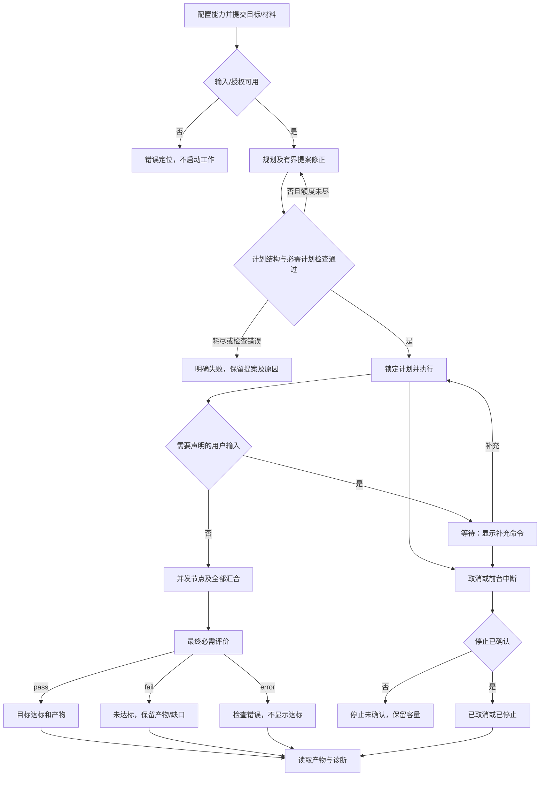
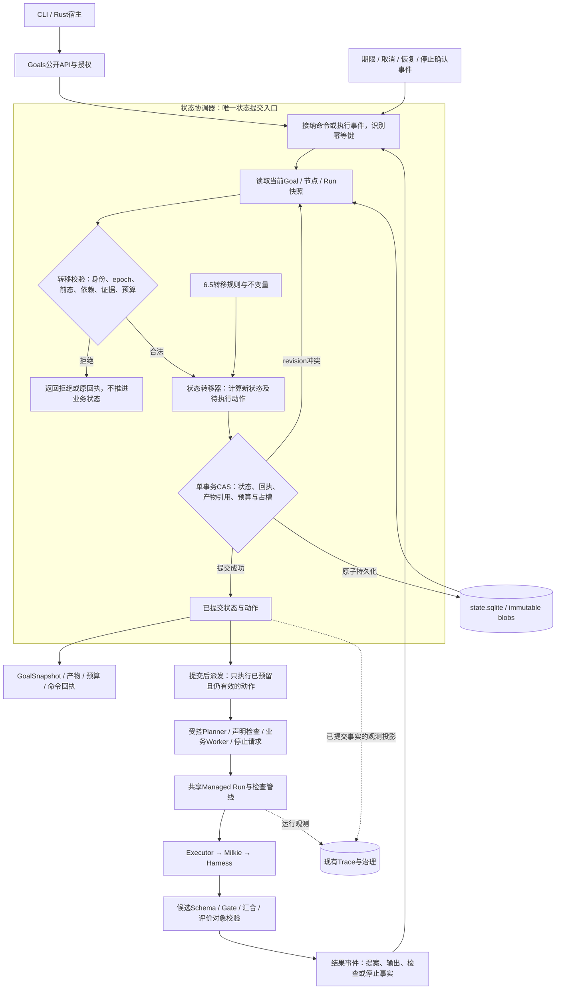

# TaskLoop #10：Goal Spec 与受检 DAG 编排

版本：L2 v0.4；状态：Draft，供技术评审，未实现、未自批。[Issue #10](https://github.com/xforce-io/taskloop/issues/10)。

L1 依据：[概要提案与归属修订](https://github.com/xforce-io/taskloop/issues/10#issuecomment-6715457806)；产品路径与验收冻结依据为提交 `16a68d48abb829dc14f13d0e0f4d3ed8c754558c` 的 v0.2 草稿。用户在确认该文档只有 L1 深度后明确要求“go L2”，本次据此完成技术规格，不重复索要 L2 编写许可，也不视为未来实现候选的人审批准。

本文件遵从用户指定十三节格式，是唯一详细设计事实源；L1 留在 Issue 评论。原18项 Sx.Ax 保留在§11，不改编号或降低要求。本次明确 v0.2 留待技术设计的契约；涉及 CLI、汇合与有界修正沿用已提出的 P1，不扩展为后台服务、条件语言或自动返工。应用深度文章质量由 [Inquiry #7](https://github.com/xforce-io/inquiry/issues/7) 负责。

## 1 背景

实现基线 `066a88eb89640e263958c88cbd87338d7208a22d`：

| 源码 | 当前事实 | 本设计的复用/改变 |
|---|---|---|
| `src/definition.rs::Bundle/State` | 固定平面 Work/Wait/Terminal | 旧契约保留，新增显式 DAG 版本，不强行将并行压成 current_state |
| `src/runtime.rs::Record/worker_loop` | 单 active Run、逐个 await phase；重开时未知工作不重放 | DAG 用节点/Run集合与受限并发；旧流程维持原语义 |
| `src/execution.rs::HostBindings/Executor/Invocation` | 受控工具、执行器、候选、取消及观察接口 | 复用 Milkie/执行器与工具桥；增加内部工作归属上下文 |
| `src/phase.rs::Bridge/run` | Schema、授权、候选保存、Gate、epoch、预算与结果接纳 | 提取共享的受控 Run 管线，不复制另一套 Harness 驱动 |
| `src/store.rs::Store/commit` | 单宿主锁、SQLite IMMEDIATE事务、revision CAS、幂等命令、immutable blob | 新增目标持久化及在线命令幂等回执；状态仍由宿主提交 |
| `src/budget.rs` | RunBudgetPolicy 与公开生效/消耗事实 | 增加目标级原子预留与并发结算，不改变旧上限 |
| `src/trace.rs` | 独立 trace.sqlite、Run关联及有界查询/治理 | 扩展归属字段与编排事件，不充当调度日志或业务事实源 |

现有源码不能直接提供 DAG 并发或 Goal 充分性检查。设计中的 API、表和状态均为新增契约，不声明已存在。

## 2 名词解释

规范名见 [名词表](../glossary.md)。本次易混关系：

- Goal Spec 是不可变输入，不是可被 Planner 修订的目标；PlanProposal 是候选，不是已锁定 PlanVersion。
- 节点是 DAG 公共单元；Worker 是节点内部成员；Run 是一次受控执行。一个节点可以有多个 Run，但首版每个必需 Worker 只执行一次，不隐式重试。
- Task 沿用一等任务含义：目标任务包含节点任务，不为每个 Worker 再暴露一个用户必须操作的 FlowInstance。Run 不等于独立业务实例。
- Evaluation 是评价内容；EvaluationReceipt 是受 Runtime 身份/版本检查接纳后的事实。评价 Worker 成功只表示产出有效评价，verdict=fail 可以与该 Worker 成功同时成立。
- `stop_unknown` 是停止事实，不是“执行失败”的同义词；它必须影响容量，即使 Goal 的业务结果已经失败。

## 3 目标与非目标

目标：CLI 与嵌入式 Rust 宿主共用一套 Goal、DAG、节点及验收核心；两种规划模式；三类图形；单/多 Worker；可取消、可诊断、可恢复且不重复业务执行；Goal 成功只能由确切产物与必需评价证明。

非目标：Web/MCP、分布式租约、动态改图、任意条件表达式、业务回边、隐式多数表决、自动循环返工、跨服务事务、通用写动作审批。TaskLoop 不实现资料分析方法或文章评分；不因一次集成成功声称 Inquiry 文章达标。

## 4 能力

### 4.1 UI/UX：CLI 主路径与状态

首版无图形页面；CLI 本身有完整用户路径，不标记为“无用户路径”。人工输出包括目标ID、当前阶段、节点进度、等待/失败原因和产物引用；JSON输出表达同一事实。



S1/S2走A–L，S3走L–N，S4走E–R，S5覆盖C–O与全程故障，S6经同义SDK路径接入应用。空配置/非法Spec就地报缺项，不启动模型；查询错误不伪装成“暂无报告”。计划锁定后不能由补充命令改目标、权限、预算或依赖。等待不占 Worker，宿主仍在前台；退出不是后台托管。实际命令和退出语义见§8。

### 4.2 产品不变量

R1 固定目标、能力、规则与接纳计划。R2 Agent提案，Runtime调度与提交。R3 节点输入输出和汇合可判定。R4 结构合法、工作成功、质量达标分别记录。R5 规划/Review/业务同受预算、身份和停止治理。R6 无未知执行盲重放，不以Trace代替状态。

本版不提供条件分支或 skipped 节点；失败依赖用 `dependency_failed` 表示不可执行，区别于已执行失败。修订必须是预先声明的前向节点。提案修正上限默认2次（初次加2次），宿主/请求可降低，不能超过2次；其他执行资源必须显式提供。

## 5 思路与折衷

| 选择 | 理由与代价 | 放弃项 |
|---|---|---|
| 同一 Runtime 内增加 Goal 编排面，共享受控Run管线 | 单一状态提交权威，复用Milkie/工具/Gate/Trace；需要将旧单Run执行责任与协调责任分开 | 应用循环start旧Flow；另一套执行器与状态库 |
| 单宿主、单Goal revision串行提交，Run可并发 | 用既有SQLite CAS保证接纳顺序，图规模有界；提交吞吐不是首版优化目标 | 分布式调度、每节点租约与多层消息系统 |
| 声明式端口及字段选择，Schema摘要相等校验 | 可以判定连接，不尝试一般JSON Schema包含关系证明；复杂映射用显式能力节点 | 表达式语言、任意JSON Patch转换 |
| 多Worker全部必需成功，纯函数汇合 | 不隐藏失败、不依赖完成顺序；聚合算法由能力注册 | 任意多数投票、模型在汇合中偷偷追加工作 |
| 有限规划修正、业务Run不自动重试 | 重复副作用和质量刷分边界清晰；失败可能需要用户显式新建后续Goal | until-success、锁定后重规划 |
| 在线CLI经宿主本地Unix Socket提交命令 | Socket属于当前前台宿主，无后台服务；宿主离线直接报错，幂等回执仍由同一状态事务保存 | 离线命令收件箱、第二CLI改业务表、隐式后台守护 |

采用JSON Schema 2020-12、JSON Pointer字符串语法（RFC6901），明确子集见§6；不宣称CWL兼容。图检查选择 petgraph 0.8.3 的拓扑排序检测环，自环同拒绝，运行时按稳定ID排序派发而非依赖库返回的任意拓扑序。其算法契约见[官方文档](https://docs.rs/petgraph/0.8.3/petgraph/algo/fn.toposort.html)。新增依赖只用于图算法，不承担持久化或执行状态。

## 6 架构

### 6.1 分层、状态转移处理与执行路径

状态协调器是唯一状态提交入口，其内部显式包含**事件接纳、转移校验、状态转移器、事务提交**。依赖调度只提出可派发动作；Planner、Worker、Gate和评价均返回候选事实，不能直接修改Goal、节点或Run状态。



处理顺序固定如下：

1. **事件进入**：提交/补充/取消命令、Planner提案、Worker结果、检查结果、超时和停止确认都进入同一协调器。执行结束不是业务状态已接纳。
2. **读快照与校验**：按§6.7核对当前身份、epoch、前态、计划/输入/证据摘要、依赖、取消与预算；幂等命令返回原回执，迟到或伪造结果拒绝。异步结果不以出生时revision是否等于当前值判断有效性。
3. **计算转移**：状态转移器按§6.5规则计算Goal、节点、Run的变更和待执行动作，包括锁定计划、ready集、失败传播、等待、最终验收、停止及容量处理。它不调用模型、工具或Executor，不在此步先做外部副作用。
4. **原子提交**：用当前revision做CAS，把业务变更、幂等回执、产物/评价引用、预算预留及占槽事实一起提交。业务接纳与停止/消耗结算使用§6.7分别定义的有效性条件；失效输出不得阻断可信收尾。冲突时重读并重新校验计算，不能拿旧决策直接覆盖；存储失败不派发。
5. **提交后执行**：只派发已提交且仍有效的动作；受控Run仍须先CAS记录started才调用Executor。派发/取消竞争及崩溃窗口按§6.7–6.9处理，不能因为图上有一条动作边就盲重放。结果再作为事件进入下一次转移。

图中反馈边表示Runtime处理事件的闭环，**不是业务DAG回边或锁定后重规划**。具体状态与合法事件见§6.5，事务/并发见§6.7，恢复见§6.9；模型Review只在声明检查点，不参与每次确定性转移。

主路径：受理并固化Spec/Profile→受控规划→结构与计划评价事件→事务锁定→原子预留与派发→接纳公共输出→必需Goal评价→事务提交终态。失败路径同样经过状态转移器：非法提案仅在上限内修正；输入/Worker/Gate失败传播；质量fail为not_met；检查error为failed/check_unavailable；取消和资源边界先停止再收束；未知停止单列并占容量。Trace失败只降级观测，不更改业务结论。

### 6.2 固定对象与归属

所有公开JSON含 `protocol_version:1`，未知字段、重复键、非法整数或重复ID拒绝。ID是1–64位ASCII字母/数字/`._-`，保留`_tl.`前缀供Runtime，用户不可使用。无跨Goal裸路径引用。

| 对象 | 必需字段与关系 | 不变量 |
|---|---|---|
| Goal Spec | `goal`文本、`inputs`对象、`profile_ref`、`planning.mode`、`limits`；workflow模式还需template_ref | 原始字节与规范化摘要均保存，不能由Planner覆盖 |
| GoalRequest | protocol_version、request_key、grant_ref、spec（Goal Spec） | 幂等及授权信封不混入Spec摘要；调用身份由宿主提供 |
| Profile锁定记录 | 逻辑id/version、goal_input_schema、能力目录摘要、Planner入口、规划补充Schema、计划/节点检查点/最终检查要求、必需输出别名及Schema、可用模板、Skill/Schema/执行器配置摘要 | 宿主注册并授权；模型不能注册新Capability或Gate |
| Capability/NodeContract | id/version/digest、kind、input/output端口、Worker成员、汇合器、确定性Gate、权限及预算策略 | work至少1个必需Worker；input类型无Worker；成员ID和公共端口固定 |
| PlanProposal | `goal_spec_digest`、`profile_digest`、`nodes`映射、`outputs`映射、`checks`映射、`template_digest`（仅模板模式） | 不是已锁定计划，非法仍保存原文及错误 |
| PlanVersion | proposal摘要、规范化计划字节、目标/目录/模板摘要、接纳检查引用、locked_at | 目标内仅1份接纳计划；锁定后不可变；plan_digest即规范化提案摘要，锁定时间与接纳回执不参与该摘要，避免循环引用 |
| 节点任务 | GoalId、plan_digest、node_id、capability_digest、依赖、公共输入摘要、节点状态、输出引用、Worker状态集合 | 一个公共输出版本；内部Worker不成为跨节点连接对象 |
| Run | 不透明run_id、GoalId、node_id或系统角色、worker_id、attempt=1、epoch、输入/能力摘要、预算、started/stop事实 | Planner修正是不同受控Run；业务成员不自动复跑 |
| Artifact | 现有ArtifactRef加公开归属元数据：goal_id、node_id、worker_id可选、plan_digest、schema_digest | 内容SHA-256按实际字节计算；候选和公共接纳输出分离 |
| EvaluationReceipt | evaluation_id、checker_id、rules_digest、subject、producer_run_id可选、verdict、evidence_refs、violations、accepted_revision | subject必须与当前检查请求完全一致，不接纳模型自编对象身份 |
| GoalSnapshot | GoalId、revision、spec/plan摘要、status、stage、outcome、nodes、waiting、artifacts、evaluations、stop、budget摘要、error | 生命周期、业务结果与停止事实独立，不靠一个completed字符串掩盖缺口 |

Profile包含固定验收要求，Planner只能选择已注册实现和连接输出，不能删除/修改要求。新目标可带 `parent_goal_id` 与显式 `imports` 列表；每个导入按所有者授权读取确切ArtifactRef，作为冻结输入。此操作必须是显式新提交，不由失败自动触发。

摘要：Artifact用原始字节摘要；Spec/目录/计划使用TaskLoop `normalized-json-v1`：重复键拒绝、对象键递归排序、依赖集合排序、保留有语义的数组顺序、以固定serde_json序列化后SHA-256。数字表示不同可得到不同摘要，不宣称RFC8785规范化兼容；编码版本随协议锁定，规范化字节保存而非重开时重新计算猜测。

### 6.3 端口、连接与Schema

端口是命名的JSON值，各自关联冻结Schema摘要，节点输入是端口名到值的对象。每个必需输入端口恰有1条绑定；可选端口可不绑定，缺省仅来自已锁定能力定义，不能由Planner任意发明。

绑定是下列tagged union：

- `{"kind":"goal","pointer":"/goal"}`：指向冻结的`{goal,inputs}`输入视图，不能读取权限/配置/凭据。Profile的goal_input_schema验证inputs，selector注册覆盖该固定视图。
- `{"kind":"node","node_id":"research","port":"analysis","pointer":""}`：指向已接受公共输出；禁止引用Worker/Run候选。
- `{"kind":"literal","value":...}`：字面值须校验目标端口Schema，受Spec/Profile允许范围约束，不能替换用户输入或证据。

pointer采用[RFC6901](https://www.rfc-editor.org/rfc/rfc6901)字符串形式：`""`选整值，转义按`~0/~1`；不支持URI fragment、通配、表达式或数组追加。非空pointer仅允许Profile显式声明的固定字段selector；每个selector给出Schema摘要及必然存在声明。首版selector仅跨required对象属性，不穿过可选属性、数组下标或动态条件Schema；需要这些转换时使用注册转换节点。宿主注册时核查selector能在该固定Schema中解析，拒绝无法证明的路径。

结构检查要求源端口或selector的Schema摘要与目标端口相等。不是一般Schema兼容推理；不同Schema需要显式转换节点。派发前仍用实际值校验整个节点输入，防止上游输出或selector声明与事实不符。能力Worker输入映射和汇合输出同样做实际Schema验证。

支持JSON Schema 2020-12的本地冻结资源，由现有jsonschema库验证。`$ref`只解析包内已锁定资源，禁止网络解析；`$dynamicRef`、自定义必须词汇及依赖运行时外部资源的Schema首版拒绝。format不作为隐式业务真实性检查。明确这是产品支持子集，不声称完整工作流标准兼容；[标准依据](https://json-schema.org/draft/2020-12/json-schema-core)。

### 6.4 计划检查、模板与最终要求

PlanProposal示意，数值与业务端口仅作例子，不是执行默认值：

```json
{
  "protocol_version": 1,
  "goal_spec_digest": "<sha256>",
  "profile_digest": "<sha256>",
  "nodes": {
    "analyze": {
      "capability_ref": "analysis@1",
      "depends_on": [],
      "inputs": {"question": {"kind":"goal","pointer":"/goal"}}
    },
    "write": {
      "capability_ref": "write@1",
      "depends_on": ["analyze"],
      "inputs": {"analysis": {"kind":"node","node_id":"analyze","port":"analysis","pointer":""}}
    }
  },
  "outputs": {"report": {"node_id":"write","port":"report"}},
  "checks": {"report-quality": {"checker_ref":"quality@1","targets":["report"]}}
}
```

nodes为映射，避免重复逻辑ID和位置歧义。depends_on可包含纯控制依赖，但所有node绑定的上游必须显式列入；禁止引用无依赖节点。输出与最终check都只能引用存在且契约正确的公共输出；每个工作节点必须能到达目标输出或必需检查所消费的输出，不允许孤立的“顺便做一下”工作。连接边与控制边共同参与无环验证。

| 类别 | 拒绝条件 | 结构化反馈 |
|---|---|---|
| format | 协议/字段/类型/重复键/ID/容量错误 | code、category、JSON Pointer path、message |
| cycle | 环或自环 | 指向相关depends_on的path及有限cycle节点集 |
| reference | 未知节点/端口/checker/输出，孤立工作 | 精确输入绑定/输出位置及引用身份 |
| input_connection | 必需端口未绑、多绑、selector非法、Schema不匹配 | 目标端口path、expected/actual摘要 |
| capability_permission | 目录外能力/Worker/工具、未授权资源、隔离/停止能力不足 | 能力path与拒绝原因，不输出凭据 |
| budget_acceptance | 超预算、缺必需评价/输出、模板约束不符 | 对应limit/check/template位置 |

硬容量作为HostConfig显式上限：`max_plan_bytes`、`max_nodes`、`max_edges`、`max_workers_per_node`。库安全边界分别不超过4MiB/256/4096/32，宿主必须选不高于安全边界的值并公开生效来源；这不是业务运行额度。超出在解析或派发前拒绝。

workflow模板是冻结骨架：命名节点/能力允许集合、必需依赖、输入输出与检查连接、可填字段；模板只能缩小能力范围。首版不允许Planner增加/删除骨架节点或边；自主模式在目录与预算内建图。两者校验及执行完全相同。模板不是预先批准任何输出质量。

结构合法后执行Profile声明的plan检查；规则检查器有固定期限，自定义/模型检查器用受控Run，不能直接调模型。plan检查subject绑定本次proposal_digest；fail加入修正反馈，error不当成“请再写一版”自动耗费模型，结束为检查错误。修正次数=新提案数−1，最大2；错误列表最多100项并标truncated，完整原提案保留。所有提案及自定义/模型plan检查均计Run/时间/工具预算（内建规则只计检查消耗）；只有结构与必需plan检查都pass才能锁定。

### 6.5 生命周期、工作结果和停止事实

Goal三个维度分离：

- `status`: `running | waiting | stopping | stopped | blocked | finished`。
- `stage`: `planning | plan_checking | executing | goal_checking`，终态保留最后阶段。
- `outcome`: `null | achieved | not_met | failed | cancelled`；只有finished可非null，且finished必须非null。

`running`包含有可派发工作或工作/检查在途；`waiting`仅在无在途/可派发工作且存在有效输入请求时成立。分支A等待、分支B仍执行时，Goal为running，waiting列表仍包含A，不能误报全局等待。stopped是宿主主动暂停且所有停止已确认；不是用户取消。blocked保留需明确处理的故障及未知停止，不在循环里自动重试业务。

| 事件/前置 | 合法转移与可观察结果 | 禁止结果 |
|---|---|---|
| 提交合法Spec | running/planning，创建幂等回执 | 未受理先启动Planner |
| 合法提案及plan检查pass | 同事务写不可变PlanVersion，running/executing | 边执行边更换候选计划 |
| 所有剩余可行工作等输入 | waiting，暴露等待ID/Schema/期限 | 占Worker或把依赖失败当等待 |
| 有效补充输入 | 接纳input节点输出，重新计算ready集 | 修改冻结Spec/计划或复跑已执行Worker |
| 等待期限到达且nonce未消费 | failed/input_timeout意图，节点失败/依赖传播；停止收束后finished/failed | 仅拒绝补充却永久waiting |
| 所有业务输出已接纳 | running/goal_checking | 直接achieved |
| 所有必需最终评价pass且所有Run已停止/结算 | finished/achieved，绑定输出与EvaluationReceipt | 旧产物评价冒充当前产物 |
| 完整有效的评价有fail且要求阻断 | 设置terminal_intent=not_met，阻止新派发并停止其他在途Run；全部停止/结算后finished/not_met | 尚有活动Run就直接终态，自动再开计划或改低要求 |
| 检查error/必要工作失败/预算耗尽 | 停止相关在途工作，确认后finished/failed；reason区分check_unavailable、worker_failed、budget_exhausted | 用not_met隐藏基础设施错误，或fail伪装成pass |
| 用户取消 | stopping，阻止新派发；全确认后finished/cancelled | 仅CLI返回就宣称已取消 |
| 前台SIGINT/SIGTERM或显式stop | stopping(intent=pause)；全确认且无丢失工作则stopped | 宣称退出后后台运行 |
| 任何停止未确认 | blocked或stopping，`stop.pending_runs`列明；继续占对应容量 | 删除active记录或释放槽位 |

节点状态：`pending → ready → running → checking → succeeded`；`input`节点为`pending → waiting_input → succeeded`。失败结果为`failed`，不可执行后继为`dependency_failed`，主动取消为`cancelled`。`stop_unknown`和`interrupted`是显式节点/Run处置状态，不被折叠进succeeded。状态与输出接纳同事务更新。不能从failed回ready；后续继续需新Goal。

Run阶段：`reserved → started → execution_returned → checking → settled`。`execution_returned`不等于可释放：仅在适配器确认无原生执行存活时才标`native_stop_confirmed`。结束事实包括ExecutionOutcome、候选摘要、Gate结果、预算及停止事实；这些字段分别保存。过期epoch的业务输出只记迟到处置，不改有效节点输出；同一Run的可信停止确认及消耗结算仍按§6.7处理。

失败传播：某节点必需Worker失败或公共Gate失败，阻止其后继；所有后继原子或分批CAS标dependency_failed且列根因，永不挂成waiting。与其无依赖的分支已在途工作允许有界收尾并保存候选；不再为已经不可能完成Goal而派发新业务工作。未知原生停止保持容量。第一决定性失败与后续收尾错误均保存，不能被后到成功覆盖。

### 6.6 多Worker汇合与输入等待

NodeContract锁定必需成员ID、各EntryContract、从节点输入到成员输入的绑定、公共输出Schema、纯汇合器ID/digest及节点Gate。运行成员在全局/目标并发限制内派发，不承诺同时获得全部槽位；避免“等齐N个槽位才启动”死锁。首版没有可选成员、best-of-N或内部再规划。

所有成员均通过各自Schema及Entry Gate后，按成员ID排序提供给汇合器；不能依赖完成先后。汇合必须无隐藏I/O且结果确定；首版进程内汇合仅提供Runtime内建的有界`object-by-worker`，不注册任意Rust闭包。需要自定义转换/汇合时注册显式能力节点，经同一受控Executor执行和停止；其版本、输入输出、工具权限及预算均锁定，不能隐藏调用模型或自行更改计划。汇合输出再经节点Schema和纯规则Gate；需真实模型评价时声明显式评价节点/最终checker，不在回调里隐藏模型调用。

任一成员失败：不形成公共成功输出，保留各成员成功输出与候选作为诊断；取消未结束成员并按停止事实结算。内建汇合非法输出为节点契约失败，不是质量未达标。进程内规则只允许Runtime内建Schema/身份/一致性检查，输入、Schema资源及结果容量受宿主限制；不接受带任意用户代码的规则回调。`max_rule_check_ms`用于计量和超额判错，不承诺Rust同步代码可被timeout硬终止。需要可取消或自定义逻辑的领域规则，作为显式受控能力/检查Run，沿用Executor的取消、stop_or_confirm与停止未知协议；不新增一套规则进程平台。

等待由显式`kind=input`能力节点表达，输入Schema、最大等待时长及允许补充者在Profile锁定；没有Worker，不占并发。依赖满足后Runtime生成 `wait_id`、nonce、target节点、payload_schema_digest、expires_at。客户端提交wait_id/nonce/expected_revision及payload；校验后将有效输入作为Artifact与SignalFact同事务接纳，节点succeeded、后继ready。重复同键返回同回执，过期或已消费nonce拒绝。`expires_at=min(wait_created_at+profile.max_wait_ms, goal.deadline)`，事件和signal事务都以提交时的同一宿主时钟检查。到期事务若先提交，节点failed/input_timeout、nonce失效并传播dependency_failed，Goal停止收束为failed/input_timeout；signal若在到期前先提交，到期事件幂等无效。宿主离线跨过期限，重开先处理到期再派发；不能只拒绝晚到signal而继续waiting。规划阶段等待到期同样为failed/input_timeout，无图可传播。有效输入可含领域批准的URL/文本，但不新增执行权限或修改图。

Planner输出采用PlannerResult联合类型：`{protocol_version:1,kind:"proposal",proposal:PlanProposal}`或`{protocol_version:1,kind:"needs_input",input_schema_ref,reason}`。后一种只能选Profile预注册的规划输入Schema，Runtime生成等待身份/nonce，不接受模型伪造这些字段；通过同一等待机制保存补充事实。每次Planner调用都计尝试（包括needs_input、非法输出和工具失败）；总调用上限为1+max_revisions，收到补充后无剩余尝试则planning_exhausted，不借等待重置时间或Run预算。业务Worker没有任意“请重跑我”结果；执行中发现缺证据可输出领域不足评价，或走计划中已声明的后续input节点，不能临时插节点。

### 6.7 调度、容量与每次转移检查

一个宿主持有Store所有权锁，一个协调器串行处理命令与Run完成事件，异步执行体可并发。就绪选择按Goal队列轮转、同Goal按node_id/worker_id稳定排序；独立Goal不能被大量节点永久饿死。全局槽位与目标槽位都以**持久化的已预留/在途/停止未知Run**计数，内存Semaphore只作加速，不能成为唯一事实源。

业务派发/输出接纳在SQLite事务中核对：owner/grant、Goal revision与epoch、spec/plan/capability摘要、节点/Worker前态、依赖与输入摘要、cancel/stop意图、wall期限、预算/容量预留、命令或结果幂等标识。revision是提交时读取最新值并CAS，不要求异步Run出生时的Goal revision等于当前值；无关兄弟节点推进不能使正确结果过期。有效性由epoch、目标节点前态与确切输入/能力/计划摘要决定。字段匹配失败产生有限拒绝原因，不调用模型协商。模型Review仅在Profile声明的plan/checkpoint/final检查点发生。

停止与消耗结算是不同的事件类别：依据持久化RunId、该Run原始epoch、Executor绑定指纹、唯一预留账目和可信适配器回报验证，不要求其epoch仍等于Goal当前epoch，也不受已到达的wall/active/transition预算拒绝。取消、故障、超时、终态后仍可接纳这些可信收尾事实，但不得借此接受业务输出、重新派发或改变已定质量结论。按Run及结算序号幂等更新停止/实际消耗、释放对应预留与槽位；相同确认不释放两次，陌生Run或错误适配器无权确认。业务输出与收尾同一消息返回时，分项验证：旧输出拒绝，合法停止/消耗仍结算。

派发前同事务写RunId、started=false、输入/能力指纹、预算预留和占槽事实；执行体必须先CAS置started=true后才调用Executor。事务失败不启动。每个RunId最多1个本地执行体，重入事件不能再次spawn；跨宿主恢复遇started=true按§6.9处理，不靠outbox自动重发。

Run完成消息只是候选通知。接纳事务分别执行业务和结算校验，将被允许的Gate结果/输出引用、可信结算、节点汇合资格及revision一并提交；没有业务接纳权不等于没有停止结算权。产物blob可在事务前按hash写入，未被引用的blob是孤立内容，不能作为已接纳业务证据。节点全部成员结果并发返回时只有一个CAS更新赢，其他按最新记录重新校验后提交；不能覆盖整份旧Goal JSON而丢失兄弟结果。

### 6.8 评价请求、接纳及最终完成

Profile固定 `CheckRequirement{id, phase, checker_ref, rules_digest, target_outputs, required}`；本版最终check全部required，不支持Planner把required改false。`phase=plan|node_checkpoint|goal_final`。plan目标为proposal_digest；node检查绑定节点输出；goal_final绑定Goal Spec、PlanVersion和全部目标输出的确切ArtifactRef/Schema摘要。

检查器分两类：Runtime内建确定性检查产生CheckResult；自定义领域规则或模型检查由受控Run产生按Schema验证的Evaluation候选，不注册任意进程内回调。两者都由Runtime生成CheckRequest及receipt身份。模型输入可以读固定规则、目标、受授权证据和确切目标产物；不能通过伪造evaluation_id/rules_digest/subject来确认自己。

Evaluation候选内容为`verdict(pass|fail|error)`、逐项结果、evidence_refs及violations。逐项ID集合由冻结rules_digest指向的检查规则声明，必须恰好覆盖必需项且无重复；overall verdict以error优先于fail、全部pass才pass的一致性规则校验。领域可附加更严格检查，不能让overall pass掩盖单项fail。Runtime根据CheckRequest补充可信身份，校验返回值只指向该请求允许的证据，并持久化EvaluationReceipt。格式无效、回调异常或缺失必需结果都记check error，不让模型修补身份成为合法。Checker的独立上下文/禁止工具等要求由Profile显式注册且纳入能力验证；执行器不支持隔离时在规划前拒绝，不只是提示词自称独立。

CheckRequest必需身份为goal_id、goal_spec_digest、plan_digest（plan检查改为proposal_digest）、check_id、rules_digest、target_artifact集合、epoch及不可复用nonce；issued_revision用于审计，不以兄弟节点导致的revision增加否定有效评价。接纳时重新以当前revision做CAS，同时确认epoch/nonce/target集合仍有效。CheckRequest只授权读取其target及明确允许的证据。

node_checkpoint必须由**同一DAG里的显式评价节点**实现，不生成隐式屏障图。Plan的对应check映射增加`evaluation_node_id`：必须引用一个匹配checker能力的评价节点，该节点的输入绑定所有targets的确切产物，其depends_on显式包含这些生产节点；需要被阻断的后续工作在自身depends_on显式依赖该评价节点。Runtime只对这张完整图校验无环及调度，不依据“相关后继”猜测加边。比如A→B后统一检查A/B，图为A→B、A/B→C(评价)、C→D，不向B反插C。模板约束和Profile固定的必需检查覆盖策略在接纳时校验，不允许遗漏声明要求的阻断依赖。

评价节点的有效EvaluationReceipt与节点成功在同事务接纳；checkpoint verdict=fail时该事务同时设置terminal_intent=not_met并关闭新派发，因此后继即便依赖succeeded也不能起跑。error意图为failed/check_unavailable。其他已在途分支都进入停止收束，未知停止仍占容量，全部确认/结算后才提交最终outcome。普通“评价→修订”节点不绑定阻断checkpoint，verdict=fail作为有效数据继续既定前向修订；两种角色由冻结Profile和check映射明确区分，不在运行时切换。

Plan检查与goal_final是固定阶段检查：分别在锁定前、所有DAG节点成功且无在途业务Run后运行，不产生中途隐藏的图依赖。plan/goal_final映射禁止evaluation_node_id，node_checkpoint映射必须有该字段；这些phase对应关系由Profile锁定并语义校验。

最终判定：全required receipt存在、subject/规则/产物摘要匹配且verdict全pass，才可achieved。任意真实fail设置not_met意图并按停止收束协议完成；任意error或缺receipt不能成功，即便另一个checker通过。复合结果同时保留质量缺口和基础设施错误，outcome为failed、reason=check_unavailable；没有完整检查不能宣称已证明不达标或达标。

初稿评价fail可以是一个**执行成功的评价节点输出**，后续既定修订节点消费它；这不是DAG回边，也不会触发Runtime自行重新写作。最终check消费最终稿，禁止用初稿的pass替代。通用核心检查绑定与必需结果，不判断文章语义规则内容。

### 6.9 持久化、崩溃窗口与停止

state.sqlite v2在同一库新增Goal相关存储，旧executions/commands/artifacts/definitions不重写：

| 存储对象 | 关键键/内容 | 提交约束 |
|---|---|---|
| goals | goal_id、owner、request_key、request_fp、revision、protocol、冻结Spec/Profile、GoalRecord | UNIQUE(owner,request_key)，revision CAS；GoalRecord含有界节点/Run/预算账目 |
| goal_plans | goal_id + plan_digest，规范化字节及锁定检查 | 每Goal最多1份accepted，提案另列历史 |
| goal_command_receipts | owner + goal_id + kind + request_key、fingerprint、固定响应/错误、applied_revision | 在线命令与业务变更同事务；同键异参拒绝；无离线命令表 |
| goal_artifacts | artifact_id→goal/node/worker归属、plan/schema摘要 | 与公共输出接纳同事务，复用blob存储 |
| goal_checks | evaluation_id、请求subject、结果/候选摘要、接纳revision | 不能覆盖旧检查，修订产生新对象 |

不引入每个Worker一套独立Flow表，不把Trace当事件溯源主库。GoalRecord容量由图/Run/产物数量上限约束；工具大内容放受限blob，Trace内容依现有政策，不无限膨胀Goal行。高频预算准入在同一Store提供专用事务操作，不要求每次复制整份旧快照。

| 崩溃窗口 | 重开时的事实与动作 |
|---|---|
| 预留事务前 | 没有Run，不存在待重放工作 |
| 已reserved但started=false | 确认无调用发生后，可在相同RunId/预算预留下继续首次启动；先检查指纹、取消和期限 |
| started=true，未持久化执行结束/停止确认 | 标interrupted+stop_unknown，epoch失效；调用原受信适配器stop_or_confirm；不重跑 |
| 原生结束已确认，但候选/Gate结果未完整提交 | 不能猜测成功；标interrupted。已有内容保留，不重新执行模型/Gate来伪造旧成功；显式后续Goal处理 |
| 节点/评价接纳事务已提交，响应未送达 | 按已提交事实和幂等回执返回，不再执行或推进两次 |
| blob已写但接纳未提交 | 孤立blob不算Artifact；可按既有安全回收规则处理，不纳入目标成功 |

cancel使Goal epoch递增、持久化intent、阻止新派发，再取消在途Token并请求native stop。每个Run确认后分别释放容量/结算，不能等一个全局bool覆盖全部。收尾窗口沿用现有15秒上限，并对剩余工作明确pending；超过窗口返回停止未确认，原始槽位保留。取消后的旧Run停止回报按其原始执行身份结算，不因Goal新epoch或期限而丢弃。之后仅允许对同一未知Run进行有界stop_or_confirm探测，不是再执行；不清零预算或主动重放。

前台stop/SIGINT的intent为pause，不是cancel。如果只存在等待/未启动工作且全部停止事实明确，进入stopped，后续`resume`继续未启动工作。若已启动工作被中断并且未产生可接纳终结结果，确认停止后仍blocked/interrupted，不能把它恢复成ready；用户需显式新Goal并关联已接受产物。SIGKILL后的同类窗口相同处理。旧Executor绑定丢失或指纹不同使停止不可确认，保持blocked；不能换一个执行器的stop声明清除事实。

### 6.10 预算与并发一致性

`max_transitions`仅计成功提交的**业务状态边**：Goal(status,stage,outcome)元组变更计1，节点status变更每节点计1，Run阶段变更每Run计1；同事务多对象边数相加。命令幂等重放、CAS失败、Trace、工具/字节计数更新及停止/预算结算计0。没有状态变化的事件计0。开始停止收束后仅允许终结/故障处置，不能用此通道派发业务；这些必要收尾边计入独立cleanup_transitions诊断，不因业务转移额度耗尽而拒绝。派发或业务接纳若会超过剩余额度，原事务不接纳该业务变更，另提交budget_exhausted停止意图并收尾。计数与状态同事务，重开不清零。

Goal `limits`显式包含：`max_wall_ms`、`max_active_ms`、`max_runs`、`max_transitions`、`max_tool_calls`、`max_total_candidate_bytes`、`max_concurrent_runs`。规划另含`max_revisions`（0–2）、`max_planning_ms`；每个能力必须有显式RunBudgetPolicy及规则检查期限，DAG路径不回退旧240秒/40次legacy默认值。生效上限取请求、授权、Profile与宿主适用硬上限的最小值，并记录每项来源。

- `max_wall_ms`从Goal受理起连续计算，等待/停止/宿主离线不暂停；重开不重置。
- `max_active_ms`按所有Run准备/执行/检查消耗求和，并发两Run各100ms计200ms。不是“有工作时的墙钟”；保留旧Flow原算法不重解释旧数据。
- 派发前原子预留该Run的执行与Gate最坏时间分配；`used + reserved ≤ effective_limit`。有其他Run在途时额度被预留只导致排队；全部结算后不足以分配正执行/检查额度才明确budget_exhausted，不永久排队。
- 候选总容量同样先按Run额度预留、逐次实际写入计量，覆盖候选/附件；被拒写入不能越界后再补账。相同内容多次提交的计费规则为“每次已受理字节”累计，公开logical accepted bytes与admitted bytes，避免去重使探索无界。
- 工具总调用在ToolBridge准入同事务增加Goal与Run计数，受理失败也计入；预算拒绝只计rejected，不当作已发起。预留提交额度仍包含在max_tool_calls内；每个Run受自身policy控制，Goal可剩余但不能突破Run上限。
- `max_runs`包括每次Planner、每次模型plan Review、业务成员与最终模型评价，派发即计且取消不退款；纯规则检查不是模型Run，但消耗明确check/active时间。接纳计划前按Worker展开计算所需Run上界并保留最终必需评价额度，不能把业务塞满后才发现无钱检查。
- 执行器报告模型迭代支持能力。要求显式模型迭代上限但执行器不支持验证时拒绝启动；实际模型迭代未知保留unknown，不填0，不把工具调用数等同模型次数。首版不承诺不能可靠测量的token或货币成本硬上限。

Run结算必须有停止事实；native_stop未知时保留槽位及未结算时间/容量预留，已确认发生的调用/字节不会退款。取消/超时后的尾部模型用量仍标未知或实际值，不能在进程未停时“归还全部预算”。规则检查同样有受控时间分配。超时触发停止不等于瞬间能够停止原生执行，停止事实独立公开。

### 6.11 Trace与公开诊断

复用现有查询/导出/内容政策，新增事件的data归属：goal_id、plan_digest、node_id、worker_id、role、evaluation_id可选；同一Goal共享trace根，Run/Agent/工具继续形成子Span。兼容现有TraceEvent必需execution_id字段，DAG模式其值为GoalId，并在data显式`execution_kind=goal`；state_id使用保留的`_tl.node.<id>`或`_tl.planner`等映射，公开Artifact元数据提供真实node_id，不要求应用解码state_id。

公开编排事件包括goal.admitted、plan.proposed/rejected/locked、node.ready/started/accepted/dependency_failed、check.accepted、goal.finished及stop.pending/confirmed。事件由已提交业务事实投影，丢失可查GoalSnapshot和检查记录；不能仅因有一条goal.finished Trace就提交Goal成功。Trace无法持久化显示degraded/complete=false，业务状态仍按真实接纳决定。业务历史保留Spec/计划/Run/检查/回执，不依赖Trace保留期，敏感内容按既有TracePolicy处理，不将原始材料全文强塞观测。

## 7 模块

下表定义责任与依赖，不是实现函数清单或开发TODO。

| 模块/公开面 | 拥有的责任 | 不得拥有的责任 |
|---|---|---|
| orchestration contract/registry | Goal Spec、Profile/Capability/模板锁定、Schema和计划校验 | 按模型文字直接派发，动态注册任意工具 |
| Goal协调器 | 命令接纳、revision/epoch、就绪集、失败传播、终态判定 | 执行来源内容或领域质量打分 |
| 调度与共享Managed Run管线 | 槽位/预算预留、受控Executor/ToolBridge、候选/Gate、停止事实 | 另建Milkie适配器、按Trace推断业务完成 |
| Node汇合/评价接纳 | 公共输出与EvaluationReceipt、证据归属验证 | 自动改图、降低规则、隐藏模型调用 |
| Store | 事务、幂等回执、冻结对象、内容寻址和恢复 | 让CLI客户端直接改Goal业务状态 |
| CLI/Goals SDK | 输入校验、可信调用身份、公开查询/命令/产物 | 独立的业务状态机、手工tick |
| Trace/预算公开投影 | 复用现有查询导出治理，增加Goal关联与预留事实 | 作为成功或停止的唯一证明 |
| Inquiry领域包 | 研究工具、方法、端口/Schema、写作与质量规则 | 重新实现通用调度或访问TaskLoop私有表 |

旧Flow和新Goal共享底层Run服务但有独立协调记录。legacy Flow仍每实例最多1个在途阶段、保持旧语义；DAG可以多个成员并发。全宿主共享容量，旧Flow活动也计入新协调器的全局槽位，不能用两套池各自突破宿主上限。未启用orchestration的旧构造函数保持旧串行行为。

## 8 API/CLI

### 8.1 Rust SDK

新增公开接口为协议草案，名字固定以供实现与消费方评审；本节不宣称代码已提供。

| 接口 | 输入/返回与语义 |
|---|---|
| `Runtime::open_orchestrated` | `(RuntimeOptions, Vec<Definition>, HostBindings, OrchestrationRegistry, OrchestrationOptions, Option<TraceSetup>) → Runtime`；共享旧Store及执行器，显式启用Goal；不增加现有RuntimeOptions必填字段破坏结构体调用方 |
| `Runtime::goals` | `Result<Goals>`；未启用时返回unsupported_mode，不猜配置 |
| `Goals::submit` | `(GoalRequest, &Caller) → GoalReceipt{goal_id, revision, replayed}`；受理即后台协调**在当前宿主进程内**推进，不要求调用方tick |
| `Goals::get/plan` | `(goal_id,&Caller) → GoalSnapshot/LockedPlan`；授权只读，plan尚未锁定有明确not_ready |
| `Goals::signal` | `(goal_id, GoalSignalRequest,&Caller) → CommandReceipt`；wait_id/nonce/revision校验见§6.6 |
| `Goals::cancel/stop/resume` | `(goal_id, request_key, expected_revision,&Caller) → CommandReceipt`；stop为pause，cancel为业务取消；resume只恢复安全的未启动工作，不复跑interrupted |
| `Goals::read_artifact/evaluations/budgets` | 使用opaque ID及Caller；归属/确切版本检查；预算包含used/reserved/available与来源 |
| `Goals::trace/export_trace` | 与现有Trace查询/导出契约同义，按Goal授权聚合Run，不引入另一Trace平台 |
| `GoalClient` | 无宿主所有权的本地客户端；只读公开投影，经宿主本地Socket提交在线命令并读回执；不得写业务库、spawn工作或运行协调器 |

OrchestrationRegistry在构造时注入能力、Profile、模板、规则与汇合器；现有HostBindings仍注入Executor、DomainTool、DomainGate、Grant。新 `GoalGrant` 显式允许Profile摘要、能力集合及GoalLimits，引用原有受限工具授权，不靠旧Grant.definitions为空推断“允许任意Profile”。Caller的grants同时匹配；第三方HTTP输入不能反序列化为可信Caller。

原EntryContract.input_schema用于Worker入口；公共节点端口与Worker入口的输入封装在能力注册时锁定，不能把不兼容数据硬塞给旧入口。DAG Worker沿用EntryContract中的工具/Skill/输出/Gate/附件声明，但其旧Flow.requires必须为空；跨节点依赖只由Plan连接与Artifact作用域提供，不能混入旧state/visit历史选择。新的stage_input封装由注册Schema明确验证，ToolContext.inputs保留冻结Goal输入，accepted仅含本次绑定允许的上游/导入产物和自身允许事实。内部ManagedRun管线通过归属适配器读写Goal或Flow记录，不直接复用写死单active/current_state的Bridge实现。Invocation仍有唯一execution_id/run_id、stage_input、skills、schemas、work_dir、budget；新工作归属通过新增可选context字段或内部上下文传递，保留旧序列化字段含义，不要求Milkie理解DAG。领域ToolContext增加只读节点归属和确切授权Artifact视图，工具不能由归属字段获得新权限。

### 8.2 CLI命令、配置与输出

统一语法：

```text
taskloop goal run       --config HOST.json --spec GOAL.json [--json]
taskloop goal resume    GOAL_ID --config HOST.json [--json]
taskloop goal get       GOAL_ID --store DIR [--json]
taskloop goal plan      GOAL_ID --store DIR [--json]
taskloop goal signal    GOAL_ID --store DIR --request SIGNAL.json [--json]
taskloop goal cancel    GOAL_ID --store DIR --request-key KEY --revision REV [--json]
taskloop goal stop      GOAL_ID --store DIR --request-key KEY --revision REV [--json]
taskloop goal artifact  ARTIFACT_ID --store DIR --output FILE [--json]
taskloop goal budget    GOAL_ID --store DIR [--json]
taskloop goal trace     GOAL_ID --store DIR --after CURSOR --limit N [--json]
```

run/resume是前台宿主，持有Store独占锁；第二个宿主得到already_running且不重启工作。get/plan/artifact/budget/trace为只读Client；signal/cancel/stop为在线命令Client，不获得宿主锁、无模型或Worker生命周期。CLI可在等待时显示另一终端的具体补充命令；不要求用户打开SQLite或编辑内部状态。

HOST.json指定store_dir、已打包Profile/能力工厂ID、Skill/Schema资源根、显式Milkie配置、GoalGrant、宿主容量/TracePolicy。解析不执行安装脚本，不自动发现用户凭据，不允许Agent输入任意本地模块路径。通用CLI提供随包的最小文档审阅Profile；应用自定义Rust能力由应用打包注册，可复用同一CliDriver或SDK（Inquiry Web仍是应用入口），不会声称一个JSON配置能加载任意未编译Rust工具。

客户端仅在同一OS用户的0700Store目录工作；GoalClient按本地UID映射可信身份，不能从请求JSON指定principal。嵌入应用继续由宿主提供Caller与授权；首版不承诺跨OS用户/远程客户端。持锁前台宿主创建`owner.sock`并处理在线命令；这是该进程内的本地控制入口，不是独立后台服务。客户端不打开可写数据库、不写收件表。宿主使用OS peer UID与Store所有者核对身份，并以宿主配置映射Caller/Grant，不接纳请求自报的授权。

Socket采用长度前缀JSON请求/响应帧（单帧不超过4MiB），请求包含protocol_version、kind、goal_id、request_key、expected_revision与payload；不提供任意方法/SQL/路径调用。宿主提交命令回执后返回，响应丢失按同键重试。宿主离线或Socket不可连接返回host_not_running，**没有排队成功、延迟取消或自动启动**；遗留Socket不能作为存活证明，只有取得Store锁的宿主可清理/重建。readonly查询可通过公开GoalClient读取受支持版本的SQLite投影，不获得协调或写状态权。

每个变更请求必须request_key；同owner、Goal、kind、key及相同规范化payload复用固定回执。同键异参request_conflict。expected_revision只约束一次接纳，命令已经生效后的同键重试先返回原回执，不因旧revision误报失败。不同命令的冲突需刷新后以新键重提，不能自动覆盖用户新意图。

`--json`的run/resume输出NDJSON，每条含`protocol_version,type,goal_id,revision,data`，type为goal.admitted/progress/command.receipt/goal.snapshot/error；stdout只有机器记录，日志写stderr。其他命令输出单JSON响应。`ok`只表示API操作成功，不代表Goal成功；必须读取outcome/check结果。人工显示隐藏内部Worker实现细节，但允许按需展开Run诊断。

run/resume结束码：0=achieved；2=输入/权限/配置/协议拒绝；3=规划或业务执行失败/预算耗尽；4=not_met；5=检查不可用；7=cancelled；8=blocked/stop_unknown；130=SIGINT且停止已确认。SIGINT后停止未知必须8，不能130暗示安全结束。waiting时前台继续，不自动退出；显式pause完成的stop命令自身返回0且receipt状态applied。普通查询成功均返回0，即便所查Goal未达标，业务结论在内容中；查询失败非0。宿主离线的写命令返回6/host_not_running，明确未受理且无延迟生效。

产物导出按opaque引用校验，输出路径由用户明确指定；不接受模型提供的宿主路径。覆盖现有文件需显式`--overwrite`，避免“读产物”意外覆盖用户文件。相同内容可直接返回already_exported，不重复执行模型。

### 8.3 机器可读结构契约

本文件对应的形状事实源为以下JSON Schema，语义约束仍由本L2相应章节定义；不是产品实现代码：

- [GoalRequest Schema](10-goal-dag-orchestration/contract/goal-request.schema.json)：请求信封与Goal Spec；profile_ref在受理时解析并冻结。max_revisions缺省时由Runtime规范化显式填2，Schema的default仅是注解，不能假设验证库自动填值。
- [PlannerResult Schema](10-goal-dag-orchestration/contract/planner-result.schema.json)：Planner完整结果联合类型；proposal内嵌下述提案形状，needs_input只返回注册Schema引用和理由，不含可信等待身份。
- [PlanProposal Schema](10-goal-dag-orchestration/contract/plan-proposal.schema.json)：节点、连接、输出及检查形状；重复JSON键、引用/无环/连接/权限/预算约束还必须经过§6.4的语义检查，不能只调用Schema库。
- [Evaluation候选Schema](10-goal-dag-orchestration/contract/evaluation-candidate.schema.json)：模型只能返回评价内容，不能提供受信Receipt身份；结果项集合和整体verdict一致性由§6.8检查。
- [非规范性请求示例](10-goal-dag-orchestration/contract/goal-request.example.json)：仅演示文档审阅业务；其中数值不是宿主默认值、真实运行授权或Inquiry研究配额。

Schema中的正整数上限为2^63−1以匹配SQLite安全计数，实际时长还需检查单调时钟可表示范围、容量和授权上限。所有包含引用的Schema资源由注册包内锁定解析，不在验证时请求网络。

### 8.4 错误与版本

错误结构复用`code/subject/message`，新增`category,path,expected_revision,actual_revision,retryable`可选字段；path是本请求JSON Pointer，不是文件系统敏感路径。稳定类别：input_invalid、capability_denied、plan_invalid、planning_exhausted、schema_mismatch、dependency_failed、check_unavailable、goal_not_met、budget_exhausted、revision_conflict、request_conflict、signal_expired、stale_result、stop_unknown、host_not_running、storage_incompatible、host_binding_changed。

retryable只表示同一只读/幂等命令可重读或安全重提，不授权自动重跑业务。未知协议/更高storage版本直接拒绝；不尽力猜字段。CLI与SDK持有同一校验与错误定义，退出码映射只在CLI，核心不依赖进程退出码推进。

## 9 边界

### 9.1 权限与不可信内容

提案只引用已锁定目录；能力允许工具集合取Profile、GoalGrant、HostBindings交集。计划检查不得把模板、文字理由或模型自报“已获授权”当权限。上游产物/网页/引用正文都是不可信数据，不得成为宿主命令、Skill包安装或注册代码。仅公开受授权的Artifact，不暴露Run工作目录或配置凭据。

计划校验器/运行协调器是可信核心；注册的宿主能力必须遵守Executor和停止契约。对可控适配器做恶意/异常返回测试，但不声称可用Rust类型验证任意宿主插件没有恶意。进程内扩展边界按§6.6限制为Runtime内建检查/汇合；自定义逻辑通过已注册受控能力实现，复用Executor停止事实，不能仅因Rust回调外层timeout就宣称终止。

### 9.2 状态与并发不变量

1. 每Goal最多一个accepted PlanVersion，只有它可派发业务。
2. 同一节点/Worker至多一个started Run；重复完成消息不会重复接纳。
3. 公共输出仅来自所有必需成员已接受且节点Gate通过的版本。
4. 业务转移和command receipt同事务；Trace非事务外补丁，不构成权威。
5. 全局/Goal used+reserved不越准入上限；真实停止未知时，实际尾部用量可仍未知，禁止声称测得硬终止。
6. Goal achieved绑定确切产物、规则与全部必需receipt；任何必需error/缺失/伪造阻止成功。
7. 未确认停止永不释放槽位；重开永不盲重放started未结算工作。
8. 不把后继dependency_failed计为执行过的失败Run；不把评价fail计为评价Worker执行失败。

### 9.3 必须明确的失败结果

计划格式错误和能力未授权不会启动业务；预算预留暂缺与永久耗尽区分；已存在文章但评价不可用是“有产物、检查错误”；依赖失败不是“等待更多时间”；搜索失败/缺证据为应用领域事实；关闭前台不能暗示后台执行；未知停止不因故障记录过期而自然转已取消。后续Goal必须由显式submit关联，不允许协调器自动连开多个Goal绕过运行上限。

## 10 迁移/兼容/回滚

- 公共接口增量：旧Runtime构造函数和Flow API保留；不为支持Goal给现有必填结构体偷偷加字段。新API显式启用，旧Playbook不自动变成DAG；旧ready/completed不重新解释为新Goal achieved。
- 存储版本：state.sqlite由v1原子升级v2，仅加Goal表/索引与版本，不重写旧业务记录。打开前先检查版本和Schema一致性，BEGIN IMMEDIATE迁移失败整体回滚。旧二进制见v2按现有“更高版本拒绝”规则停止，不能当成向后可写兼容。
- 共享Run管线保持旧Flow协议、授权、预算/240秒legacy回退、Trace字段及停止语义；新Goal使用显式策略。并发扩大只在open_orchestrated显式配置后生效。
- 配置/能力/Skill/Schema/执行器身份变更改变绑定摘要：有在途/未知Run时禁止直接接管；不能用新绑定确认旧Run已停止。首版不提供rebind或在线热升级：已有Store恢复须匹配冻结绑定；要使用新配置，确认旧执行全部停止后显式创建新Store/Goal并导入授权产物，保留旧Store供读取。
- 回滚：已在v2运行的Store不能交给旧二进制猜写。需要回到旧版时，先停止并确认所有执行，保留当前Store；恢复**升级前一致备份**到另一目录再启动旧版，明确升级后的新Goal不会在旧版恢复。若需保留新Goal则使用支持v2的修正版前进，不伪称无损降级。
- 备份在宿主停止且原生执行全部确认后使用SQLite一致备份流程；文件级材料保留主库及仍存在对应WAL，不能在线只拷贝state.sqlite，也不自行删除WAL。Trace按独立库政策处理，不因回滚Trace删除业务证据。
- 发布为本地库/CLI，当前无生产部署阶段，不发明服务部署或线上健康检查。实现后仍需真实CLI/应用验证、独立审查、CI和用户门禁合入，本L2不替代这些证据。

## 11 测试计划与细化验收

以下全为必需验收，当前均未执行；后续逐行记录候选、设计版本、环境、时间、原始证据与 pass/fail/blocked/not_run。E2E 从公开 CLI/SDK 验证；Integration 验证持久化与故障边界；Unit 检查图与契约。夹具证明确定性规则，不能证明真实Agent规划或应用文章质量。

| ID/Story | 前置及公开入口操作 | 可判定结果与禁止行为 | 证据、依赖与层级 |
|---|---|---|---|
| S1.A1/S1 | 配置能力后CLI提交目标，读取人/机输出 | 两种输出同义；不用手写图或操纵内部表 | CLI原始输出及公开视图；agent；E2E |
| S1.A2/S1 | 分别成功、失败/未达标、等待补充、取消 | 四类路径可判，输入错误保留原因，不伪成功 | CLI操作与产物；agent/受控能力；E2E |
| S1.A3/S1 | 等待时补充、前台退出及重新打开 | 生命周期明确，无后台承诺，未知工作不重放 | 进程事实/公开状态/Run列表；agent；E2E |
| S2.A1/S2 | 自主和模板模式各提案执行 | 同一核心校验，模板不扩权 | 计划/校验/Run记录；真实Agent另列；E2E |
| S2.A2/S2 | 提交格式、环/自环、引用、连接、能力权限、预算验收六类非法图 | 六类均有位置与原因，业务未启动 | CLI/SDK错误与零业务派发；夹具；Integration/Unit |
| S2.A3/S2 | 提案先非法再有限修正；另耗尽次数/时间/调用预算 | 正例锁定执行，反例停止且原约束不放宽 | 全部提案、反馈、预算；受控Planner；Integration |
| S3.A1/S3 | 顺序、并行分叉、全部汇合计划各执行 | 三图形通过，真实并行受上限约束 | 开始结束关联及产物；受控Worker；Integration/E2E |
| S3.A2/S3 | 单Worker与多Worker节点，合法/非法输入及汇合 | 两类节点公共输出可判，非法不派发，内部Run不泄露成依赖 | 输入/输出/汇合记录；Integration |
| S3.A3/S3 | 上游失败；另等待补充且运行其他节点 | 后继明确不可执行，等待不占工作槽、不永久挂起 | 公开状态及容量事实；Integration |
| S4.A1/S4 | 在声明检查点分别返回pass/fail/error | 三类独立；只有必需评价全部通过才成功 | 检查原文与产物摘要/状态；Integration |
| S4.A2/S4 | 过期/伪造评价、检查不可用、工作全成功但目标fail | 三类均不得成功，候选仍可回溯 | 公开拒绝/错误/未达标及原始证据；Integration/E2E |
| S4.A3/S4 | 修改候选摘要、版本或依赖后尝试推进 | 每次转移拒绝不合法事实，作者自报无提交权 | 版本与接纳证据；Integration/Unit |
| S5.A1/S5 | 同键重复命令与迟到结果 | 不重复创建/派发/推进 | 命令回执及Run计数；Integration |
| S5.A2/S5 | 规划/Review/业务中取消、未知停止和宿主中断 | 同受约束、容量真实、未知不重放、产物保留 | 进程停止与公开快照；Integration/E2E |
| S5.A3/S5 | 规划/Review/业务预算耗尽，另运行2实例 | 上限不抬高且隔离，不用内部表诊断 | 公开预算/Trace/实例记录；Integration/E2E |
| S6.A1/S6 | Inquiry通过公开核心真实规划执行并回溯产物/引用 | 1条真实集成闭环与1条回溯，领域评价正确接纳 | 原始Agent/工具/产物；真实服务；E2E |
| S6.A2/S6 | Inquiry领域评价返回未达标 | 1条目标未达标，保留文章和缺口、不自动返工 | 应用评价与Runtime公开状态；E2E |
| S6.A3/S6 | 替换能力和Schema运行第二类最小业务 | 2类业务使用同一核心，无研究硬编码 | 公开调用、配置及结果；Integration/E2E |

功能地图：S1–S3 主要映射 `.agents/skills/verify-taskloop/features/06-goal-dag.md`；S4–S5 主要映射 `07-goal-acceptance-reliability.md`；S6主要映射 `08-application-integration.md`，实施前补齐。现有01–05保留为执行、Trace、治理、预算与可选依赖回归；不存在的新增功能文件不算已验证。

### 11.1 技术机制到验收的覆盖

原18项产品验收仍是必需门槛；下表补足本L2的机制测试，不用技术测试替代真实CLI或文章评价。

| 对应验收 | 机制与必须覆盖的反例 | 层级与取证 |
|---|---|---|
| S1.A1/A2 | 同一Goal人工/JSON输出比对；空配置/非法输入零Run；读取错误与无产物分离 | E2E：CLI原始stdout/stderr、退出码、公开快照 |
| S1.A3、S5.A2 | 前台等待，另一客户端补充/取消；离线命令拒绝且不写业务库；SIGINT与SIGKILL；已启动和未启动恢复区分 | E2E/Integration：实际进程PID/适配器停止事实、所有Run列表 |
| S2.A1 | 真实Planner自主/模板；模板拒绝增删骨架和扩权；固定输入包摘要 | E2E：真实Agent日志、提案原文及锁定计划；夹具结果单列 |
| S2.A2 | 重复JSON键、未知字段、超容量、环/自环、未知端口、孤立节点、非法selector、Schema不匹配、权限及验收缺失 | Unit/Integration：分类/path/expected/actual及业务派发计数0 |
| S2.A3 | 初次错→修正合法；needs_input联合结果/补充后耗尽；3次均错；时间/工具/Run先耗尽；plan check fail与error不同 | Integration：每次提案/检查及全预算，不通过换Run重置上限 |
| S3.A1 | 三图形；不同延迟完成序列；实际最大并发不超过配置 | Integration/E2E：带身份的开始/结束与持久化槽位，不能仅看输出顺序 |
| S3.A2 | 多成员乱序返回仍确定性汇合；一员失败不公共接纳；汇合非法Schema/panic/停止未知 | Integration：成员产物/候选、汇合摘要和节点结果 |
| S3.A3 | 一支input等待，另一支推进；等待到期与signal并发及离线跨期限；上游失败后相关后继dependency_failed，无永久pending | Integration：公开ready/waiting/依赖状态和容量 |
| S4.A1/A2 | pass/fail/error组合、缺必需receipt、跨Goal证据、旧规则/旧摘要/错producer_run拒绝 | Integration：CheckRequest/EvaluationReceipt和最终状态 |
| S4.A2/A3 | 显式checkpoint节点和A→B后联合检查A/B的无环图；checkpoint fail时停止并行分支再收束；评价Worker成功但verdict fail；初稿pass不能接纳最终稿；取消与结果同刻竞争 | Integration/E2E：worker outcome、quality verdict、revision各自证据 |
| S5.A1 | 同键同参、同键异参；响应丢失后重试；完成事件重复/迟到/乱序 | Integration：命令回执唯一性、Run/接纳计数不增加 |
| S5.A2 | 在§6.9每个崩溃窗口注入；取消递增epoch后旧Run停止/消耗仍可结算；wall/transition耗尽仍可收尾；stop确认/未知/旧绑定缺失；数据库写失败 | Integration：停止/epoch/持久化对照，不仅内存断言 |
| S5.A3 | 两Run同时争最后工具调用/时间/候选额度；业务状态边的transition精确计数；准备与规则check也消耗；未知停止不归还reserved | Integration：used/reserved/available不变量及拒绝原因 |
| S5.A3 | 两Goal同能力不同输入；owner越权；一个Goal未知停止不能伪造另一Goal成功 | Integration：隔离产物和授权；全局容量确实受占用 |
| S6.A1/A2 | Inquiry真实Agent规划执行、产物/引用和未达标；公开接口读取，不读内部表 | E2E：应用侧运行、最终产物/评价、来源定位；最终文章质量另属Inquiry #7 |
| S6.A3 | 随包文档审阅Profile，用相同Goals核心完成另一最小业务 | E2E/Integration：替换目录/Schema，不修改研究专用Runtime分支 |
| S1–S6回归 | 旧Flow、Milkie协议、工具预算/提交保留、Trace尾部/脱敏/保留均不变；v1→v2原子迁移与旧二进制拒写 | Integration：既有01–05功能地图及数据版本证据 |

### 11.2 设计完成与交付完成的分界

设计检查只验证十三节、契约内部一致、字段/状态/错误/预算与Sx.Ax覆盖、交叉链接和示例，不宣称执行过产品验收。实现时须冻结确切L2版本，再为上述每行保存原始证据。候选变更重跑受影响检查，不能把设计提交SHA当成运行候选。

真实Agent验证运行前登记输入、Skill/Profile、模型、截止时间、预算与人工介入规则；不得在失败后换题或隐式增额。TaskLoop S6消费Inquiry领域评价，只有Inquiry #7的语义质量验收通过才能声称深度文章能力达标。确定性mock用于系统边界，真实网络探针只证明当前入口，不冒充真实文章。

## 12 开放问题

本版已给出可评审的技术选择，不再将状态、图格式、字段连接、并发/事务、停止恢复、预算、CLI或兼容性留给实现者自行发明。以下是必须通过实现证据解除的技术风险，不是允许降低产品要求的出口：

1. 共享Run管线重构可能影响旧Flow。须按§11保持旧协议/授权/预算/Trace回归；不能为避免重构在应用里另写状态机。
2. petgraph与现有Rust1.91构建兼容，JSON Schema支持子集应以锁定版本实测；若依赖不满足，应等价替换算法或限定解析实现，不改变无环/连接校验合同。当前只核对文档，未宣称安装或编译通过。
3. Milkie/目标Harness在多Run并发下的独立工作目录、会话与停止隔离须真实验证。若存在串扰，不把并发上限静默降到1然后声称并行验收通过。
4. SQLite单行GoalRecord在本版容量上限内的更新与预算事务需验证，不承诺分布式吞吐。必要优化不能弱化单一revision接纳和原子预留。
5. 自定义规则/转换通过受控Executor运行；须验证错误返回和停止未知。Runtime内建检查/汇合不提供任意用户闭包入口，不能将回调强杀能力留待实现者发明。

本次“go L2”授权设计工作，文档仍为Draft；不预先标Approved、Review PASS或未来候选human_approval。若技术评审提出会改变P1/Issue范围的修改，明确回到L1，不以实现细节名义扩大范围。Inquiry #7 的文章质量规则、实际运行配额及其L2仍独立处理。

## 13 关联

- [TaskLoop #10](https://github.com/xforce-io/taskloop/issues/10)：需求与S1–S6。
- [L1 概要及归属修订](https://github.com/xforce-io/taskloop/issues/10#issuecomment-6715457806)。
- 产品v0.2固定依据：提交`16a68d48abb829dc14f13d0e0f4d3ed8c754558c`同路径文档；本次保留18个细验收ID。
- [Inquiry #7](https://github.com/xforce-io/inquiry/issues/7)：应用研究、写作与最终质量；原Inquiry #2质量门槛不变。
- TaskLoop #5–#9：Milkie、Trace、治理及预算；#15/#16：有界恢复与可选历史产物。
- [petgraph 0.8.3 toposort](https://docs.rs/petgraph/0.8.3/petgraph/algo/fn.toposort.html)、[RFC6901](https://www.rfc-editor.org/rfc/rfc6901)、[JSON Schema 2020-12 Core](https://json-schema.org/draft/2020-12/json-schema-core)。仅按本文件子集采用，不宣称CWL或整个标准生态兼容。
