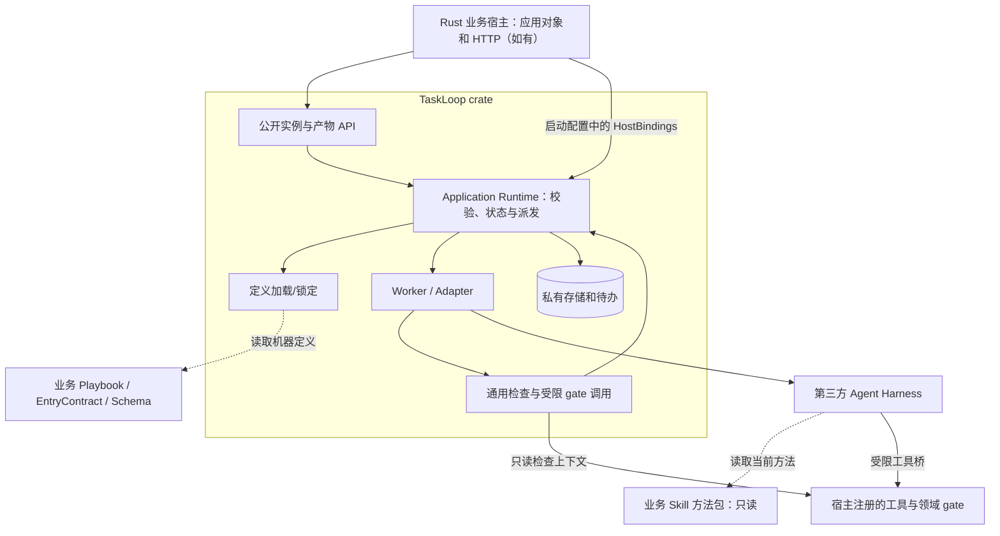
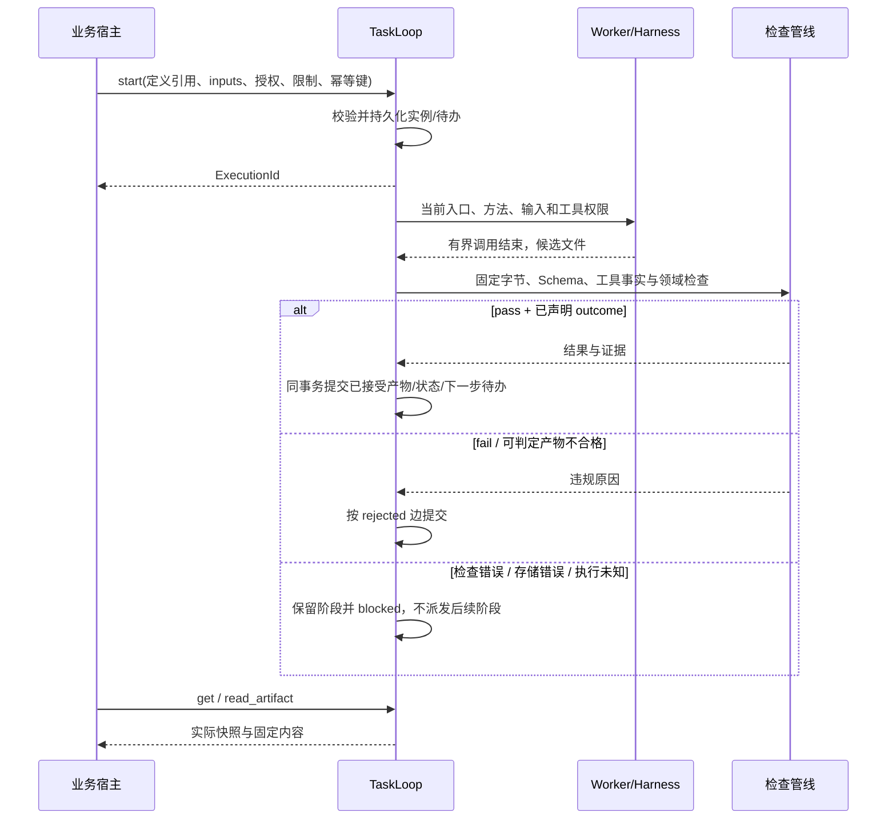

# TaskLoop Issue #2：最小 Rust 执行契约

> 前置设计基线：本文件保留 Issue #2 的提案事实；当前实现票的 Rust 集成、运行保障与验收以 [Issue #3 L2](3-minimal-runtime-mvp.md) 为准。当前机器格式在根目录 schemas/，本目录 contract/ 的同名文件仅冻结设计见证。

| 项目 | 内容 |
|---|---|
| 版本 / 状态 | v0.1.0，2026-11-02，Draft；设计检查后交人工评审，尚未实现 |
| 需求 | [Issue #2](https://github.com/xforce-io/taskloop/issues/2)，S1–S4 |
| L1 | [Issue #2 L1 v0.1.0](https://github.com/xforce-io/taskloop/issues/2#issuecomment-6580253277)；范围来自用户本轮对轻量 crate、边界和封装的要求 |
| 事实源 | 本文件为本 Issue 唯一 L2；[contract](2-minimal-runtime-contract/contract/) 中标明的通用 Schema 为机器契约 |
| 术语 | [名词表](../glossary.md) |

L1: write（原票评论）；L2: write。keel-how: skip: 无现成机制可讲：基线 `fbe3c87e8f8614b7098ffe4d710040f572a3e833` 仅 README、名词表和 RFC，无运行时代码。本稿承接从 Inquiry 移出的通用设计，不交付 Python 后端。Rust 类型、crate 和 Harness 接口都是提案，不是已可调用的 SDK。

## 1 背景

业务需要用自己的方法包、流程和产物检查完成任务，又不应了解线程调度、数据库表或执行尝试。TaskLoop 封装这些复杂性，向 Rust 宿主提供少量操作；不要求业务部署额外服务。

[总体 RFC](../RFC-0001-architecture.md) 是更宽的历史 Draft。本 Issue 是一期实施范围：在 Rust crate、平面有界流程、固定执行器、只读外部工具的交集上形成完整契约。RFC 的 Python/CLI 入口、租约心跳、动态计划与路由、外部写动作账等不作为一期依赖。未由本稿采用的总体能力仍是后续方向，不能据历史提案扩展 MVP。

## 2 名词解释

完整定义见[名词表](../glossary.md)，仅澄清两组易混关系：

- Skill 给 Agent 提供方法；EntryContract 给执行边界；Playbook 给状态和转移。附加机器资源可随 Skill 分发，也可在包外。标准 Skill 不必变成 CLI 或状态机。
- FlowInstance 是一次流程实例，ExecutionId 是其公开不透明标识；Task 是一次 work 状态访问的逻辑工作，Run 是执行尝试。Application Runtime 保存并唯一提交状态，不接受 Agent 自报 next_state。

一个 FlowInstance 对应一个 Goal；每次 StateVisit 的 work 对应一个 Task，Run 属于 Task。wait 不创建工作 Run；补查是新 StateVisit/Task。自动重试一期不交付，不能因此删去拒绝旧 Run 结果的关联检查。

## 3 目标与非目标

目标：业务只依赖流程/产物契约和 start/get/signal/cancel/read_artifact；Agent 按当前入口获得方法和输入；产物真实可读并经检查；多实例不串扰；重复、取消和重启有确定结果。

一期配置建议 max_admitted_instances=8、max_concurrent_runs=1，按阶段轮转；是默认资源上限，不是部署多个 Worker 的要求。三种状态、有限结果分支、命名信号、有界回环足够表达当前用例。

非目标：Web/HTTP、独立 Planner、动态 Router、任意脚本 guard、嵌套并行、插件市场/安装器、分布式队列/租约心跳、活动图热迁移、原位自动续跑、通用外部写动作/审批平台。首期工具只读外部来源，并写本次候选目录；需要业务写副作用时另行设计，不能套用只读保证。

## 4 能力

### 4.1 UI/UX

N/A：TaskLoop 不提供页面或产品 CLI；调用方是 Rust 宿主。API 调用主路径在 §6.3，异常反馈与可判定结果在 §8/§11。领域页面由应用负责，不进入 crate。

### 4.2 对外可观察能力

加载定义失败不得触发模型；start 成功前实例和幂等事实已持久化。get 返回真实阶段、生命周期、原始业务输入、等待要求和已接受产物引用，应用无需读取 Task/Run 表。signal 仅提交声明的业务事实。cancel 返回 cancelling 或实际终态，不能把“已请求停止”说成“已停止”。读取返回固定字节和摘要，不能任意下载宿主路径。

业务结果与生命周期分开：completed 表示定义到达合法终点；是否得到期望业务结果由 business_outcome 表达。缺资料可到合法部分终点，不能通用地等同于业务成功。

## 5 思路与折衷

| 决定 | 原因 / 放弃项 |
|---|---|
| Rust crate 同进程，托管自身执行循环 | 隐藏调度；不让应用手动 tick 或建设服务/消息系统 |
| 平面 work/wait/terminal、枚举 outcome 选边 | 业务可变而解释器有限；放弃完整工作流语言及任意条件代码 |
| 静态宿主绑定，一个真实 Harness 先通过探针 | 不从包自动安装代码；不提前建设插件、自动模型选择和多适配生态 |
| 固定候选字节 → 通用结构检查 → 领域 gate → 状态提交 | 进程退出与自评不能替代验收；领域语义留给业务 |
| 私有本地存储、公开不透明标识与快照 | 应用不依赖表/事务/执行代数；避免共享数据库迁移耦合 |
| 中断与检查不可用先阻塞，可取消后新建 | 放弃未经核实的自动重试与原位恢复，减少重复执行风险 |

复杂性放在加载/适配/持久化边界，正常业务不需要直接调用这些内部模块。后续增加执行器、领域 gate、业务图不改变实例 API；新协议能力要显式版本化，不借扩展点隐藏任意执行。

## 6 架构

### 6.1 模块与所有权

原七层职责保留为映射而非七个组件：L7 业务 UI（本库无）、L6 crate API、L5 Runtime/检查/固定选路、L4 Worker/Adapter、L3 Harness、L2 工具、L1 私有数据。Decision 是 gate 返回有限业务结果及 Runtime 校验的职责；Router 是固定 executor 绑定，一期均不要求独立进程或 Agent。

### 6.2 定义加载与方法提供

宿主启动配置明确给出本地 DefinitionSource、资源根目录、存储目录和 HostBindings。加载拒绝未知协议、重复键、逃逸路径、未注册引用、缺分支、不可达终点与无界循环；不执行包脚本或调用模型。内部得到 DefinitionRef/摘要及锁定资源闭包，启动结果把可用引用提供给宿主，不要求应用重算摘要。

公共机器格式为 [bundle.schema.json](2-minimal-runtime-contract/contract/bundle.schema.json)。Schema 只支持锁定本地的 2020-12 完整文件，不在校验时联网，不支持任意 $ref。`task-input.schema.json` 是保留的内建 Schema 名称；业务加载目录无需复制该文件，也不得覆盖它。其它业务 Schema 相对指定资源根解析并进入定义闭包；即使位于 Skill 附件，解析和授权规则不变。

HostBindings 是公开的宿主能力注入面：executor 逻辑 ID → 已核验适配器/固定模型配置，tool ID → 受限回调，gate ID → 检查回调，以及 Skill ID → 包/版本/摘要。BindingRegistry 是内部解析结果，应用不访问其实现。只有宿主可信配置可注入实现，不接受浏览器/Agent 指定程序、shell、路径或安装脚本。

artifact.read / artifact.write 是框架提供的保留工具，分别限于本入口授权输入和当前候选目录；宿主不必另写一遍产物存取，也不能覆盖它们。业务仅注册自己的领域工具和 gate，执行器优先使用 TaskLoop 已验证的适配器。

锁定不只是保存哈希：活动实例必须能读到当时的机器定义、Schema、方法字节及实现版本。方法包只读共享；每 Run 的会话、cwd、配置和候选目录独立。Worker 按入口将锁定方法通过只读挂载或等效资源 API 提供给 Harness，校验输入和输出的实际可见性。缺资源时阻塞/拒绝，不能静默换新版本；更新安装包不改变既有实例。

### 6.3 主路径与失败路径

work 正常结束走 accepted[outcome]；确定的执行失败走 failed；候选拒绝走 rejected。wait 只接声明信号或到期，terminal 无出边且先核验 requires。缺前置产物、无证据、未知 outcome、门禁异常和损坏协议不猜测推进。门禁通过不表示所有世界事实为真。

## 7 模块

### 7.1 内部职责与数据

| 模块 | 私有责任 / 对外边界 |
|---|---|
| 定义加载 | 解析资源、图/绑定校验和锁定；应用只拿可用定义引用 |
| Application Runtime | 持有实例、执行资源限制、接受事件、唯一状态提交、恢复和托管工作循环 |
| Worker/Adapter | 准备输入与方法、监督当前阶段、有界执行、收集、取消；不授予全局流程写接口 |
| 检查管线 | 验证候选关联、固定文件与 Schema；调用领域 gate，保存本次检查证据 |
| 私有存储 | 单写者 SQLite 与不可变字节，状态和下一步待办原子保存；不向应用暴露表或事务句柄 |

内部数据仅定义所需不变量，不冻结 SQL 表形态：Goal 关联目标/输入/限制；FlowInstance 持有定义锁、当前状态、revision、访问和终点；Task 标识一次 work 访问；Run 标识一次有效尝试及执行配置；Artifact 保存摘要/来源/归属；Event/检查记录保留可追溯事实。业务 JSON 不展开成框架领域表。

每实例最多一个有效工作 Run；技术生命周期为 created/running/waiting/blocked/cancelling/completed/failed/cancelled。同一 Skill 的多个实例只共享定义，不共享输入、信号、预算、会话或结果。wait 和已确认执行结束的 blocked 不占 Worker 槽位，但计接收上限；终态释放接收名额。中断未知的 blocked 与取消未确认的进程仍占执行容量，不能因为状态名是 blocked 就派发另一份。单槽位可能等待核实，这是安全边界，不把 B 错标失败。

### 7.2 适配与结果契约

Worker 内部调用上下文包含当前入口、ExecutionId/Task/Run/访问/有效代数、锁定方法、flow_input、已接受前置产物和信号、工具授权、输出槽位与有效资源限额。ID 只是关联，必须同时提供受限读取字节/事实的能力；不能只交不可解析字符串。Agent 无权改控制上下文或授予工具。

[RunSubmission](2-minimal-runtime-contract/contract/submission.schema.json) 是适配器收集候选后的内部协议，不是要求所有 CLI 改 stdout。实际结束来自监督结果；清单由受信关联通道交回，模型在 JSON 中自称 run_id/origin 不构成身份。适配器使用参数数组而非拼接 shell；原生 CLI/Harness 不满足有界执行、隔离、工具约束或取消时不得声明受控阶段能力。

采集禁止路径逃逸、软链、重复/未声明槽位、缺文件和超限。按目录安全读取并固定同一份字节，完成摘要/Schema 后接受这些确切字节；不校验一份再存另一份。存储 I/O 错误是 blocked/storage_error，不伪装成业务不合格。

[CheckResult](2-minimal-runtime-contract/contract/check-result.schema.json) 为 pass/fail/error：pass 必须有入口允许 outcome 和真实可解析证据；fail 保留违规走 rejected；error、超时、异常或损坏协议阻塞。gate 只拿只读上下文与受限查询，不能拿实例仓储或状态控制；同进程宿主代码属于可信基，接口封装不是恶意原生代码沙箱。领域 gate 可用规则或独立模型；生成者自评不能冒充独立评价。模型检查属于本阶段受限回调并计入检查/全局资源限制，不向同一单 Worker 队列同步等待另一个工作任务，以免形成自等待。

### 7.3 工具事实与领域检查

宿主工具回调返回领域 JSON 和实际保存字节；框架桥接层记录当前实例/Run、工具 ID、调用/结果摘要及时间，生成不可由 Agent 提交的 [通用回执](2-minimal-runtime-contract/contract/tool-receipt.schema.json)。领域字段放 payload 并由领域 Schema/gate 校验。TaskLoop 不内置 URL、HTTP、来源可用性或引用语义；这些只是研究 fixture，编码工具可有完全不同 payload。

领域 gate 对照已锁定输入、原始候选字节和受信事实，返回 CheckResult。证据必须指向本次合法检查调用、受信回执或授权已接受产物，不能只检查非空字符串。工具回执证明受信代码报告过的动作，不保证外部内容陈述正确，也不能替代独立的研究质量评价。

业务扩展的公开交接仅有以下两类；具体 Rust 符号在实现时固定，不能由应用发明一个平行执行协议：

| 回调 | 只读/受限输入 | 返回与所有权 |
|---|---|---|
| 领域 tool.call | ToolContext 提供当前授权、期限/预算与受限产物能力；另给工具 JSON 参数，不要求业务理解 Run 或有效代数 | ToolOutput：领域 payload 与实际内容/附件；框架固定字节、封装并保存 ArtifactReceipt，不由工具或 Agent 直接写实例表 |
| 领域 gate.check | GateContext 提供业务 inputs、候选固定字节、已接受输入/产物、受信工具事实，以及框架创建的本次 check_evidence_ref | CheckResult；业务可引用提供的证据句柄，不自行构造框架身份；Runtime 校验结果/引用并唯一提交状态 |

回调不得修改共享实例状态；异常/超时由框架边界转为 error/阻塞。ToolContext 与 GateContext 是当前入口的能力句柄，不是裸数据库、任意文件系统或全局 Runtime。宿主原生实现仍属可信基，工具访问限制必须在实际适配与调用桥上验证。

## 8 API/CLI

### 8.1 公开最小接口

只有同进程 Rust API，不交付 HTTP、MCP 或产品 CLI。宿主初始化提供配置/HostBindings，TaskLoop 加载定义并托管执行；关闭属于宿主生命周期，不要求业务调度内部阶段。下面是契约规格，不是承诺现有编译符号。

| 操作 | 输入 | 结果与稳定语义 |
|---|---|---|
| start | 定义摘要、业务 inputs、授权引用、限制、request_key；调用者上下文由宿主可信通道提供 | ExecutionId；校验/落盘后返回；同调用者同键同请求返回原 ID，异内容 conflict；权限先核验，幂等先于容量 |
| get | ExecutionId、调用者上下文 | ExecutionSnapshot；含原始 inputs、当前业务状态/访问、技术 status、revision、business_outcome、进度、等待信号、已接受产物、错误；不要求应用读取 Run 或数据库 |
| signal | ExecutionId、声明的 event_name/payload、request_key、expected_revision、调用者上下文 | 接受回执与新 revision；不能指定目标状态；事件/Schema/权限/期限/版本/幂等校验后才生效 |
| cancel | ExecutionId、request_key、调用者上下文 | 当前快照；重复请求安全；先撤销执行权并停止，确认前 cancelling；终态原样返回 |
| read_artifact | 已接受 Artifact ID、调用者上下文及可选范围 | 固定字节/流与摘要；只读、按实例授权，不暴露本地路径，不读取其它实例 |

[Start](2-minimal-runtime-contract/contract/start-request.schema.json)、[Snapshot](2-minimal-runtime-contract/contract/snapshot.schema.json)、[Signal](2-minimal-runtime-contract/contract/signal-request.schema.json)、[Cancel](2-minimal-runtime-contract/contract/cancel-request.schema.json) 为通用机器格式。ArtifactRef 的公开 state_id/visit/slot/摘要足够组织阶段产物，不必反查 producer Run；诊断信息不成为应用依赖。inputs 原样保存且不可被 signal 覆盖，新事实单独记录。

### 8.2 错误与外部信号

稳定错误：definition_invalid/binding_missing/capability_denied/input_invalid/artifact_invalid/check_unavailable/gate_protocol_invalid/revision_conflict/request_conflict/signal_not_allowed/signal_expired/admission_full/stale_attempt/limit_reached/interrupted/storage_error。调用错误与生命周期/业务结果分开；get 失败不修改实例。

接收信号按：鉴权与幂等回执 → revision → 处于 wait 且声明该事件 → payload/权限/当前时间 → 保存事实并转移。同键重放返回原回执，同键异内容冲突。过期信号不得因后台定时器尚未处理而被接受；到期和信号在同一状态提交序列竞争，仅一方成功。Runtime 保留事件不能从 signal 注入；不提供 runtime.retry_* 或 goto/resume。

## 9 边界

### 9.1 持久化、重复和取消

TaskLoop 以私有 store_dir 管理 SQLite 和字节目录，调用者不得共享内部连接、读表或控制迁移。字节先安全持久化，再在单写者事务中保存接受引用、检查、事件、revision 和下一步待办；允许崩溃留下未引用字节，不允许有效记录指向未持久化内容。不宣称 SQLite 能与任意文件系统跨资源原子提交。

revision 与当前 Run/访问/锁定摘要/内部 run_epoch 一同校验；迟到结果不能改变状态，同提交重放不双推进，异清单冲突。run_epoch 仅为实例内失效代数，不采用租约/心跳服务，且不暴露给普通业务调用。

派发用私有持久化待办，按 Run 去重；单宿主有效，第二个写入宿主应拒绝启动。取消先持久化撤权，再停止本实例进程/调用；成功提交与取消串行化。无法确认停止保持 cancelling/blocked 并保留容量，不直接启动另一份。网络请求停止不能撤回已经发送的远端动作；一期只允许外部只读。

### 9.2 重启与资源

未派发工作恢复排队，wait 恢复原期限，已开始但未知提交的 Run 撤权并 blocked/interrupted；不能自动重复未知执行。业务可取消旧实例后新建，不提供原位恢复协议。已接受产物和幂等回执保留。没有单独 StopReceipt/审批系统或恢复信号协议的前置依赖。

有效限制取宿主授权、定义和请求的较小值：状态访问/转移/Run 数、活动时间/绝对期限、检查调用、工具请求/字节与候选大小均有边界。领域网络/模型配置由宿主落实；未知用量标未知，不能以此绕过可执行限制。达到限额停止派发并报告 limit_reached，不降低门禁。wait 的有限期限由业务定义。

### 9.3 安全、授权与观测

输入网页/模型/候选都是数据；不得变成宿主指令、权限或 SQL。工具范围为启动授权、入口声明、适配器能力的交集，缺能力在执行前拒绝。业务工具负责自身协议/网络/内容限制，框架负责授权通道与实例边界。密钥用宿主句柄，不进包、前端、候选和日志。

最小观测复用关联事件、检查、工具回执、用量/耗时与错误；记录 ExecutionId/Task/Run/定义摘要/版本，不存私有推理，不部署监控平台。内部诊断可包含执行标识，但公开 API 不要求应用理解它们。

## 10 迁移、兼容与回滚

当前无产品数据，无生产迁移。原 Inquiry 的通用 Schema、推进模型、第二业务 fixture 与故障见证迁入本 Issue contract；研究 fixture 标明来自 Inquiry `584eaa80dd899f3b181b66d4f68ace3309de290d`，只用于通用契约测试，生产研究定义以 Inquiry 自己的目录为准。HTTP 获取回执 Schema 不是通用回执。

本稿在旧 Schema 上补齐 get 所需 inputs 与公开阶段定位，避免消费者依赖内部 Task/Run；尚无已发布 SDK，因此是 Draft 阶段契约修订。应用固定经过真实接入验证的 crate Git SHA 与 Cargo.lock；目前只有设计提交，不能填成可用运行时版本。协议 major 不兼容时拒绝加载，活动实例保留原锁，升级创建新实例。回滚先停新派发、处理活动调用并备份私有存储；旧版本不识别新存储时拒绝启动。

## 11 测试计划

| ID / Issue | 入口与异常输入 | 可判定结果与证据要求 | 层级 / 当前范围 |
|---|---|---|---|
| T1 / S1 | 两类定义；未知绑定、缺状态/分支、非法 Schema/包摘要 | 正常加载；不合法拒绝且没有模型调用；不依赖研究状态名 | Unit：设计见证；真实 Rust 加载 not_run |
| T2 / S2 | 真实 Harness 得到锁定方法/输入，交候选；伪造回执/路径/引用、gate fail/error/异常 | 确切字节可读；拒绝伪造；pass 只走已声明边，error 保留阶段阻塞 | Integration + Unit：模型部分覆盖；真实文件/进程/网络隔离 not_run |
| T3 / S3 | 同 Skill A/B，A 等待/取消、B 继续；错投结果/目录/回执 | ID、会话、目录、状态、预算、产物及取消不串扰 | Integration + E2E：多实例模型/最小 SQLite CAS 见证；真实 Harness not_run |
| T4 / S3 | 重复、迟到、取消先后、超时/信号、提交边界崩溃、重启 | 不双推进/双执行，不接受过期输入；已提交事实保持，未知执行不自动重复 | Integration：真实 Rust/SQLite/监督进程/时钟故障测试 not_run，快照模型不替代 |
| T5 / S4 | Rust 宿主仅通过 5 操作完成启动、等待补充、报告、取消和读取 | 无应用读表/控制 Worker/执行代数；不增加 HTTP 服务，错误与结果可区分 | E2E：最小宿主加真实 crate/Harness not_run；目前有跨仓契约映射 |
| T6 / S4 | 检查公共快照和两类工具事实 | 包含原始 inputs 和 state_id/visit，工具 payload 无 HTTP 硬编码，通用协议不从 Inquiry 导入 | Unit：Schema 正反例与依赖边界检查；不证明 Rust SDK 编译 |

设计模型及证明范围见 [contract README](2-minimal-runtime-contract/contract/README.md) 和结果文件。T3 的线程/SQLite 最小表不证明完整事务或真实会话隔离；模型中的研究/审阅 gate 是 fixture。实例恢复/定时器/鉴权模型也不能冒充生产实现。设计检查不等于架构 Approved。

## 12 开放问题与最小交付门槛

已决定：Rust crate、私有本地存储、静态绑定、三类平面状态、五个业务操作、隔离执行、候选/接受分离、未知执行阻塞、无独立 Planner/动态路由、无通用业务写审批。

尚需在实现前探针决定：真实 Harness/模型版本、资源加载方式、工具桥和取消/隔离能力。先验证一个阶段得到确切方法和输入、真实工具事实、候选交接、取消、A/B 隔离；不通过先更换适配方案，不能先构建完整框架后再把边界降级成提示词约束。

交付顺序：本设计人工评审 → 能力探针 → 最小 Rust 核心/一个适配器及真实故障检查 → 应用按公开接口接入 → 固定已验证依赖并完成 T1–T6。具体 Rust 异步库/Schema 库属实现选择，不预建插件/服务以规避选择。真实执行和研究语义质量测试当前均未执行，不能勾选实现验收。

## 13 ADR 与关联

| ADR | 决定与替代项 |
|---|---|
| 01 | 封装在 crate，五操作服务于应用；放弃共享 DB/内部调度与额外服务依赖 |
| 02 | Skill 方法与显式机器契约分工；放弃从自然语言推断强制状态机 |
| 03 | 固定图/有界回环/枚举结果；放弃独立 Planner、任意 guard 和动态路由平台 |
| 04 | 固定字节与受信事实，独立 gate 决定结果；放弃进程退出或 Agent 自评等于成功 |
| 05 | 单宿主本地事务、幂等、内部失效代数；放弃分布式租约与自动重复未知副作用 |
| 06 | get 提供应用所需输入和阶段产物；放弃用内部 Run/SQL 换取展示数据 |

均为 Proposed。关联：[Issue #2](https://github.com/xforce-io/taskloop/issues/2)、[总体 Issue #1](https://github.com/xforce-io/taskloop/issues/1)、[Inquiry Issue #1](https://github.com/xforce-io/inquiry/issues/1)。最终设计复核与依赖映射见 [review](2-minimal-runtime-contract/review.md)；人工评审和真实运行时验收待完成。
