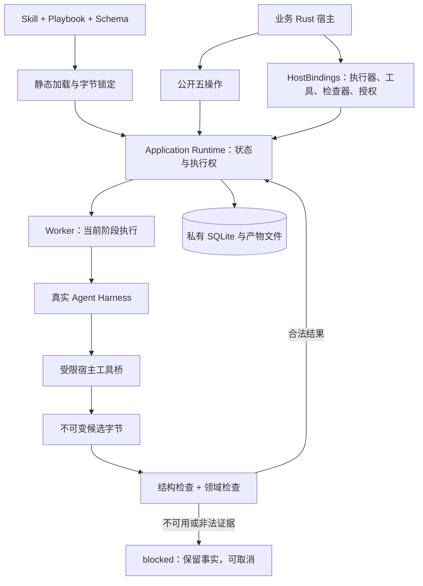

# TaskLoop Issue #3：最小 Rust 运行时

版本：v0.1.0；状态：开发中，尚未冻结验收或独立审查。
需求：[Issue #3](https://github.com/xforce-io/taskloop/issues/3)。本文件为该实现票唯一 L2。
L1: reuse [Issue #2 L1 v0.1.0](https://github.com/xforce-io/taskloop/issues/2#issuecomment-6580253277)，产品基线来自用户对轻量 crate、业务流程与方法包边界的既有确认，及 2026-11-03 明确要求依次端到端实现两个项目。L2: write；沿用 [Issue #2 契约 v0.1.0](2-minimal-runtime-contract.md) 的业务行为，本文件固定实际 Rust 集成与本地运行保障。how: skip，无现成运行时代码；起点 main 为 `fbe3c87e8f8614b7098ffe4d710040f572a3e833`。

## 1 背景

Inquiry 需要一个可直接依赖的执行库，而非另一套 HTTP 服务。设计见证尚不能证明真实 Agent 获得方法、工具受约束、候选可靠保存或取消确实停止进程。本票实现这些已确认行为，不引入新产品入口。

## 2 名词解释

沿用[名词表](../glossary.md)。Skill 是被加载的方法包；Playbook 是声明流程；FlowInstance 才持有某次任务的状态。共享 Skill 不共享实例状态。

## 3 目标与非目标

目标：通过公开五操作及初始化绑定，完成有界流程、产物检查、实例隔离、取消和持久化。
非目标：页面、产品 CLI、HTTP 服务、动态模型选择、自动重试、分布式执行、通用外部写动作和审批平台。原生 Rust 回调属于可信宿主代码，不声称为恶意回调提供安全沙箱。

## 4 能力

普通 Skill 可以单独静态校验，不要求附带 Playbook；集成校验另检查定义与绑定。普通包允许二进制资源，但当前 Agent 文本资源读取接口拒绝二进制内容。

### 4.1 UI/UX

N/A：本库无页面或产品 CLI。Rust 宿主通过快照区分 running、waiting、blocked、cancelling 和终态；`completed` 仍需检查业务 outcome，不能把部分结果当研究成功。

## 5 思路与折衷

- 同进程 crate 与静态回调，放弃服务、插件安装和额外应用数据库。
- SQLite 单宿主持有文件锁；状态以 revision/CAS 更新，命令回执与转移同事务提交；放弃多宿主协调。
- 内容寻址文件先落盘再提交元数据；未被接纳的候选保留在私有运行记录，不因未完成而伪装成公开产物。
- 一个执行槽、按阶段 FIFO；默认最多受理 8 个未结束实例。waiting 与已确认停止的 blocked 不占执行槽，未知执行占用。
- 中断后先阻塞并核实旧执行停止；放弃自动重放及原位自动续跑。
- 首个适配器固定 Codex CLI 0.166.0 和显式模型，无模型回退。升级须重新验证能力边界，不假称所有 CLI 版本兼容。

## 6 架构

主路径：静态加载 → 注册绑定 → 打开运行时 → start → 单阶段执行 → 候选结构检查 → 领域检查 → 原子接纳与转移 → get/read_artifact。
失败路径：定义非法时不调用模型；模型失败沿 failed 分支；领域 fail 沿 rejected 分支；检查不可用/非法结果阻塞；取消先撤销当前执行权，实际停止确认后才能报告 cancelled。停止不明保持容量，旧回调不得接纳。

## 7 模块

公开定义加载与普通 Skill 校验负责静态资源；公开 Runtime 负责五操作；HostBindings 注入可信能力。内部存储、阶段执行、调度与执行代数均不构成应用依赖。CodexExecutor 实现通用 Executor；领域工具和质量判断不进入该适配器。

## 8 API/CLI

可编译 Rust 类型见 [crate 入口](../../src/lib.rs)，请求与快照见 [model](../../src/model.rs)，公开扩展点见 [execution](../../src/execution.rs)。没有产品 CLI。

| 接口 | 输入与结果 |
|---|---|
| `Definition::load` | 本地定义文件及宿主指定 Skill 根；返回锁定字节与摘要，或带位置错误；无模型和网络调用 |
| `validate_skill` | 普通 Skill 根；检查包规范，不要求机器流程 |
| `validate` | 已锁定定义与 HostBindings；检查完整性、引用和所需能力 |
| `Runtime::open` | 私有目录、定义集合、绑定；返回运行时，拒绝同时占有同一目录 |
| `start(request, caller)` | 定义摘要、业务输入、grant_ref、限制和幂等键；返回不透明 ExecutionId |
| `get(id, caller)` | 返回原始输入、状态、阶段、revision、等待事项和已接纳产物引用 |
| `signal(id, request, caller)` | 事件、payload、幂等键和 expected_revision；返回受理回执；到期检查在提交事务内进行 |
| `cancel(id, key, caller)` | 撤销旧执行权、请求实际停止；可返回 cancelling，不能提前承诺 cancelled |
| `read_artifact(id, caller)` | 仅已接纳且归属授权实例的固定字节和摘要 |
| `shutdown` | 生命周期关闭；等待执行器停止，有界超时失败不能冒充停止成功 |

Caller 必须由可信宿主根据会话/身份构造，不得从 HTTP 业务请求反序列化授权。请求中的 grant_ref 必须属于 Caller；实例与产物跨主体读取返回 not_found。相同幂等键不同内容返回 request_conflict；同内容返回原结果，不能重新执行。

机器 JSON 定义以仓库根 [schemas](../../schemas/README.md) 为当前执行格式。Rust 请求使用编译期协议 v1 类型，不把设计见证的 JSON 信封误称为已提供的网络服务。

## 9 边界

Inquiry 拥有研究流程、方法、输入输出 Schema、搜索/获取/规范化与领域 gate；TaskLoop 解释结构化状态与转移，保存真实执行事实。Agent 只提交候选和调用当前授权工具，不能自行宣布下一状态。

Codex 阶段关闭继承的 MCP、shell、浏览器、技能发现和插件等能力，仅提供当前入口动态工具。每次运行刷新并复核继承 MCP 全部关闭，无法检查则拒绝启动；只读沙箱是额外限制。Skill 按当前入口注入锁定内容，其他包资源和任意路径不可读。配置校验命令有超时，错误不输出凭据。

工具回调必须实现只读外部动作，遵守取消和资源限制。宿主负责 HTTP 身份、网络工具的 SSRF 防护及业务政策；TaskLoop 不把普通 Rust 回调误称为隔离进程。真实工具回执由桥生成，模型不能凭写出一个 ID 创建可信事实。

## 10 迁移/兼容/回滚

首版仅 Unix 本地宿主；私有存储 schema v1，遇到更高版本拒绝打开，不猜测迁移。目录必须仅拥有者可访问（0700），新目录由库创建；不自动修改已有公共目录权限。单目录不能跨宿主共用。

无既有产品数据迁移。升级前宿主停止执行并备份完整私有目录；回滚使用原程序与完整备份，不能仅回滚状态文件而混用其他版本产物。宿主配置及执行器身份锁定；不兼容的未结束执行不得在新配置下悄然重跑。

## 11 测试计划

以下为必需验收标准，不表示已经通过；最终证据须记录干净候选 SHA、设计版本、环境和真实命令。无页面/产品 CLI，无用户路径，功能地图与 computer use 的 Drive 不适用于本库；Inquiry 必须另行真实驾驶验证。

| ID / Issue | 前置与路径 | 可判定结果、异常及禁止结果 | 层级与证据 |
|---|---|---|---|
| S1.A1 / S1 | 两类业务定义经公开加载/校验 | 三种状态可加载；重复键、未知引用、缺资源和非法图在模型调用前拒绝并定位 | Integration；定义测试输出 |
| S1.A2 / S1 | 普通 Skill 含二进制资源且无 Playbook；损坏元数据/符号链接反例 | 普通包通过；非法元数据与逃逸资源拒绝；源包变化不改变已加载字节 | Unit / Integration；包与锁定测试 |
| S2.A1 / S2 | 实际 Codex 登录；随机值只在锁定方法中 | 实际 Agent 提交正确候选，固定产物可读；输入替代值不能蒙混通过 | E2E；真实模型/CLI 版本、产物摘要、运行结果 |
| S2.A2 / S2 | 正/负/不可用检查器，伪造证据及越权读取 | 合法 pass 才接纳；fail 与 error 分开；越权和假证据不推进 | Integration + E2E；门禁反例、实际拒绝调用记录 |
| S3.A1 / S3 | 同 Skill A 进入真实工具，B 排队，取消 A | A 实际进程确认停止；B 随后独立完成；A 无接纳、B 内容不串写 | E2E；实际调用、终态及产物摘要 |
| S3.A2 / S3 | 重复/冲突命令、迟到回调、信号竞争和到期 | 不重复执行/接纳，过期事实不转移；已受理回执到期后仍可重放 | Integration / Unit；事务和执行权反例 |
| S3.A3 / S3 | OS 强制终止运行中宿主后重开 | 候选保留、旧运行不重放，未知执行不释放槽；确认停止后后续实例可运行；已接纳字节仍可读 | Integration；真实子进程终止与重启记录 |
| S4.A1 / S4 | 外部最小 Rust 宿主依赖冻结提交 | 五操作可接入，不查内部表、不引入 Inquiry 依赖 | E2E；外部构建与操作输出 |
| S4.A2 / S4 | 干净候选、完整检查、独立审查与平台交付 | 必需验收全 pass，独立 review PASS，CI 及人工门满足后合入；无生产目标不虚构部署 | Integration；候选证据、PR、CI 与合入 SHA |

## 12 开放问题

当前真实 Harness 探针及故障测试仍须在最终冻结候选重跑；尚未通过独立审查、CI 或合入。公开部署目标不存在，交付范围为可验证的本地 crate；Inquiry 的产品与研究质量验收不由本库测试替代。

## 13 关联

- [Issue #3](https://github.com/xforce-io/taskloop/issues/3)
- [设计基线 Issue #2](https://github.com/xforce-io/taskloop/issues/2)
- [Inquiry Issue #1](https://github.com/xforce-io/inquiry/issues/1)
- [实现计划与探针事实](../plan/3-minimal-runtime-mvp.md)
