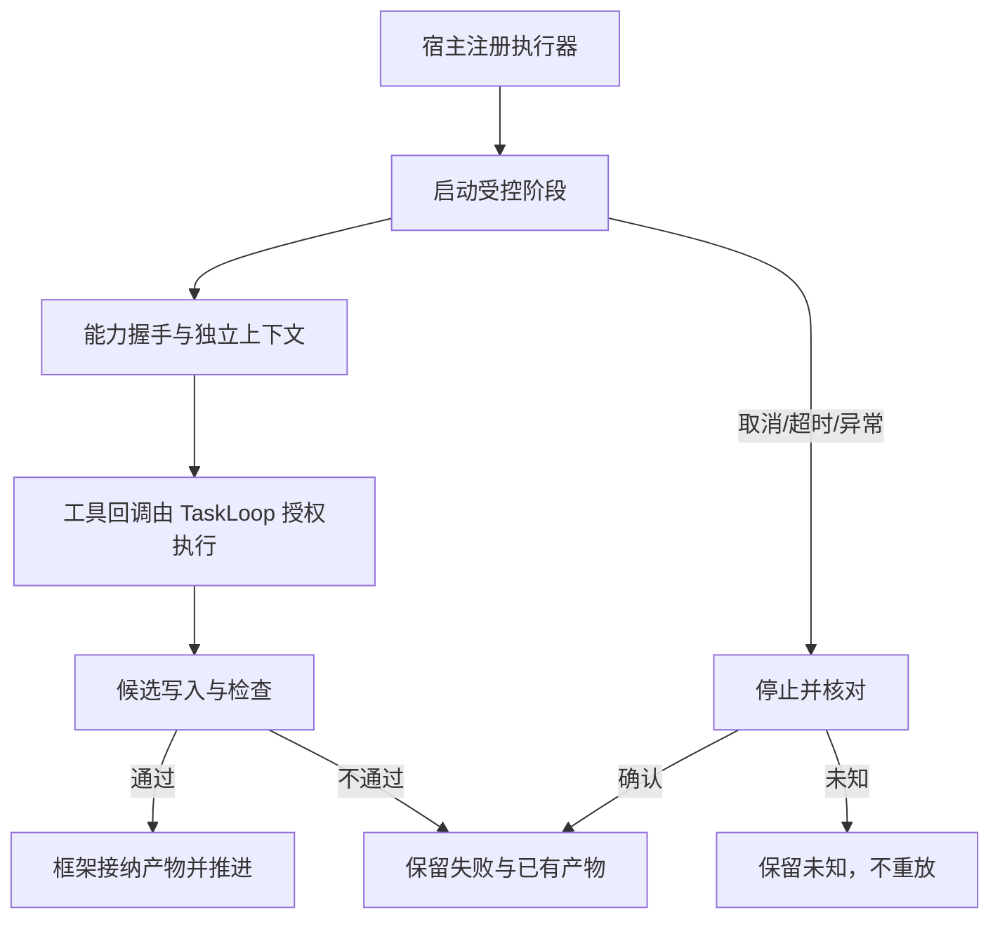

# #6 Milkie Executor 与生命周期

版本 v0.2；状态：既有 Epic 范围的技术契约，真实验收尚未完成。
Issue：https://github.com/xforce-io/taskloop/issues/6 。L1: reuse + 整理，依据为本次会话确认 TaskLoop→Milkie→Harness、宿主保留工具授权/产物接纳及可靠停止，以及本票 S1/S2。L2: write；公共执行接口和跨进程所有权变化。采用用户规定的十三节结构，§11 对应 L1.8。

## 1 背景

当前 `phase.rs/execute_work` 组装 Invocation，调用 Executor，并在超时/异常后独立 stop_or_confirm；Bridge 继续拥有授权、次数、候选写入、回执、过期代数和检查。`codex.rs/CodexExecutor` 直接维护原生协议。新增适配器只转接 Milkie 统一接口，不改变业务推进与240秒上限（时限调整属于 #9）。

## 2 名词解释

沿用 [名词表](../glossary.md)。新增 MilkieExecutor 为通过 Milkie 本地 Sidecar 实现 Executor 的适配器；Sidecar 为宿主启动并通过本地 stdio 管理的 Milkie 执行协议进程。Milkie 原生执行标识与 TaskLoop Run 标识分别保存，不能混用。

## 3 目标与非目标

目标：复用 Milkie 多 Harness，保留 TaskLoop 工具/业务检查契约；取消和执行 future 被丢弃后仍可确认停止，未知不计成功，两个任务不互停。
非目标：迁移业务到 Milkie FSM、自动重放未知工具效果、默认移除 CodexExecutor、TaskLoop trace 查询与默认治理/预算、复制登录材料、发布 npm 包或部署。

## 4 能力

新增公开 MilkieExecutor，宿主显式提供 Sidecar 启动程序/前置参数、连接文件、执行数据根及原生专用配置/会话目录。无自动发现登录、无原生 Harness 回退。每次 Invocation 使用独立 Sidecar 与 Milkie 执行上下文，保持 TaskLoop Run 输入锁定。

### 4.1 UI/UX

无图形页面。主入口是 SDK HostBindings.executor。宿主配置→启动流程→观察业务快照→读取接纳产物或明确失败；取消时分别观察业务取消与停止事实。缺配置/能力在推理前拒绝；没有候选不是成功；未确认停止保留 StopUnknown。观测通过显式接收器交给后续 TaskLoop trace 子票，不显示采集成功就推进业务。不新增 CLI 或 trace 页面。

S1 覆盖 A→F/G；S2 覆盖两个独立 B 及 H/I。成功/错误/空候选各由既有 Runtime 契约判定。

## 5 思路与折衷

复用公开 Executor/ToolBridge 与版本化 JSON-RPC，不在 Rust 再写 Codex/Pi/Grok 原生协议。运行所有权由独立后台任务持有，execute future 被超时丢弃不会丢掉取消入口。放弃以 worker 退出或 process kill 当作 Agent 停止确认；只信受信 Milkie 执行结果的 stopped。连接丢失且可能已经执行时保守 Unknown，不重新 start。

## 6 架构

Runtime → MilkieExecutor → 本地 Sidecar → Milkie worker → Harness。反向 tool.call 进入原 Bridge；原生函数名编码与 TaskLoop ToolSpec 对应，未知名称、错误 run/context 和重复 callId 拒绝。请求响应读取与宿主工具处理并发，等待工具不能阻塞取消。
主路径：版本能力握手→创建上下文→执行→处理回调→读取终态→关闭进程→返回受控 Outcome→Runtime 检查产物。
失败路径：准备失败不启动模型；启动请求已发但结果丢失时不猜测未执行；取消先关工具入口并请求 Milkie 停止，不能确认则 StopUnknown。后台任务生命周期独立于调用 future，stop_or_confirm 仍可等待；恢复时只通过 Milkie 公开查询/取消和适配器自身关联记录核对，不读 Milkie 内部表。

## 7 模块

MilkieExecutor 管理配置、Run 所有权和结果；统一 RPC 通道只处理 Milkie 协议；ToolBridge 新增可选元数据入口，默认转发原 call 保持已有实现兼容；显式观测接收器供 #7 接纳，不决定业务状态。原 Bridge 的权限、代数、预算、提交和 gate 不迁出。

## 8 API/CLI

配置采用绝对路径，前置 argv 按元素传递，连接内容不打印。固定协议1，必须支持宿主工具、超时和取消；不支持明确拒绝。Milkie 连接由宿主准备并在注册时固定摘要，执行时改变则拒绝。注册身份包含连接文件与启动/环境/存储配置摘要，不输出原始环境或连接内容。Milkie 至少依赖 #277/#278，任意 JSON 子 Schema 及长度/范围保真依赖 Milkie e68c6d6；不采用本地未发布目录作为最终依赖。

原生工具名只允许编码后的登记表，TaskLoop 原工具 ID 不变。Schema 原样保留语义：补充标准 JSON Schema 的 additionalProperties=true 缺省，以区别 Milkie 的省略即 false；空子 Schema 保持任意 JSON，未支持结构明确拒绝，不删除约束。工具结果固定映射 succeeded/invalid_input/rejected/execution_failed，原始异常/连接材料不进协议诊断。

每帧8MiB，最多64个等待RPC、32个并行宿主回调；超限明确失败/拒绝。RPC 最长等待12秒，停止核对最长15秒，业务期限仍受 Invocation/Runtime 限制。显式观测接收器由256项有界通道隔离，单次接收超200毫秒或队列溢出记交付不完整，不阻塞工具或取消。停止核对允许 Milkie 的原生清理时间，不因进程退出提前计已停止。显式观测选项沿用 Milkie 契约，由接收器提供 traceparent 和容量；未设置不启用新默认策略。

## 9 边界

每个 TaskLoop Run 独立目录、Milkie context/run 对应关系和取消令牌。TaskLoop 仍验证 epoch 与授权；晚到工具即使原生请求关联正确也不能越过原 Bridge。取消不保证外部副作用回滚；未送达/pending 不自动重放。原生 stopped 与未核对宿主效果分别记录：Agent 已停止但工具效果未知时继续阻塞，不伪称 Agent 未停止。最终聊天不等于产物提交，trace 不参与业务接纳。

## 10 迁移/兼容/回滚

新增执行器可由 HostBindings 明确选用，旧 CodexExecutor 暂保留，无静默回退；Inquiry 在 #3 迁移。ToolBridge 的新增带元数据方法有兼容默认实现。适配器关联记录版本1，仅用于精确停止和恢复，不替代业务记录。回滚保留旧 Run 的未知状态与关联，不删除记录或重放。

## 11 测试计划

两条 Story 主功能文件均为 `.agents/skills/verify-taskloop/features/01-milkie-execution.md`。下列必需，结果另记冻结候选。

| ID / 归属 | 前置与真实入口 | 路径与可判定结果/禁止行为 | 证据、执行、层级 |
|---|---|---|---|
| S1.A1 / S1 | 两种真实 Harness、Milkie固定版本、宿主专用目录；Runtime SDK | 启动→宿主工具→候选→gate；成功与拒绝均按原契约，未授权无效果 | 版本、业务快照、产物/回执、关联；真实服务；E2E |
| S1.A2 / S1 | 确定性 Sidecar/真实本地进程；Runtime SDK | 握手不兼容、未知工具、错误context/run、重复调用均拒绝；空聊天不能提交；Schema不丢约束 | RPC transcript、工具次数、快照与候选；Integration/Unit |
| S2.A1 / S2 | 两个真实任务、支持异常注入 | 取消、超时、worker崩溃、Harness退出分别保留终态/停止事实和已有产物；另一任务继续 | 两组执行与停止/资源证据；真实服务；E2E |
| S2.A2 / S2 | 进程夹具及Runtime | execute future drop 后仍能 stop_or_confirm；失去启动结果/停止证明保持Unknown；过期回调无业务影响，恢复不重放 | 公共SDK、进程退出、关联记录与调用计数；Integration/Unit |
| S2.A3 / S2 | 现有Rust消费者与回归 | 原执行器/Bridge/API继续构建与通过；不从应用读取内部表 | cargo test、clippy、consumer与功能地图；Integration/Unit |

## 12 开放问题

真实宿主目录与第二 Harness 环境仍待提供，阻止真实验收但不阻止适配代码。统一 trace 默认策略/查询与期限分别在 #7/#8/#9 固定，不在此隐式决定。

## 13 关联

- Epic：https://github.com/xforce-io/taskloop/issues/5
- 上游：https://github.com/xforce-io/milkie/issues/277 、https://github.com/xforce-io/milkie/issues/278
- 后续：https://github.com/xforce-io/taskloop/issues/7 、https://github.com/xforce-io/inquiry/issues/3
