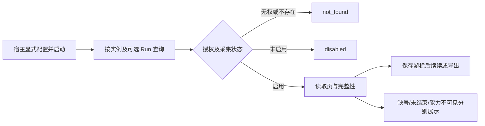

# #7 统一 Trace 查询与导出

版本：v0.3（Draft）；Issue：https://github.com/xforce-io/taskloop/issues/7 。

L1: reuse v0.1，概要见 Issue 设计评论（范围与主路径不变；本次修复既定的采集不改业务与有界分页契约）；L2: write，本文件为唯一详细契约。产品基线来自本次会话“TaskLoop 集成 Milkie trace 并统一治理”、Epic S3 和本票 S1/S2；不新增页面、远程服务或自动开启采集。用户规定的 L1/L2 位置和十三节优先于 Skill 默认分文件模板；验收细化放本文件 §11，不重复详细正文。

## 1 背景

Runtime 的 `Record.history/attempts/checks/receipts` 为业务事实；`phase::run_checked` 负责阶段、Executor、工具桥和 gate。MilkieExecutor 已暴露 `MilkieObserver`，但没有 Runtime 级采集及公共时间线。现有授权统一经 `Inner::authorized` 校验实例 owner。本票新增可丢失而不可静默的观测投影，不让它参与业务状态推进。

## 2 名词解释

已有术语见 [名词表](../glossary.md)。TraceCursor 为接收顺序的续读位置，不表示实际发生的全局顺序；SourceSequence 为同来源的原始序号，跨来源不可比较。Span 为一个可关联开始、结束或活动的观测操作；未知结束保留为未结束，不推断模型仍在工作。

## 3 目标与非目标

提供按 ExecutionId 及可选 Run 查询、分页、增量读取和 JSON 导出，关联阶段、Agent、实际工具执行和检查四层。非目标：新 GUI/HTTP 服务、替换业务历史、模型隐藏推理、OTLP 网络 exporter、#8 的完整策略管理和保留期限配置。数据结构保留 W3C trace/span/source/native 标识供后续 OTel 对接，不宣称为 OTLP 格式。

## 4 能力

显式使用 `Runtime::open_with_trace`，传入容量和 Milkie 源容量；旧 `open` 不采集。公共 `trace` 返回格式/语义版本、事件页、接收游标及完整性；`export_trace` 为同一授权和过滤条件的有界 JSON 页面，可用返回游标连续导出。未知实例和跨 owner 一律 not_found；已授权但未启用采集明确 disabled。未知 Run 返回空页，不把空页当成完整。

### 4.1 UI/UX

无页面。SDK 主路径和关键状态：

空：启用但尚无记录时返回空页与 recording/pending 状态。错：无权、非法游标/页大小或存储不可读返回稳定错误。成功：运行中和结束后都可续读，重启可读已持久化记录；业务结束时采集可能仍pending，不能将phase.finished当观测排空证明，按TracePage完整性继续查询。查询是同步有界 SDK 调用，无加载页面；调用方负责呈现加载和重试。

## 5 思路与折衷

独立 `trace.sqlite` 保持业务库格式不变，采集失败不回滚业务。分页正文由SQL游标条件和LIMIT直接获取；来源计数/末序号/活动、生命周期与未结束操作使用原子写入的派生摘要，不在每页反序列化全历史。每 Run 一个 trace，ExecutionId 聚合多个 Run；阶段 span 为根，Milkie Agent 是其子 span，Milkie 工具请求为 Agent 子 span，实际 TaskLoop 工具执行继承请求 span；检查为阶段子 span。拒绝用一个全局可变 observer 绑定共享 Executor，以每次 invocation 传入 observer 避免多个 Runtime 串线。接收游标只用于读进度，保留来源序号和源单调时钟，不按墙钟排序伪造因果。重复幂等；同标识不同内容、同来源序号冲突为完整性问题。乱序暂有缺口可在补齐后消除，重复不重计用量。保留原生累计 usage 语义，不将其误算为本 Run 增量。放弃将事件全量塞入 Record、业务事务强依赖采集、每页遍历原生日志和自动重放未知工具效果。

## 6 架构

分层：Runtime 授权及阶段工具/gate 埋点 → TraceStore 规范化、去重和持久化 → SDK 查询/导出；MilkieExecutor 从 invocation 取得独立 observer，将 source 事件与状态交给同一 TraceStore。

主路径：Run 开始持久化阶段开始 → 传递 traceparent → Milkie 事件与实际工具操作分别关联 → 检查开始/结束 → 阶段结束。事件带 traceId/spanId/parentSpanId、ExecutionId、Run、状态访问、来源及原始事件标识，关系不强行改写为单一全局时序。最近活动按同来源序号确定，仅返回观察到的 Agent/模型活动，不能视为模型仍在运行。已核对原生stopped及空宿主效果账本并持久化关联后，立即发布业务结果；观测补读（总计最多500ms）、队列排空（最多500ms）与最终状态回调（200ms）在监督任务尾部独立进行，不占用阶段执行期限。普通未启用观察的执行保持原停止/连接关闭契约。队列尾部超界后取消剩余回调，报告不完整；不让数据错误或采集延迟改写已发布结果。Milkie的stopped证明Agent/宿主效果已停，采集Sidecar关闭另行核对；Runtime.shutdown在原15秒关闭总限内等待finish_observations后才完成观测存储收尾，采集资源关闭未知返回trace_cleanup_unconfirmed，不把原生停证明改成未知。

失败路径：观察存储/容量/格式异常记录降级状态，禁止改变业务结果；无法写入降级标记时进程内保留故障，查询不可伪报完整。宿主重启后原未闭合 span 仍未结束，不能补造终态。实际工具 future 被丢弃只留下开始，不伪造副作用失败或已送达。已核对原生停止及空效果账本后关闭该invocation宿主工具入口，采集尾部不得重新获得业务执行能力。

## 7 模块

TraceStore 独占观测数据库和采集完整性；Runtime 授权、查询与业务层埋点；Executor 新增兼容默认观察入口；MilkieExecutor 按 invocation 接入观察，其原独立 observer 接口保留；启用 Runtime 采集时本 invocation 使用 Runtime observer，未启用时使用原配置，不把未经治理的副本自动广播到另一个 sink；工具桥保持原鉴权、预算、fencing 与回执唯一权威。

## 8 API/CLI

仅新增 Rust SDK，无新 CLI。`TraceOptions` 所有容量显式提供并验证范围；查询 `TraceQuery {run_id,after,limit}` 的 after 为非负接收游标，limit 为 1..1000。事件 envelope schemaVersion=1、semanticVersion=1。`TracePage` 的 next 为最后返回接收游标（空页保持 after）；多 Run 事件交错不会重复返回；相同游标可重读。导出同页同过滤，不暗示单次返回无限全量。旧 Executor 默认仍执行，但 Agent 内部能力明确 unavailable。Executor新增兼容默认finish_observations；Runtime关闭时调用，直接使用MilkieExecutor且需要最终采集状态的宿主也可调用。返回usage的observation_state=pending及observation_incomplete为业务交付时快照，最终完整性以TracePage/最终状态为准，不回写业务结果。

## 9 边界

支持内部观测的 Run 必须持久化 adapter.summary 采集尾部确认后才可报告 complete；来源和阶段终态不替代采集终态。确认未到时明确 observation_pending，尾部失败保留不完整，消费者不能在业务结束时停止增量导出。派生摘要版本2从原始事件重建，旧版本1的业务与来源终态不补造尾部确认。

只接受本 invocation 标识和 trace 的 Milkie 事件；保留 contextId/runId/native 映射，外来标识不赋权。只采集明列元数据，不采提示、参数正文、工具输出正文、stderr、隐藏推理或任意原始异常。中央容量到达时停止接收并标 capacity，业务继续；旧事件保留可查。不同 Run 的序号、单调时钟和累计用量不混算。查询始终先执行 owner 授权，export 无旁路。

## 10 迁移/兼容/回滚

新增独立观测数据库，不变更业务库 user_version；旧 open、Executor::execute 和已有 ToolBridge 调用继续可用。升级后原历史无观测不追造。派生摘要独立标记格式版本2（版本1同样从原事件重建），首次从现有事件按接收顺序回填，事务内建立写入维护；不改原事件字节、游标或业务/核心观测库版本。原事件追加且仅整Run退役，退役最后一条事件时同步清理摘要；#8的容量/到期删除沿用该边界。旧实现可忽略派生表继续读取原事件，未来未知派生格式明确拒绝。停用新入口可回旧候选继续读取原业务数据，观测文件保留；不将删除文件作为回滚步骤。

## 11 测试计划

主要功能文件：`.agents/skills/verify-taskloop/features/02-trace-query.md`，覆盖 S1/S2。以下均为必需验收，证据绑定冻结 SHA、v0.1、环境和实际入口输出。

| ID | 前置/入口与操作 | 可判定结果及禁止结果 | 验证与证据 |
|---|---|---|---|
| S1.A1 | Runtime SDK 启用观测，运行有工具与 gate 的实例；运行中及结束后查询并按页导出（含一万条历史后的固定SQL指令预算尾页、重启与摘要回填） | 四层关联、稳定源标识、接收游标续读；不把导出当 OTLP | E2E：真实 Milkie Sidecar + 确定性 Harness；SDK 输出及事件关系；真实 Harness 另按 Epic 验证，不冒充模型成功 |
| S1.A2 | owner 与不同 principal 查询/导出，同实例与另实例过滤，再重开 Runtime | 越权 not_found，重启保留，跨实例不混入；旧入口 disabled | Integration：公共 SDK、持久化重开、独立 consumer |
| S2.A1 | 接收重复、序号缺失和乱序补齐及冲突 | 重复一条、序号可核对、缺口可判且补齐恢复；冲突明确降级，不按墙钟重排 | Integration/Unit：源注入、逐页读取、异常及状态断言 |
| S2.A2 | 注入断连/退出、未结束调用及不可见模型请求，容量耗尽或采集失败 | 业务结果独立，慢补读/慢终态回调不耗阶段期限；未结束与 unavailable 明列，不假成功/假活动 | Integration：公开执行结果与 TracePage 对照；Unit：容量和错误路径 |

## 12 开放问题

第二真实 Harness 和专用配置/会话目录仍待宿主提供；不影响本票确定性协议/SDK 实现，但阻止 Epic 真实模型验收。#8 将补完整访问/脱敏/保留策略；本票不自定保留天数、不默认自动开启。无本票新增产品范围待决。

## 13 关联

[Epic #5](https://github.com/xforce-io/taskloop/issues/5)、[Milkie #278](https://github.com/xforce-io/milkie/issues/278)、[#6](https://github.com/xforce-io/taskloop/issues/6)、[本票 #7](https://github.com/xforce-io/taskloop/issues/7)。
