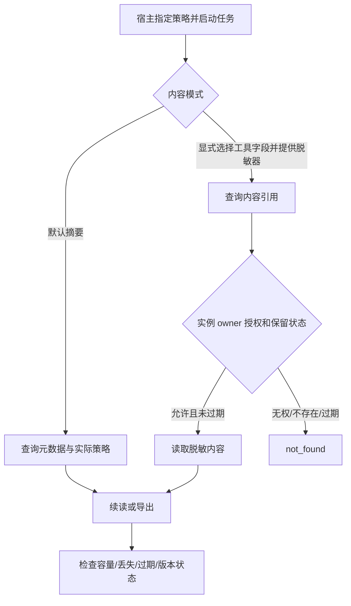

# #8 Trace 内容与数据治理

版本：v0.4（Draft）。Issue：https://github.com/xforce-io/taskloop/issues/8 。L1: write（Issue 概要）；L2: write（本文件为唯一详细契约）。沿用用户确认的“TaskLoop 集成 Milkie Trace 并统一治理”和本票 S1/S2；不将推荐的保留天数或容量当成批准默认值。章节和存放位置遵循用户 AGENTS；细化验收放 §11。

## 1 背景

#7 的 `TraceStore` 已集中采集并保留元数据、按 Run 容量和实例 owner 授权；`Bridge::call_traced` 是实际宿主工具入口，`Runtime::trace/export_trace` 是查询边界。现有源端队列最多 256 条、单回调 200ms、结束排空 500ms；故障与业务结果独立。目前缺显式策略投影、受控内容引用、全局容量及保留清理。本设计复用上述机制，不修改业务 `Record` 或 artifacts。

## 2 名词解释

已有术语见 [名词表](../glossary.md)。TracePolicy 是宿主提供的内容、容量和保留契约；TraceContentRef 是受同一实例 owner 授权、按容量与期限保留的观测内容引用，不是业务 Artifact，也不是任意文件路径。

## 3 目标与非目标

两种内容模式均可通过公共 SDK 检查实际策略；默认无正文，显式模式只保存已选择并脱敏的工具字段。接入源和中央观测共同受容量、版本、完整性与保留治理。非目标：任意提示词/环境/原生会话全文采集、远端监控服务、把观测当业务事实、通过采样删业务回执。

## 4 能力

新 `Runtime::open_with_trace_policy` 接收 #7 容量和 TracePolicy；所有新增限额及期限由宿主显式给出，无隐藏保留默认。查询/导出返回实际 policy_id、内容模式、限额、保留、源队列与等待边界。原 `open_with_trace` 保留元数据模式及按 Run 限额，其全局保留明确为 legacy/manual；Inquiry 新链路使用完整策略入口，不把兼容入口宣传为全治理已配置。

### 4.1 UI/UX

无新页面；SDK 主路径及两条 Story 共用：

空：尚无事件仍返回启用策略与 incomplete；错误：无权统一 not_found，策略非法在启动前 input_invalid，不兼容版本 storage_incompatible；成功：导出和内容引用与查询使用同一实例范围。内容被省略、脱敏失败、容量满或到期分别可判，不改写工具结果。无正文采集开关的 GUI。

## 5 思路与折衷

内容先按配置字段选择，再由宿主提供的版本化脱敏器处理，再执行内建敏感键屏蔽，持久化后仅把引用放进事件。默认不复制工具参数/输出、提示、stderr 或环境；显式模式不采整个请求包。拒绝自动猜测哪些业务字段可公开；宿主脱敏器负责业务特有秘密，TaskLoop 负责不绕过选择、敏感键防线、权限、容量和期限。摘要 hash 不是匿名化保证。

每个 Run 固定接纳时的策略快照和期限；重启不延长既有期限。按中央接收时间保留，不按来源墙钟。超额拒收新记录并公开降级，保留已采集记录；不无限积压、不阻塞业务。不强制选择采集失败即终止业务的策略。到期删除事件与内容，留下有界过期标记；过期标记被容量淘汰后返回未知缺口，不能宣称从未发生。放弃无限全文保留、把内容塞入业务 blob、让内容 ID 自带跨任务权限。

## 6 架构

业务结果与观测尾部分离沿用 #7 v0.3。Runtime 关闭先确认原生停止，再等待采集资源结束，最后清除观测存储未刷盘标记；尾部未结束的源清理明确 deferred，不以业务终态替代采集终态。派生摘要遵守相同 Run 保留可见性，过期正文及摘要均不可查询；整 Run 删除同时清理摘要，原始游标不改写。

分层：Runtime 身份授权 → TraceStore 持久化与容量/期限 → TracePolicy 字段选择与脱敏 → Bridge 内容引用；Milkie 仍只交付安全元数据，中央政策处理其事件和源健康。主路径：校验策略 → Run 接纳及快照 → 有界记录/内容 → owner 查询/导出/读引用 → 按期限清理。失败路径：源队列、脱敏、写入、容量或宿主退出均留 incomplete；正文采集失败返回无引用而继续原工具调用；业务状态推进仍只认原执行/检查。

## 7 模块

`trace_policy` 定义公开策略、脱敏器与有效策略快照；`trace` 管理独立数据库版本、Run 配额、引用与清理；`runtime` 实施公共入口授权和定期维护；`phase::Bridge` 在合法工具范围内采集被选择字段，不更改原权限、预算和 fencing。

## 8 API/CLI

仅新增 Rust SDK。`TracePolicy` 必须给 policy_id、全局事件/字节/Run 限额、保留毫秒数和单引用限额；元数据模式 content_tools 为空；显式模式指定工具及 input/output JSON Pointer，并提供非空版本的异步脱敏器。每工具每方向最多 32 个非根路径；拒绝非法 Pointer 或显式凭据/环境路径。脱敏等待最多 200ms，不持有存储锁；同时处理数量有界，过载降级。`read_trace_content(execution_id, content_id, caller)` 先验证实例 owner，再在该实例范围读取，不接受任意路径。清理可由维护入口触发，查询与写入同样执行到期检查。

全局字节配额是保留事件 JSON 与内容 JSON 的逻辑字节，不承诺 SQLite 文件字节等值。Run 标记及故障记录有界：max_runs 为 1..10000，单份策略快照最多 64KiB；其元数据另受这些上限控制，不计入事件/内容 payload 配额。每工具每方向最多 32 个字段，最多 64 个工具、Pointer 最多 256 字节；SQLite 空闲页可复用，保留清理不声称安全擦除磁盘。格式/语义版本和策略版本分别可核对。

## 9 边界

旧入口始终摘要模式；内容政策不从业务输入、Agent 或 traceparent 取得。隐私边界包含导出、引用、策略状态和内部源异常。过滤/脱敏器错误只返回固定故障码，不记录其原始异常。达到期限后不接受晚到事件重新建立已过期 Run；未结束操作不因清理变成成功。无法恢复丢失状态时标 unknown，而不补造 complete。

## 10 迁移/兼容/回滚

观测数据库升级到版本 3，业务库版本不变。保留旧事件为 legacy 策略，不补造原内容或开始时间；显式新策略只支配接纳后的新 Run。旧 #7 代码拒绝打开新观测库，但可不启用观测读取原业务库；回滚不删文件。未来版本更高时启动前明确拒绝，避免静默清空。

## 11 测试计划

主要功能文件 `.agents/skills/verify-taskloop/features/03-trace-policy.md`，覆盖 S1/S2；以下均为必需项，冻结候选记录版本、SHA、环境及原始输出。

| ID | 前置/公开路径 | 可判定结果与禁止结果 | 证据与层级 |
|---|---|---|---|
| S1.A1 | 默认摘要模式，工具输入/输出含合成凭据、环境及完整提示 | 查询、导出、数据库新增内容中无正文；返回实际策略，不伪称开启内容 | Integration：公共 Runtime API 与存储防泄漏检查 |
| S1.A2 | 显式工具字段、版本化脱敏器，两个实例/owner | 仅选定并脱敏内容可读，跨实例/owner 引用 not_found；非法选择和配置启动前拒绝 | E2E/Integration：独立 SDK consumer、公共读引用；Unit：Pointer 与敏感键 |
| S2.A1 | 小配额、写入失败、源队列超载、退出未刷新或脱敏超时 | 固定降级可查，无无限等待；原工具、产物及业务结果保持真实 | Integration/Unit：故障注入与原执行结果对照；回归 #6/#7 |
| S2.A3 | 中央和 Milkie 源端观测缓冲存在，中央期限到期 | 经 Milkie 公开入口确认清理源观测缓冲，运行中/未知源不得误删或复活；失败和未确认清理单列，不能把中央清理冒称全链路清理 | Integration/E2E：真实 Sidecar 文件生命周期与公开协议，不读取内部 SQLite |
| S2.A2 | 短显式期限、重开、旧 v1 和未来数据库版本 | 到期清理内容和事件，晚到不复活，策略/缺口明确；旧库迁移、未来库明确拒绝 | Integration/Unit：公开查询、内容读取、维护及持久化重开 |

真实 Harness 仍由 Epic 验证；本票治理故障可确定性注入，不用假模型声称真实研究成功。

## 12 开放问题

源端清理采用 Milkie #278 v0.3 的公开幂等 observation.purge。每个已接纳 Run 在开始采集前持久化 executor 逻辑名及 identity 摘要，后台只在绑定一致时清理；不读取 Milkie 私有表或直接删源文件。中央到期后清理状态独立保留，pending/deferred/unsupported/failed 不等于 purged，未确认条目不因容量而淘汰。升级前缺绑定的记录保留 unbound，不能猜测当前配置就是旧配置。

无须替用户选择新的容量、保留天数或正文开放范围：全部由新入口参数明确提供，当前旧入口保持既有摘要行为。第二 Harness 与真实验收专用目录仍待宿主提供，不在本票伪造。

## 13 关联

[本票 #8](https://github.com/xforce-io/taskloop/issues/8)、[依赖 #7](https://github.com/xforce-io/taskloop/issues/7)、[Epic #5](https://github.com/xforce-io/taskloop/issues/5)。

### v0.3 源缓冲与恢复契约

新增 Executor::cleanup_observation(run_id)，默认内部不可观测执行器返回 not_applicable，声称内部观测但未实现清理者为 unsupported。MilkieExecutor 只查自有 owner 关联和 Milkie execution.query/observation.purge；验证 run/context 和能力，不启动/取消原生执行，不碰认证或原生功能会话。活动、原生停止未确认或工具 pending 返回 deferred；公开协议/存储失败 failed；只有确认返回才记 purged。请求/回复丢失可幂等重试。

后台清理独立于业务调度，每次至多 1 个，单次 5 秒、重试间隔至少 1 秒、轮询 500ms；运行时关闭中止本宿主的清理 Sidecar，不影响业务 Sidecar。SourceCleanup 状态通过同一授权查询返回，包含 Run、逻辑执行器和最近/下次尝试时间，不暴露路径或原始异常。活动 Run 的策略清理状态为 scheduled，到期转 pending，再到上述结果。

接纳失败时继续业务但关闭该 invocation 的源观测，避免中央配额已满仍无限创建源 journal；这要求 Milkie 的 observed 入口把 None 解释为显式关闭，普通 execute 保留独立 observer 行为。已接纳源仍由每 Run 源容量和中央 max_runs 共同限制；未确认源清理记录不得淘汰。清理失败可阻止新观测接纳，不阻止业务执行。晚到事件根据原接纳时间拒收，不得建立新 journal。

旧 v1 无期限事件仍为 legacy；旧 v2 有期限而无执行器绑定者迁移为 unbound 并明确未清理，不能虚构成功。业务库不变，旧观测实现拒绝新格式。

### v0.3 审查修正

清理前必须由 Runtime 的 active Run/已结束 attempt 事实确认同一 invocation 不会再启动；原生停止未知继续 deferred。适配器还需确认本机 supervisor 已完成，不能把 owner.start_sent=false 或目录尚未创建当作不会启动的证据。该约束覆盖保留期限短于启动握手的情况，不修改业务生命周期。

降低 max_runs 后，接纳必须批量淘汰足够的、已确认源清理的过期记录，并重新核对剩余数量；未确认记录阻止降到新上限时拒绝新观测，不改变业务结果，不强制删除未确认来源。历史策略与新策略分别保留，不能通过只删一条再新增一条绕过降低后的限制。
