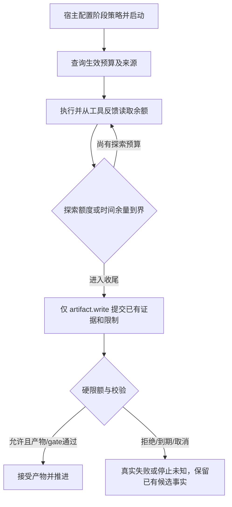

# #9 显式执行预算与受控收尾

版本：v0.2（Draft）。Issue：https://github.com/xforce-io/taskloop/issues/9 。L1: write（[v0.1 概要评论](https://github.com/xforce-io/taskloop/issues/9#issuecomment-6702967746)）；L2: write（本文件为唯一详细契约）。产品基线为用户确认预算问题及 Epic #5 S6、本票 S1/S2；不自行选择新的默认阶段时限、提高任务总限额或重跑研究质量实验。章节遵循用户 AGENTS；细化验收见 §11。

## 1 背景

`Runtime::start` 已对请求/Grant/流程限制取交集；`phase::run_checked` 又以 240000ms 截执行、120000ms 截检查；`Bridge` 独立限制工具次数、候选累计写入和保留字节。`MilkieExecutor` 仅传 timeoutMs，未传模型迭代。Inquiry 的 BudgetBridge 已按 analyze80/其它40、保留2次 artifact.write 收尾，但无法解释内部240秒截断。真实 Vertex 的工具41次仍有余额而到期失败证据沿用 Epic，不能改写为成功。

## 2 名词解释

见 [名词表](../glossary.md) 的 RunBudgetPolicy、RunBudgetSnapshot。工具额度指准入到 TaskLoop 宿主桥的调用，包含准入后的失败；预算拒绝另计，不耗提交保留。Harness 在桥前拒绝的原生请求不冒充已知宿主调用数。模型迭代只用 Harness 实际支持的约束，不从工具数或 token 推算。

## 3 目标与非目标

公开当前和历史 Run 的任务/阶段/Harness 限制交集，并实际强制工具、模型迭代、时间、容量四类约束；工具/时间临界时仅保留受控提交路径。非目标：自动调大总预算、保证模型必定按时成稿、模拟工具次数当迭代、绕过 Schema/授权或让 Trace 决定业务结果。

## 4 能力

宿主按 entry ID 配置 RunBudgetPolicy：policy_id、可选阶段/检查时限、工具上限、提交保留次数、时间收尾余量、可选模型迭代、候选字节。所有字段显式给出；时间上限 None 明确继承任务剩余，不额外加阶段截断。兼容入口保留公开标记的 legacy240秒/120秒、40次（或宿主原上限）、0保留/0余量；其来源同样可查，不藏在执行函数常数中。

### 4.1 UI/UX

无新页面，公开 Rust SDK：

空：未派发无 Run 快照，返回任务限制与空 Run 列表；旧记录未采过预算则 unknown，不追造。错：策略非法启动前拒绝，不支持迭代在原生执行前拒绝；无权查询 not_found。成功：当前/终止后均能核对来源、用量和触发原因，重开可读；无新增 UI/CLI。工具反馈的预算元数据位于结果之外，不改业务 payload/回执或产物字节。

## 5 思路与折衷

每 Run 锁定策略，时间为任务 active 剩余、wall 剩余、可选阶段、适配器上限的交集；检查另取任务剩余和检查策略；同步回调在一次 poll 中越过期限也不能因返回 Completed/pass 被接纳。运行时用单调时钟执行期限，UTC 只作公开定位；清理停止有独立确认窗口，不把停止未知写成已停止。宿主预算属于执行政策事实，持久化于业务记录而不是依赖可丢失 Trace。策略变化进入宿主绑定摘要，避免恢复时静默套用新政策。

只为 artifact.write 保留提交次数，探索拒绝不占用该保留；提交也消耗总次数，失败不会返还。进入时间收尾后拒绝其它工具，硬截止后所有调用拒绝；已发起外部效果不可保证回滚。保留额度不保证 Schema/gate 成功，也不放宽字节、权限或取消。放弃未计量的无限预算查询工具、自动重试直到成稿和仅把常数改大。

## 6 架构

原生执行停止与宿主效果账本已确认后，观测补读和回调排空不再占用阶段业务期限；Trace 的最终完整性通过查询呈现，交付时 pending 只作快照。关闭顺序沿用 #7 v0.3 / #8 v0.4，先完成采集资源收尾再清存储标记。工具次数、模型迭代和业务时间的实际限额不变。

分层：宿主按 EntryContract 选政策 → Runtime 记录任务来源 → 每 Run 预算状态统一准入 → Executor 把限制和提示传给 Harness → 工具桥/gate 执行硬边界 → 公共预算查询。主路径先保存生效预算再执行，工具调用和候选写入更新计量，结束后记录触发与终态；Trace 可投影摘要，不能作为预算权威。

失败路径：不支持的迭代约束不启动原生执行；模型不提交、提交失败、时间耗尽与主动取消分别保留；停止确认失败沿原 StopUnknown 契约。无法保存政策事实的存储错误保持 blocked，不以模型 Completed 抹掉。

## 7 模块

budget 模块负责类型、来源交集、单调期限及原子准入；Runtime 保存政策/查询和绑定；phase 选择预算并对工具/候选/gate 强制；Executor 声明已知时间/传输边界与模型迭代验证方式；Milkie 在握手后将支持的迭代限制交给自身原生适配器。旧 CodexExecutor 不支持迭代限制时明确拒绝。

## 8 API/CLI

新增 RuntimeOptions.entry_budgets；未配置 entry 使用显式 legacy 政策。新增 Runtime::budgets(execution_id, caller) 返回任务限制及来源和 RunBudgetSnapshot 列表，沿用 owner 授权。Invocation 增加可选生效预算；旧自定义 Executor 仍实现 execute，但请求其不支持的迭代时拒绝。ToolBridge 提供类型化预算提示，显式政策的成功/失败响应向模型返回安全预算信息；兼容模式保持原工具 payload。

工具总量为 min(宿主总上限,entry上限)，保留不得大于有效总量。候选总量/累计准入字节为 min(宿主容量,entry容量)，并另列每帧传输上限与附件规则，不能把不同量纲相加。Milkie v1 单次时限上限3600000ms、模型迭代上限10000；Codex 不支持迭代必须在 native start 前拒绝，未知实际用量不补零。

## 9 边界

准入失败的读请求不能吞掉提交保留；已准入但业务失败/Schema失败的调用消耗额度。并发准入原子化，不能共同越界。到硬截止后拒绝新效果及晚到产物；取消、fencing、授权、Schema、附件和字节约束照常生效。模型迭代实际计量来自 Harness，声明支持但缺实际用量时只报告约束状态，不伪造计数。Tool payload/Trace 中不保存原始异常或凭据。不存在统一费用估算。

## 10 迁移/兼容/回滚

业务 JSON 记录增量字段缺失默认 unknown/空，SQLite 业务版本不变。新策略可分 entry 配置，旧入口来源公开且行为保持。Inquiry #3 移除重复 BudgetBridge，把既有80/40和保留2显式配置到新契约；任务既有总预算不改变。新 binary/config 变更沿绑定核对，不重放旧未知 Run。回滚保留数据，不自动删候选。

## 11 测试计划

主要功能文件 `.agents/skills/verify-taskloop/features/04-execution-budget.md`。以下均为必需，冻结 SHA、v0.1、入口和实际输出逐项保存。

| ID | 前置/公开路径 | 可判定结果与禁止结果 | 证据/层级 |
|---|---|---|---|
| S1.A1 | SDK 配 entry/任务/Grant，并查询运行中与结束后预算 | 来源交集正确，兼容240/120透明，显式配置不额外截240；越权not_found，重开可读 | Integration/Unit：公开 Runtime.budgets；时间可用 Tokio 可控时钟推进，不假称真实4分钟模型调用 |
| S1.A2 | 独立触发工具总量、候选字节、时间与模型迭代 | 四类独立，触发原因可核对；不支持迭代不 native start，不把未知计量写0 | Integration/E2E：实际 Milkie Sidecar + 确定性 Harness，核对约束拒绝/传递与迭代终止，确定性 Pi API 执行实际生成的限额钩子；原生工具规则另由 Epic 真实验证 |
| S2.A1 | 小工具预算/并发，保留2，临界后提交 | 读被拒后仍可合法提交；总次数不突破，失败提交耗额度，内容仍校验 | Integration：公共工具桥与产物/gate结果；Unit：并发计数 |
| S2.A2 | 时间余量/硬截止/取消/晚到与失败提交 | 时间收尾仅可提交，硬截止无新接纳；不保证及时成稿，候选和失败/停止事实保留 | Integration：可控时钟和真实 Sidecar取消，回归 #6/#7/#8 |

## 12 开放问题

无新增默认期限待决：兼容值公开保留，新 entry 政策由宿主显式选择；Inquiry 的时间配置在 #3 依据既有任务总预算固定。真实 Codex/第二 Harness 专用存储仍待宿主提供，不用本票夹具消除此缺口。

## 13 关联

[本票 #9](https://github.com/xforce-io/taskloop/issues/9)、[Epic #5 S6](https://github.com/xforce-io/taskloop/issues/5)、[#6](https://github.com/xforce-io/taskloop/issues/6)、[Inquiry #3](https://github.com/xforce-io/inquiry/issues/3)。
